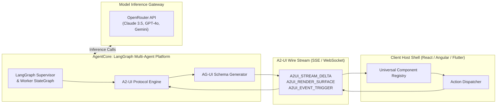
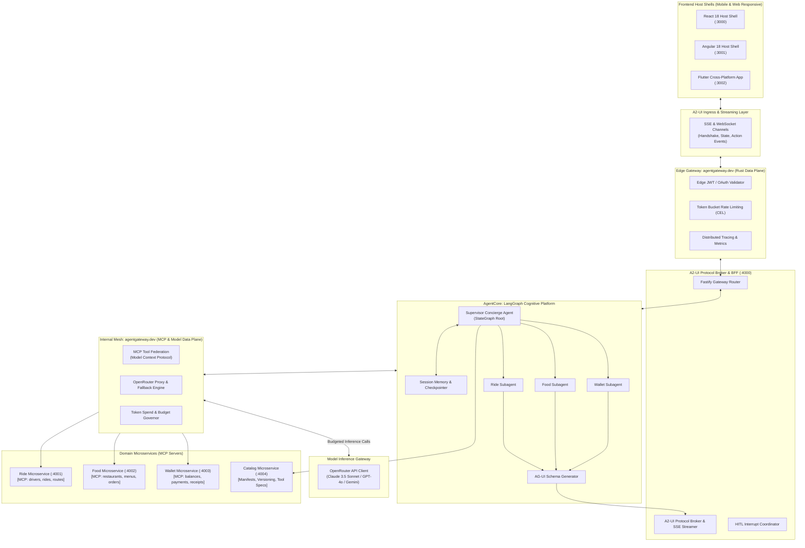
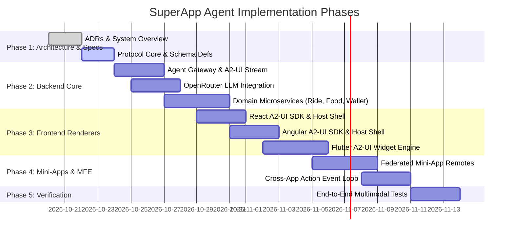

# SuperApp Agent 🚀
> Next-Generation Agentic SuperApp Platform with AG-UI / A2-UI Protocols, Polyglot Frontends (React / Angular / Flutter), and Microservice-Driven Mini-Apps.

---

## 📖 Table of Contents
- [1. Concept & Vision](#1-concept--vision)
- [2. Core Pillars & Protocols (AG-UI & A2-UI)](#2-core-pillars--protocols-ag-ui--a2-ui)
- [3. Architecture Evaluation: Microservices & Microfrontends](#3-architecture-evaluation-microservices--microfrontends)
- [4. High-Level System Architecture](#4-high-level-system-architecture)
- [5. Frontend Flavors & Responsive Layouts](#5-frontend-flavors--responsive-layouts)
- [6. Backend Architecture & OpenRouter Agent](#6-backend-architecture--openrouter-agent)
- [7. Repository Structure](#7-repository-structure)
- [8. Architectural Decision Records (ADRs)](#8-architectural-decision-records-adrs)
- [9. Step-by-Step Development Roadmap](#9-step-by-step-development-roadmap)
- [10. Quick Start & Setup Preview](#10-quick-start--setup-preview)

---

## 1. Concept & Vision

Traditional **SuperApps** (like WeChat, Grab, Gojek, and Tata Neu) aggregate multiple services into a single application shell through static menus, category tiles, and deep-link routing. While powerful, users must manually navigate through siloed mini-apps, remember which service performs which task, and manually copy data across apps.

**SuperApp Agent** transforms the SuperApp paradigm by placing an **Autonomous AI Agent at the core of the Host Shell**:
- **Concierge & Navigator**: The user interacts naturally via speech or text (e.g., *"Book a cab to Downtown Restaurant and book a table for two at 8 PM"*). The Agent orchestrates cross-domain mini-apps simultaneously.
- **Server-Driven Dynamic UI**: Rather than forcing the user into static forms, the Agent generates context-aware user interfaces on-the-fly.
- **Polyglot & Omni-Channel**: Designed to run seamlessly across **Mobile PWA**, **Native Mobile (iOS / Android)**, and **Desktop Web** using reference host implementations in **React 18**, **Angular 18**, and **Flutter**.

---

## 2. Core Pillars & Protocols (AG-UI & A2-UI)

To enable an LLM-driven backend agent to reliably control user interfaces without hallucinating broken frontend code, the platform defines two standardized protocols:



### 1. AG-UI (Agent-Generated UI / Adaptive Generative UI)
- A **declarative, framework-agnostic JSON schema** representing UI component trees, styling tokens, data bindings, and action hooks.
- Supported primitives: `SurfaceCard`, `ChoiceGroup`, `MetricWidget`, `MapViewer`, `Button`, `FormInput`, `DataTable`, and `MiniAppEmbed`.
- Prevents LLMs from writing brittle framework code (JSX/HTML/CSS); instead, the LLM emits strictly validated JSON conforming to the AG-UI specification.

### 2. A2-UI (Agent-to-User Interface Protocol)
- A **bi-directional, event-driven streaming protocol** operating over Server-Sent Events (SSE) or WebSockets.
- **Phase 1: Handshake**: The client announces its platform (`react`, `angular`, `flutter`), viewport category (`mobile`, `tablet`, `desktop`), and available native components.
- **Phase 2: Streaming Deltas**: The agent streams real-time reasoning steps, intermediate status notes, or progressive UI fragments.
- **Phase 3: Surface Rendering**: The client reconciles and renders the AG-UI tree natively.
- **Phase 4: Action Loop**: User actions (e.g. tapping a choice card or submitting a form) dispatch `A2UI_EVENT_TRIGGER` messages back to the agent event loop, continuing the multi-step workflow.

---

## 3. Architecture Evaluation: Microservices & Microfrontends

The user explicitly requested evaluating whether **microservices** are required for the backend and **microfrontends** for the frontend:

### 3.1 Backend: Are Microservices Required?
> **Answer**: **Yes, with an Agentic Gateway (BFF) Pattern.**
- **Why**: Mini-apps in a SuperApp represent distinct business domains (Mobility, Food, Payments). Microservices allow independent scaling, separate database lifecycles, and isolated domain logic.
- **How the Agent fits in**: The Backend Agent acts as an **Intelligent API Gateway / BFF**. It dynamically registers OpenAPI tools from each domain microservice (Ride Service, Food Service, Wallet Service) and orchestrates them.
- **Local Dev Ergonomics**: For local demo development, the project supports a dual-mode: Docker Compose for isolated microservices, or a lightweight single-command runner for rapid local testing.

### 3.2 Frontend: Are Microfrontends (MFE) Required?
> **Answer**: **Yes, using a Hybrid Federated MFE and Universal Component Engine.**
- **Why**: A SuperApp cannot be a single monolithic frontend bundle. Mini-apps must be deployed, versioned, and updated independently without rebuilding the host shell.
- **Web Solution (React & Angular)**: Module Federation (Webpack 5 / Native Federation) paired with Web Components (Custom Elements) enables dynamic runtime remote loading.
- **Mobile & Cross-Platform Solution (Flutter)**: Flutter renders AG-UI declarative schemas via dynamic widget mapping, with support for embedded dynamic feature packages and hybrid WebViews where needed.

---

## 4. High-Level System Architecture



---

## 5. Frontend Flavors & Responsive Layouts

### 5.1 Responsive Side-by-Side Split Workspace
The frontends support mobile viewports as well as tablet/desktop screens with a **side-by-side split layout**:

- **Mobile Viewport (< 768px)**:
  - Stacked timeline view with a bottom-docked conversational agent prompt bar.
  - Expandable bottom sheet for interactive AG-UI cards and mini-app screens.
- **Tablet & Desktop Viewport ($\ge$ 768px)**:
  - **Left Pane (35-40% width)**: Persistent Conversational Agent Concierge, reasoning step display, audio transcriptions, and interactive quick-action chips.
  - **Right Pane (60-65% width)**: Immersive Mini-App Workspace or expanded AG-UI canvas (e.g. real-time route map, restaurant menu grid, payment summary).

```
+--------------------------------------------------------------------------+
|  [Logo] SUPERAPP AGENT               [Search Services...]  [Wallet: $85] |
+------------------------------------+-------------------------------------+
|  AGENT CONCIERGE (35% width)       |  CANVAS / MINI-APP (65% width)      |
|                                    |                                     |
|  User: Book ride & order pizza     |  +--------------------------------+ |
|  Agent: Processing request...      |  | Interactive Route Map          | |
|                                    |  |                                | |
|  [AG-UI Summary Card]              |  |   [ Car Pin ] ====> [ Home ]   | |
|  • Comfort Sedan: $22.00           |  +--------------------------------+ |
|  • Pizza Margherita: $16.50        |  | Live Order Status: En Route    | |
|  Total: $38.50                     |  | Driver: Alex (4.9 ★)           | |
|                                    |  +--------------------------------+ |
|  [Confirm Both & Pay]              |                                     |
|  +-------------------------------+ |                                     |
|  | [Prompt: Type instructions...] | |                                     |
|  +-------------------------------+ |                                     |
+------------------------------------+-------------------------------------+
```

### 5.2 Tri-Flavor Matrix

| Feature | React 18 Host | Angular 18 Host | Flutter Cross-Platform |
|---------|---------------|-----------------|------------------------|
| **Target Platforms** | Web, PWA, Mobile Web | Web, PWA, Enterprise Web | iOS, Android, macOS, Web |
| **MFE Strategy** | Vite Module Federation | Native Federation (Angular CLI) | Dynamic Feature Modules / SDUI |
| **AG-UI Rendering** | `@superapp/react-a2ui` | `@superapp/angular-a2ui` | `flutter_a2ui` Widget Factory |
| **State Engine** | React Signals / Zustand | Angular Signals | Flutter Riverpod / Bloc |
| **Styling** | Tailwind CSS + Shared Tokens | Tailwind / SCSS + Shared Tokens | Material 3 + Custom ThemeData |

---

## 6. Backend Architecture: LangGraph Agent Platform & OpenRouter Model Gateway

### 6.1 The Cognitive Agent Platform vs. The Model Gateway
A vital design principle of this architecture is the strict decoupling of the **Agent Platform** from the **Model Provider**:
- **Cognitive Engine (LangGraph / LangChain)**:
  - Manages cyclical multi-step reasoning, supervisor-worker routing, and state graphs.
  - Implements **human-in-the-loop checkpoints** (`interrupt()`), pausing execution when an AG-UI card requires explicit user confirmation and resuming seamlessly when the user interacts.
  - Uses checkpointers (in-memory or Redis) to persist threads across devices.
  - Binds to microservice REST endpoints via dynamic LangChain Structured Tools.
- **Model Inference Gateway (OpenRouter)**:
  - OpenRouter is exclusively the **LLM API Provider / System-1 Raw Model Gateway**.
  - Accessible via standard `ChatOpenAI` configuration pointing to `https://openrouter.ai/api/v1`.
  - Enables switching between models (`anthropic/claude-3.5-sonnet`, `google/gemini-2.0-flash-001`, `openai/gpt-4o`, `meta-llama/llama-3.3-70b-instruct`) with zero changes to agent graphs or tool definitions.

### 6.2 Security Guardrails
- **Backend-Only Credentials**: The `OPENROUTER_API_KEY` is loaded exclusively inside `services/agent-core` and is **never** dispatched to frontend clients.
- **Schema Validation**: All agent responses destined for client rendering pass through strict Zod / JSON schema validators.
- **Zero-Trust Mini-App Storage**: Mini-apps run in scoped namespaces and cannot access unauthorized host cookies or cross-app tokens.

---

## 7. Repository Structure

```
super-app-agent/
├── .env.example                               # OpenRouter API Key & Microservice config
├── README.md                                  # Platform overview & architecture guide
├── pnpm-workspace.yaml                        # Workspace definition
├── package.json                               # Root scripts & orchestration
├── turbo.json                                 # Turborepo task pipeline
│
├── docs/                                      # Full Documentation Hub
│   ├── architecture/
│   │   ├── system-overview.md                 # Complete architectural breakdown
│   │   └── protocol-ag-ui-a2-ui.md            # AG-UI & A2-UI Protocol reference
│   └── adr/                                   # Architectural Decision Records
│       ├── ADR-0001-superapp-and-mini-app-ecosystem.md
│       ├── ADR-0002-ag-ui-and-a2-ui-declarative-protocols.md
│       ├── ADR-0003-backend-agent-microservices-architecture.md
│       ├── ADR-0004-microfrontend-and-mini-app-runtime.md
│       ├── ADR-0005-multi-flavor-frontend-adapters-react-angular-flutter.md
│       └── ADR-0006-state-security-and-event-bus.md
│
├── packages/                                  # Shared Protocol & Token Packages
│   ├── protocol-core/                         # AG-UI JSON schema, A2-UI envelopes, Zod models
│   ├── ui-tokens/                             # Design tokens, CSS variables, typography
│   ├── react-a2ui/                            # React AG-UI renderer library
│   └── angular-a2ui/                          # Angular AG-UI renderer library
│
├── services/                                  # Backend Microservices
│   ├── agent-core/                            # Agent Ingress & OpenRouter Orchestrator (:4000)
│   ├── service-ride/                          # Ride & Mobility Microservice (:4001)
│   ├── service-food/                          # Food & Dining Microservice (:4002)
│   ├── service-wallet/                        # Payments & Wallet Microservice (:4003)
│   └── service-catalog/                       # Mini-App Registry & Tool Catalog (:4004)
│
├── apps/                                      # Frontend Host Applications
│   ├── shell-react/                           # React 18 Responsive Host Shell (:3000)
│   ├── shell-angular/                         # Angular 18 Responsive Host Shell (:3001)
│   └── shell-flutter/                         # Flutter Mobile & Responsive Web (:3002)
│
└── mini-apps/                                 # Federated Mini-App Remotes
    ├── miniapp-ride/                          # Ride Hailing Mini-App Remote
    ├── miniapp-food/                          # Food Ordering Mini-App Remote
    └── miniapp-wallet/                        # Wallet & Transactions Mini-App Remote
```

---

## 8. Architectural Decision Records (ADRs)

| ADR | Title | Key Decisions |
|-----|-------|---------------|
| [ADR-0001](docs/adr/ADR-0001-superapp-and-mini-app-ecosystem.md) | SuperApp and Mini-App Architecture with Agentic Concierge | Host shell + autonomous mini-app plugins; agent as concierge. |
| [ADR-0002](docs/adr/ADR-0002-ag-ui-and-a2-ui-declarative-protocols.md) | AG-UI & A2-UI Protocol Specification | Declarative schema for UI; SSE/WS streaming action protocol. |
| [ADR-0003](docs/adr/ADR-0003-backend-agent-microservices-architecture.md) | Backend Architecture: Microservices vs Modular Monolith | Agent Gateway as BFF; domain microservices (Ride, Food, Wallet). |
| [ADR-0004](docs/adr/ADR-0004-microfrontend-and-mini-app-runtime.md) | Microfrontend (MFE) and Mini-App Runtime Strategy | Module Federation + Web Components + Universal SDUI. |
| [ADR-0005](docs/adr/ADR-0005-multi-flavor-frontend-adapters-react-angular-flutter.md) | Multi-Flavor Frontend Adapters & Responsive Split-Screen | Tri-flavor component registries; dual-pane desktop / stacked mobile. |
| [ADR-0006](docs/adr/ADR-0006-state-security-and-event-bus.md) | State Management, Sandboxing, and Security | Zero-trust host sandbox, server-side OpenRouter keys, typed event bus. |
| [ADR-0007](docs/adr/ADR-0007-agentic-platform-langgraph-and-llm-gateway.md) | Agentic Platform Architecture: LangGraph & OpenRouter | Decouples cognitive agent framework (LangGraph) from LLM inference provider (OpenRouter). |
| [ADR-0008](docs/adr/ADR-0008-adoption-of-agentgateway-dev.md) | Adoption of agentgateway.dev | Edge proxy, MCP tool federation, and model data plane. |

---

## 9. Step-by-Step Development Roadmap



- **Phase 1: Architecture & Contracts (Current)**: Finalize ADRs, AG-UI schema definitions in `packages/protocol-core`, and UI design tokens.
- **Phase 2: Backend Microservices & OpenRouter Agent Gateway**: Implement the Fastify Agent Gateway, SSE streaming, OpenRouter client, and the mock domain microservices (`service-ride`, `service-food`, `service-wallet`, `service-catalog`).
- **Phase 3: Multi-Flavor Frontend Host Shells**: Build the React 18, Angular 18, and Flutter host shells with the responsive side-by-side split layout and AG-UI component registries.
- **Phase 4: Federated Mini-Apps**: Build the Ride, Food, and Wallet mini-apps as independently runnable and embeddable microfrontends.
- **Phase 5: End-to-End Polish & Demo Walkthrough**: Connect the live OpenRouter key, test composite conversational workflows (e.g. multi-step food + ride booking), and verify responsive mobile & web behavior.

---

## 10. Quick Start & Setup Preview

```bash
# 1. Clone repository and navigate to root
cd super-app-agent

# 2. Configure environment variables
cp .env.example .env
# Edit .env and enter your OPENROUTER_API_KEY

# 3. Install dependencies across the monorepo
pnpm install

# 4. Run Backend Services (Agent Gateway + Microservices)
pnpm run dev:backend

# 5. Launch Frontend Flavors (choose one or all)
pnpm run dev:react    # React Host Shell on http://localhost:3000
pnpm run dev:angular  # Angular Host Shell on http://localhost:3001
pnpm run dev:flutter  # Flutter App on http://localhost:3002
```
