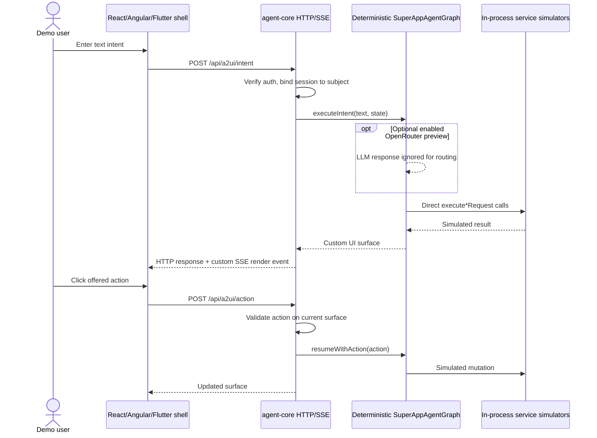

# Super App Agent

**Agent-first Smart City Super App — implementation prototype and architectural reference.**

> **Status (23 October 2026):** A functional *simulated* Smart City demonstration, not a production platform. The source contains React, Angular and Flutter shells; service simulators; a custom JSON UI/event contract; basic token verification; and optional OpenRouter inference previews. It does **not** implement a genuine LangGraph execution runtime, official AG-UI/A2UI, durable workflow persistence, production user consent, or live government integrations.

The design goal is **Option A: Agent-Centric Super App**. A Concierge Agent should be the primary interface for discovering services, assembling multi-domain journeys and choosing UI surfaces. The shell continues to own presentation/navigation, while domain services own business authorization and transactions. The current code demonstrates that concept with deterministic routing.

## Documentation

| Start here | Purpose |
| --- | --- |
| [Documentation index](docs/INDEX.md) | All guides, architecture and decisions |
| [System overview](docs/architecture/system-overview.md) | **As-built** architecture, boundaries and data flow |
| [Target architecture](docs/architecture/target-architecture.md) | Agent-first **proposed** direction, not implemented |
| [UI protocols](docs/architecture/protocol-ag-ui-a2-ui.md) | Current custom messages vs official AG-UI and A2UI |
| [Service contracts](docs/architecture/service-contracts.md) | Simulated service endpoints, catalog and actions |
| [Local development](docs/development/local-development.md) | Setup and demo commands |
| [Testing](docs/development/testing.md) | Test coverage, limitations and validation checklist |
| [Security](SECURITY.md) | Authentication, threat boundaries and production blockers |
| [Backlog](TODO.md) | Prioritized pending work; earlier demo phases archived |

## Current implementation at a glance

| Component | Location | What exists today |
| --- | --- | --- |
| React host | `apps/shell-react` | Chat panel, custom declarative UI renderer, directly imported mini-app modules |
| Angular host | `apps/shell-angular` | Separate Angular demonstration shell and custom rendering |
| Flutter host | `apps/shell-flutter` | Flutter/Dart demo interface and native widget mapping |
| Agent HTTP/SSE server | `services/agent-core/src/index.ts` | Intent/action endpoints, SSE, in-memory user-bound sessions, surface action allowlist |
| Journey logic | `services/agent-core/src/langgraph/graph.ts` | Keyword classification, direct TypeScript calls to simulated domains, hardcoded UI builders |
| Model adapter | `services/agent-core/src/openrouter.ts` | Optional, bounded OpenRouter call; **response is not used to select a journey** |
| Services | `services/service-{ride,food,wallet,catalog,profile}` | Simulated API handlers and fixtures; NOT external government integrations |
| Protocols | `packages/protocol-core` | **Project-specific** AG-UI/A2-UI-named types, events, validation |
| Gateway configuration | `services/agentgateway/config.yaml` | Candidate agentgateway.dev configuration; MCP/LLM routing **not established as end-to-end verified** |
| Identity | `services/agent-core/src/auth.ts` | RS256/JWKS JWT signature and selected claims checks; explicit local-only demo identity |

**Naming warning:** The repo's legacy `AG-UI` = custom component tree and `A2-UI` = custom transport/events. That is **not** the terminology or schema of the public standards. Standard [AG-UI](https://github.com/ag-ui-protocol/ag-ui) is agent↔application interaction, while [A2UI](https://a2ui.org/) is a declarative UI specification. Keep the custom contract isolated until formal adapters exist.

## Quick start — local demo (no LLM key)

Prerequisites: a modern Node.js 22+ installation with TypeScript type stripping support, npm, and optionally Flutter and Docker. See [setup caveats](docs/development/local-development.md).

```bash
git clone https://github.com/bassemZohdy/super-app-agent.git
cd super-app-agent
cp .env.example .env
# Edit .env and set DEMO_AUTH=true only for local development
npm install
npm test
npm run dev:backend
```

In another terminal:

```bash
npm run dev:react
```

Open http://localhost:3000. Backend health: http://localhost:4000/health. If `DEMO_AUTH` is not enabled, the React demo marker will be rejected, by design. Never set `DEMO_AUTH=true` for a public deployment or use real personal/payment data.

Other scripts: `npm run dev:angular`, `npm run dev:flutter`, `npm run build` and `npm run test:record`. These require their respective toolchains and are **not guaranteed validated** by this documentation update. The legacy recorded scenarios are historical artifacts, not evidence of current production security.

## Optional LLM preview: free-first

```dotenv
OPENROUTER_API_KEY=                # optional; keep in ignored .env
OPENROUTER_MODEL=openrouter/free
ENABLE_LIVE_LLM=false             # set true to allow the informational preview
OPENROUTER_ALLOW_PAID_MODELS=false
```

Without a key, normal mock journeys still work and make **no LLM calls**. When enabled, the agent sends context to an OpenRouter model; **it ignores the model response for routing and tool execution**. The free router selects a free model according to provider availability; a specific `:free` model can be used for model-specific tests. Free API availability/rate limits can change. There is no silent paid failover; selecting a paid model requires `OPENROUTER_ALLOW_PAID_MODELS=true`. See [local development](docs/development/local-development.md).

**Never paste API keys into GitHub, issues or this repository.** An OpenRouter key is not required for the included mock tests.

## As-built request flow



The demo can run without the separate agentgateway container; direct service imports mean this request path does not validate remote MCP federation.

## Scope and operating constraints

- **Mock services and fixtures:** names such as DubaiNow, TAMM, UAE PASS, DEWA, Salik and Dubai Police are *scenario references*, not evidence of connectivity, authorization or official endorsement.
- **Sessions:** state/duplicate-action tracking is in memory only and vanishes on restart. UI action checks do not replace domain authorization or explicit transaction consent.
- **Authentication:** `DEMO_AUTH` simulates one local user; production-mode verification of RS256 JWTs exists, but browser shells do not yet implement full OIDC/PKCE or authenticated production SSE.
- **Frontend federation:** mini-apps are imported into shells; manifests contain example remote URLs but an independently deployed, secure MFE registry/loader is not shown by this source.
- **Models:** OpenRouter is the optional inference service. The cognitive runtime remains deterministic, not multi-agent planning.
- **Gateway:** the YAML represents an architectural candidate and does not prove that its deployed image accepts the configuration or implements the declared policies.

For real identity, delegated consent, payments, or citizen records, all blockers in [SECURITY.md](SECURITY.md) and [TODO.md](TODO.md) must be resolved first.

## Collaboration

The [ADRs](docs/adr/) document decisions and proposals, each labeled according to implementation maturity. New features should include tests, contract updates, and matching documentation; do not mark a target capability “implemented” solely because a manifest or diagram mentions it.

License: MIT (as declared in `package.json`).
