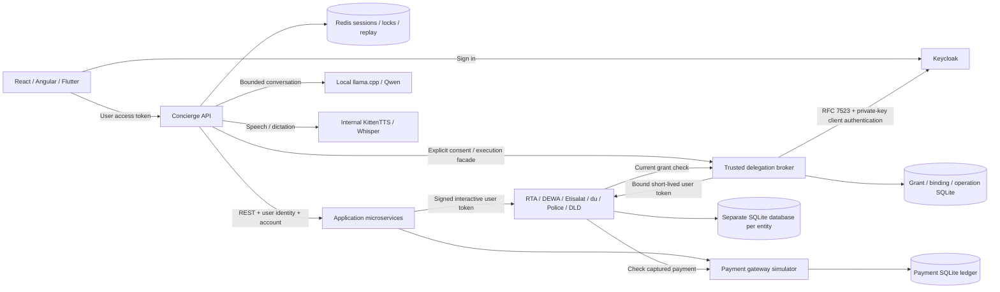

# Cityside — Super App Agent

An agent-centric TypeScript application using first-party LangGraph.js. The focused demo runs as **one Node.js process with embedded SQLite**, a configurable OpenAI-compatible planner, and a JSON-fixture government REST simulator. It retrieves fines, pauses for explicit approval, and completes an idempotent simulated payment. No real government records or funds are connected.

## Start the focused agent

Requires Node.js 24 and npm. No Docker, PostgreSQL, Redis, Keycloak or model download is required for the deterministic local demo.

```bash
npm ci --ignore-scripts
npm rebuild better-sqlite3
npm run agent:init
npm start
# In another terminal:
npm run agent:client
```

Try **Show outstanding fines** or **Retrieve my fines and pay them**. Review the exact total before typing `approve`, `reject` or `cancel` in the executable client. To resume after restarting the agent, run `npm run agent:client -- <threadId>` with the interaction ID printed by the client. Data and native LangGraph checkpoints persist in `.data/agent.sqlite`; private random test credentials are generated in `.env.agent` and never printed. Test identities expire after seven days.

Set `AGENT_PLANNER=compatible` plus a local/self-hosted `AGENT_LLM_BASE_URL` and `AGENT_LLM_MODEL` for model-selected plans. Fixture mode is deterministic simulation; a provider outage never silently selects it. Keep `AGENT_AUTH=test` for the isolated local demo, or configure the existing Keycloak verifier and explicit fines scopes. See [API/configuration](docs/integrations.md) and [security](docs/security.md).

To explicitly use an existing exported `OPENROUTER_API_KEY`, initialize with `npm run agent:init -- --openrouter` instead. The compatible planner uses the free router, requires zero-price provider routing and keeps the key server-side. `npm run agent:verify:model` runs the real-provider smoke check. Existing private configurations are preserved; see [OpenRouter setup](docs/integrations.md#explicit-openrouter-setup) to switch one.

```bash
npm run check:agent
# Optional single-container demo (not needed for local execution):
docker compose -f compose.agent.yml up --build
```

[Architecture](docs/architecture.md) · [Native graph](docs/agent-flow.md) · [Testing](docs/testing.md). Use one process/replica per SQLite file. The React, Angular and Flutter fines routes use this API; other journeys retain the integrated compatibility path below.

Start `npm run dev:react` in another terminal and open [the fines conversation](http://localhost:3000/services/fines). Sign in with the local `token` field from `AGENT_TEST_IDENTITIES` in private `.env.agent`, then ask to view fines or review a payment. The OpenRouter API key stays on the server. The **Swap panes** icon exchanges conversation and service details. Each pane’s size icon maximizes it; click that same icon again to restore the split view. The split starts at 50/50; drag the divider to resize it, or focus it and use the arrow keys (Enter resets). The same controls are available in the main concierge, with progressive book/clamshell fold layouts. See [browser setup and recovery](docs/integrations.md#react-fines-workspace).

[What exists today](#what-exists-today) · [Documentation index](docs/INDEX.md) · [Open work](TODO.md) · [Verification evidence](docs/reports/README.md)

The main concierge can use the existing LiteLLM server with **GLM 5.3** or **MiMo**, or explicitly select local/free OpenRouter inference. Provider keys stay server-side. See [provider configuration](docs/development/local-ai.md#select-a-conversation-provider).

## What exists today

| Area | Implemented in the local demo | Not claimed |
| --- | --- | --- |
| Focused agent | One Node.js process, official SQLite LangGraph checkpoints, bounded model-selected plans, REST fines simulator, React/Angular/Flutter fines conversations, durable approval and deduplicated simulated payment, plus a fines-then-vehicle-renewal journey with two approvals and truthful partial or unknown outcomes | Real-model quality, production identity/delegation or multi-replica operation |
| Integrated compatibility runtime | Concierge plus six application APIs and seven account-scoped provider simulators; real HTTP boundaries and SQLite persistence | Real agency, UAE PASS, bank or PSP integration; records and funds are synthetic |
| Identity | Keycloak 26.6.4 pinned by digest; browser PKCE, signed ownership checks, introspection, separate RFC 7523 delegation broker | Production identity, custom actor mapper, multi-hop authority; local HTTP with seeded credentials |
| Compatibility conversation | Bounded LangGraph review/execute flow, Redis ownership/leases/checkpoints/replay, explicit approval and cancellation, authenticated MCP | Model-selected tool plans, general workflow engine or compensation |
| Text and voice | Internal local Qwen/llama.cpp, KittenTTS and Whisper; React/Angular voice settings, reviewable English/Arabic dictation | Arabic speech, physical device and native evaluation |
| Payments | Linked billers and synthetic saved cards; finite wallet/card reviews; bills, exact fines, prepaid/toll recharges, wallet funding, grouped checkout, original-source refunds, signed events, recovery and statements | Real cards or money; atomic multi-provider settlement (cross-provider effects are sequential with truthful partial and unknown states) |
| Automation | Finite versioned consent records that can be paused (one rule or all at once), resumed, skipped and revoked in the React panel; run-scoped preparation, a read-only preview of what a rule would do, per-execution credentials and settlement of automatic executions in isolated simulator runs, an off-by-default persistent job worker with a scheduler for calendar, invoice-due and balance-threshold rules, and an owner inbox of what each rule did, skipped or is waiting on ([guide](docs/development/automation-worker.md)) | Execution: nothing schedules unless both worker flags are set, nothing runs outside an isolated run, and mandates return `executionEnabled:false` |
| Simulator | Persistent business clock, eight isolated issuer outcomes, guarded run-scoped failpoint controls, read-only run inspector, partial lifecycle fixtures | Network admin panel, full lifecycle event generation |
| Shells | React, Angular and Flutter web with focused fines/renewal, equal resizable panes, shared model status, profile-sharing controls and Connections | Full payment, accessibility, localization and native-device parity |
| Compatibility operations | Fifteen Node processes with private telemetry, correlation IDs, dependency readiness, bounded shutdown, encrypted cold restore and fenced single-writer rehearsal | Replicated HA, scheduled off-host backup, immutable audit archive |

Open work is tracked only in [TODO.md](TODO.md); the delivered record is the [changelog](docs/CHANGELOG.md); what was verified, when and against which revision is the [evidence register](docs/reports/README.md). Dated reports and recordings state what was true at their own checkpoint.

## Run the integrated compatibility demo

Requires Node.js 24+, npm, and Docker Compose. Install dependencies before starting the containers: the demo mounts this checkout and its installed backend dependencies read-only.

```bash
npm ci --ignore-scripts
test -f .env || cp .env.example .env  # preserve existing private configuration
npm run demo:up
npm run dev:react
```

Open [React](http://localhost:3000), sign in with Keycloak, and choose **bassem** or **demo-commuter**, password **demo123**. Each user has separate personal and household accounts. `demo:up` waits for Keycloak, broker and application/provider health/readiness, then safely reconciles the demo identity/delegation configuration. The first setup builds the internal CPU speech service and downloads roughly 1.4 GB of revision-pinned open-source text/voice models. No cloud key is required. Set `ENABLE_LOCAL_LLM=false` for deterministic text replies; speech remains local. [Local AI setup and licences](docs/development/local-ai.md).

Open **Delegated access** to approve bounded wallet reads or one exact AED 1 synthetic credit, run the approved operation, inspect audit history and revoke consent. A separate trusted broker uses supported Keycloak RFC 7523, private-key client authentication and current provider-side grant checks. No preview features or custom actor mapper are used. [Delegation guide](docs/development/delegation.md) · [Decision](docs/adr/ADR-0012-secure-delegation-demo.md) · [Verification](docs/reports/2026-10-24-delegation-demo.md) · [Paced recording](docs/recordings/delegation/index.html).

`npm run dev:angular` serves the Angular shell at http://localhost:3001. Flutter web uses the shared Keycloak PKCE sign-in and account/history controls; build with `npm run build:flutter` and serve with `npm run demo:flutter` at http://localhost:3002. Use Flutter 3.47+ and Dart 3.13+; web compilation, client contracts and pane widget tests are verified separately from native execution. Native execution remains unverified.

```bash
npm run demo:wait       # readiness only; also run automatically by demo:up
npm run demo:verify:journeys # all provider payment and move-in flows
npm run demo:verify     # real local Keycloak + REST + payments + Redis checks
npm run test:redis      # distributed locks, ownership, JSON persistence and replay
npm run demo:verify:manual   # bundled routes + cancellation + authenticated MCP
npm run demo:verify:security # access/ID token separation and logout revocation
npm run demo:verify:delegation # linked identity, workload, seven providers and bounded write
npm run demo:verify:delegation:security # real assertion attacks and token/grant revocation
npm run demo:verify:restart  # resume a saved LangGraph approval after restart
npm run local-ai:verify # actual local text → speech → dictation checks
npm run local-ai:test   # private speech API security and boundary tests
npm run check          # ESLint, docs/secrets, Node tests and workspace builds
npm run demo:logs
npm run demo:down       # stops containers; preserves databases
```

Do not run the integrated stack and `dev:backend` simultaneously: both use ports 4000–4006. [Full setup, credentials and troubleshooting](docs/development/local-development.md).

## What runs



| Layer | Components | Persistence / responsibility |
| --- | --- | --- |
| Shells | Cityside React, Angular, Flutter | Presentation, sign-in and account selection; browsers use code + PKCE |
| Concierge | `services/agent-core` | LangGraph prepare/review/execute graph, authenticated MCP, manual routes and bound approvals |
| Application APIs | ride, food/utilities, wallet, catalog/housing, profile, telecom | Validate user JWTs and accounts; forward signed interactive identity to providers |
| Delegation | Separate broker on 4010 | Explicit consent, private-key JWT exchange, exact token/grant bindings and atomic execution limits; keys isolated from agent-core |
| Provider APIs | `services/provider-simulator`, seven independently configured instances | Versioned REST, OpenAPI 3.1, verified user/grant authorization, account-owned SQLite state and idempotency |
| Local AI | CPU llama.cpp/Qwen, internal KittenTTS/Whisper | Private Docker services, pinned model volume; no hosted inference |
| Identity | Seeded Keycloak realm | End-user authentication and distinct confidential service accounts |
| Session store | Redis with append-only persistence | Owner/account binding, transcript, surfaces, reconciliation state, TTL, leases and shared SSE replay |

The food-named application service still owns utilities for compatibility. `service-telecom` integrates both telecom entities. Profile/preferences and food orders use account-scoped application SQLite storage. The lightweight fixture runner remains available for historical scenarios and tests; it is not the isolated integration stack.

## Provider APIs and OpenAPI

| Simulator | Port | OpenAPI | Main resources |
| --- | --- | --- | --- |
| RTA | 4101 | [Contract](services/provider-simulator/openapi/rta.openapi.json) | parking, rides, Salik, EV charging, residential permits |
| DEWA | 4102 | [Contract](services/provider-simulator/openapi/dewa.openapi.json) | meter consumption, bills, connections |
| Etisalat | 4103 | [Contract](services/provider-simulator/openapi/etisalat.openapi.json) | subscriptions, plans, bills |
| du | 4104 | [Contract](services/provider-simulator/openapi/du.openapi.json) | subscriptions, plans, bills |
| Dubai Police | 4105 | [Contract](services/provider-simulator/openapi/police.openapi.json) | fines and settlements |
| Land/tenancy | 4106 | [Contract](services/provider-simulator/openapi/dld.openapi.json) | tenancy and move-in proposals |
| Payment gateway | 4107 | [Contract](services/provider-simulator/openapi/payments.openapi.json) | wallets, top-ups, capture, declines, refunds, transaction history |

Each exposes `/health`, `/live`, `/ready` and `/openapi.json`; `/ready` runs a SQLite check on the provider. The integrated application APIs have their own generated contract, `packages/backend-kit/openapi/application-apis.openapi.json`, described in the [application API guide](docs/development/application-api.md). Protected resources use `/v1/accounts/{accountId}/…`; writes require `Idempotency-Key`. See [provider integration guide](docs/demo/provider-backends.md) for grants, examples, exact payment semantics and limits.

## Integrated compatibility model behavior and limits

Local Qwen2.5-1.5B-Instruct replies use bounded recent messages and current service results. llama.cpp runs CPU-only behind the authenticated core; model errors stay visible. `/health` probes actual model readiness. Requests enforce a 24 KiB context budget, 192 output tokens, a 45-second timeout and per-actor call/concurrency limits.

React and Angular offer **Conversation settings → Voice studio** with four local presets, speed, preview and stop controls. Dictation becomes an editable draft; **Send** and service confirmation stay explicit. English spoken replies are opt-in; English/Arabic dictation is available, with Arabic replies as text. No browser speech/cloud fallback or voice cloning is enabled. [Voice behavior](docs/architecture/voice-and-conversation.md) · [Original sample](docs/assets/voice/rashid-preview.wav) · [Executed checks](docs/reports/2026-10-24-local-ai.md).

LangGraph runs prepare → persisted review interrupt → confirmed execution, with Redis checkpoints in integrated mode. Routing remains deterministic; the model supplies conversation text. Official AG-UI/A2UI, scheduled/compensating workflows, production consent, remote mini-app loading and real government integrations remain outside this demo. The legacy AG-UI/A2-UI names describe a project-specific JSON surface and event protocol.

The demo uses known credentials, local HTTP, Redis AOF `everysec`, and embedded databases. It is intended for local development. [Security boundaries](SECURITY.md), [remaining work](TODO.md), [execution evidence](docs/reports/README.md).

React service links also work directly, for example [Wallet](http://localhost:3000/services/wallet), without a prior concierge proposal or model call. The bundled route registry and authenticated MCP transport are described in [the demo target decision](docs/adr/ADR-0011-local-demo-target.md) and [MCP guide](docs/development/mcp.md).

## Record the demo

`npm run test:e2e` checks twelve authenticated browser journeys against isolated temporary provider data. `npm run test:video` records the same journeys with **6-second review and 8-second receipt pauses**, then creates MP4/WebM, captions and measured chapters. Your running demo data is preserved. [Setup, pacing and artifact guide](docs/development/recording.md).

```bash
npm run recordings:serve
```

Watch [the latest recording](http://localhost:3300) or open its [checked-in viewer](docs/recordings/index.html).

## Payments and automation

Open **Payment accounts** in React to save synthetic card presets and link provider-verified billers, then pay bills, exact fine sets and toll/prepaid recharges from the wallet or a saved card, fund the wallet, check out a group, refund through the original source, recover pending payments and browse statements. Every step is an explicit reviewed action: review, bound authorization, optional one-time challenge, then Pay. Lost responses and restarts keep the original payment identity and recover through the owner's inspection, never through a blind retry.

Each capability has a guide in the [documentation index](docs/INDEX.md#payments-and-simulation) with its paced recording and verification command. The automation design and its security contract are in [payment-automation-demo](docs/architecture/payment-automation-demo.md) and [payment-automation-security](docs/architecture/payment-automation-security.md).

`npm run simulator:verify` exercises the persisted preview business clock across separate processes; it emits descriptive due events and resets its isolated run without touching provider funds ([commands and limits](docs/development/simulator.md)).

## Operations and recovery

P2-02 is complete for the local demo: protected, redacted trace/metric inspection, correlated request/run/workflow/tool/approval IDs, dependency-aware readiness, stuck-work/backpressure alerts and encrypted cold backups. Start with `npm run ops:init`; use `npm run ops:inspect` after recreating the Node containers. The [operations runbook](docs/development/operations.md) covers qualification SLOs, backup/restore and fenced single-writer failover; [executed evidence](docs/reports/2026-10-24-operations.md) records the tested boundary. Production HA remains a separate release requirement.

## Documentation

[Documentation index](docs/INDEX.md) · [System overview](docs/architecture/system-overview.md) · [Provider contracts](docs/architecture/service-contracts.md) · [Session and stream behavior](docs/architecture/event-stream.md) · [Testing](docs/development/testing.md) · [Change history](docs/CHANGELOG.md)

License: MIT.
