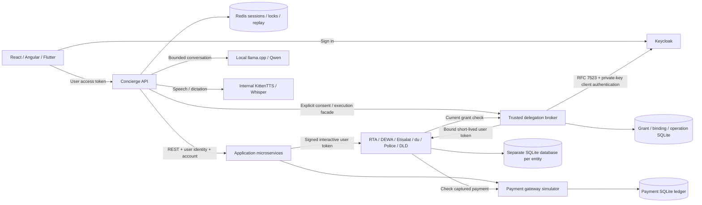

# Cityside — Super App Agent

A runnable city-services demo with a conversational concierge, independently persisted provider APIs, Keycloak authentication, Redis sessions, and a checkpointed LangGraph approval flow. RTA, DEWA, Etisalat, du, Dubai Police and Dubai Land Department are **simulated entities**. Payments use simulated funds; no real government or financial system is connected.

[Current implementation and verification](docs/STATUS.md) · [Documentation index](docs/INDEX.md) · [Remaining tasks](TODO.md). Latest executed application checkpoint: `cd3c7d5`, 533 Node tests and 18 workspace builds. Since then, multi-group surface dispatch (P1-12), explicit-selection and disabled-action parity (P1-12/P1-13), choice-group and telecom route contract semantics (P1-14), application request-body validation (P2-05) and the AUTO-03 isolated-run preparation checkpoint landed with focused tests (566 offline tests; [evidence](docs/reports/2026-10-25-p1-parity-automation-preparation.md)).

## Run the integrated demo

Requires Node.js 24+, npm, and Docker Compose. Install dependencies before starting the containers: the demo mounts this checkout and its installed backend dependencies read-only.

```bash
npm ci --ignore-scripts
test -f .env || cp .env.example .env  # preserve existing private configuration
npm run demo:up
npm run dev:react
```

Open [React](http://localhost:3000), sign in with Keycloak, and choose **bassem** or **demo-commuter**, password **demo123**. Each user has separate personal and household accounts. `demo:up` waits for Keycloak, broker and application/provider health/readiness, then safely reconciles the demo identity/delegation configuration. The first setup builds the internal CPU speech service and downloads roughly 1.4 GB of revision-pinned open-source text/voice models. No cloud key is required. Set `ENABLE_LOCAL_LLM=false` for deterministic text replies; speech remains local. [Local AI setup and licences](docs/development/local-ai.md).

Open **Delegated access** to approve bounded wallet reads or one exact AED 1 synthetic credit, run the approved operation, inspect audit history and revoke consent. A separate trusted broker uses supported Keycloak RFC 7523, private-key client authentication and current provider-side grant checks. No preview features or custom actor mapper are used. [Delegation guide](docs/development/delegation.md) · [Decision](docs/adr/ADR-0012-secure-delegation-demo.md) · [Verification](docs/reports/2026-10-24-delegation-demo.md) · [Paced recording](docs/recordings/delegation/index.html).

`npm run dev:angular` serves the Angular shell at http://localhost:3001. Flutter has local-demo sign-in and account/history controls. Use Flutter 3.47+ and Dart 3.13+; web compilation and widget checks are covered in the current report. Native execution remains unverified.

```bash
npm run demo:wait       # readiness only; also run automatically by demo:up
npm run demo:verify:journeys # all provider payment and move-in flows
npm run demo:verify     # real local Keycloak + REST + payments + Redis checks
npm run test:redis      # distributed locks, ownership, JSON persistence and replay
npm run demo:verify:manual   # bundled routes + cancellation + authenticated MCP
npm run demo:verify:security # access/ID token separation and logout revocation
npm run demo:verify:delegation # linked identity, workload, seven providers and bounded write
npm run demo:verify:delegation:security # real assertion attacks and token/grant revocation
npm run demo:verify:restart  # resume a saved LangGraph approval after restart
npm run local-ai:verify # actual local text → speech → dictation checks
npm run local-ai:test   # private speech API security and boundary tests
npm run check          # ESLint, docs/secrets, Node tests and workspace builds
npm run demo:logs
npm run demo:down       # stops containers; preserves databases
```

Do not run the integrated stack and `dev:backend` simultaneously: both use ports 4000–4006. [Full setup, credentials and troubleshooting](docs/development/local-development.md).

## What runs



| Layer | Components | Persistence / responsibility |
| --- | --- | --- |
| Shells | Cityside React, Angular, Flutter | Presentation, sign-in and account selection; browsers use code + PKCE |
| Concierge | `services/agent-core` | LangGraph prepare/review/execute graph, authenticated MCP, manual routes and bound approvals |
| Application APIs | ride, food/utilities, wallet, catalog/housing, profile, telecom | Validate user JWTs and accounts; forward signed interactive identity to providers |
| Delegation | Separate broker on 4010 | Explicit consent, private-key JWT exchange, exact token/grant bindings and atomic execution limits; keys isolated from agent-core |
| Provider APIs | `services/provider-simulator`, seven independently configured instances | Versioned REST, OpenAPI 3.1, verified user/grant authorization, account-owned SQLite state and idempotency |
| Local AI | CPU llama.cpp/Qwen, internal KittenTTS/Whisper | Private Docker services, pinned model volume; no hosted inference |
| Identity | Seeded Keycloak realm | End-user authentication and distinct confidential service accounts |
| Session store | Redis with append-only persistence | Owner/account binding, transcript, surfaces, reconciliation state, TTL, leases and shared SSE replay |

The food-named application service still owns utilities for compatibility. `service-telecom` integrates both telecom entities. Profile/preferences and food orders use account-scoped application SQLite storage. The lightweight fixture runner remains available for historical scenarios and tests; it is not the isolated integration stack.

## Provider APIs and OpenAPI

| Simulator | Port | OpenAPI | Main resources |
| --- | --- | --- | --- |
| RTA | 4101 | [Contract](services/provider-simulator/openapi/rta.openapi.json) | parking, rides, Salik, EV charging, residential permits |
| DEWA | 4102 | [Contract](services/provider-simulator/openapi/dewa.openapi.json) | meter consumption, bills, connections |
| Etisalat | 4103 | [Contract](services/provider-simulator/openapi/etisalat.openapi.json) | subscriptions, plans, bills |
| du | 4104 | [Contract](services/provider-simulator/openapi/du.openapi.json) | subscriptions, plans, bills |
| Dubai Police | 4105 | [Contract](services/provider-simulator/openapi/police.openapi.json) | fines and settlements |
| Land/tenancy | 4106 | [Contract](services/provider-simulator/openapi/dld.openapi.json) | tenancy and move-in proposals |
| Payment gateway | 4107 | [Contract](services/provider-simulator/openapi/payments.openapi.json) | wallets, top-ups, capture, declines, refunds, transaction history |

Each exposes `/health`, `/live`, `/ready` and `/openapi.json`; `/ready` runs a SQLite check on the provider. The integrated application APIs have their own generated contract, `packages/backend-kit/openapi/application-apis.openapi.json`, described in the [application API guide](docs/development/application-api.md). Protected resources use `/v1/accounts/{accountId}/…`; writes require `Idempotency-Key`. See [provider integration guide](docs/demo/provider-backends.md) for grants, examples, exact payment semantics and limits.

## Model behavior and limits

Local Qwen2.5-1.5B-Instruct replies use bounded recent messages and current service results. llama.cpp runs CPU-only behind the authenticated core; model errors stay visible. `/health` probes actual model readiness. Requests enforce a 24 KiB context budget, 192 output tokens, a 45-second timeout and per-actor call/concurrency limits. The retained OpenRouter diagnostic/helper is historical and unused by application inference; an existing private key is neither needed nor forwarded by the demo.

React and Angular offer **Conversation settings → Voice studio** with four local presets, speed, preview and stop controls. Dictation becomes an editable draft; **Send** and service confirmation stay explicit. English spoken replies are opt-in; English/Arabic dictation is available, with Arabic replies as text. No browser speech/cloud fallback or voice cloning is enabled. [Voice behavior](docs/architecture/voice-and-conversation.md) · [Original sample](docs/assets/voice/rashid-preview.wav) · [Executed checks](docs/reports/2026-10-24-local-ai.md).

LangGraph runs prepare → persisted review interrupt → confirmed execution, with Redis checkpoints in integrated mode. Routing remains deterministic; the model supplies conversation text. Official AG-UI/A2UI, scheduled/compensating workflows, production consent, remote mini-app loading and real government integrations remain outside this demo. The legacy AG-UI/A2-UI names describe a project-specific JSON surface and event protocol.

The demo uses known credentials, local HTTP, Redis AOF `everysec`, and embedded databases. It is intended for local development. [Security boundaries](SECURITY.md), [remaining work](TODO.md), [execution evidence](docs/reports/README.md).

React service links also work directly, for example [Wallet](http://localhost:3000/services/wallet), without a prior concierge proposal or model call. The bundled route registry and authenticated MCP transport are described in [the demo target decision](docs/adr/ADR-0011-local-demo-target.md) and [MCP guide](docs/development/mcp.md).

## Record the demo

`npm run test:e2e` checks twelve authenticated browser journeys against isolated temporary provider data. `npm run test:video` records the same journeys with **6-second review and 8-second receipt pauses**, then creates MP4/WebM, captions and measured chapters. Your running demo data is preserved. [Setup, pacing and artifact guide](docs/development/recording.md).

```bash
npm run recordings:serve
```

Watch [the latest recording](http://localhost:3300) or open its [checked-in viewer](docs/recordings/index.html).

## Payment accounts and planned automation

Open **Payment accounts** in React to save synthetic card presets, link provider-verified biller references and review a fresh quote with your chosen source. Prepaid/vehicle discovery, defaults, disabled cards, account switching, source versions and active-use removal guards are checked; the preview does not move funds. Linked bill/fine history now shows source-owned revisions, due/closed states and seeded prior cycles. Bill service payments share the stored wallet-order flow. [Guide and compatibility](docs/development/payment-accounts.md) · [Executed checks](docs/reports/2026-10-24-payment-checkout.md).

[Stored authorization reviews](docs/development/payment-authorization.md) now support explicit owner approval, finite card/wallet holds, one-time demo challenges and cancellation. Bills now have a separate explicit Pay action with provider admission, capture, recovery and confirmed receipts. Run `npm run demo:verify:payment-authorization` for its isolated browser verification.

Current wallet payments now append balanced journal entries, with one-time legacy balance migration and checked posted/held/available funds. [Journal and recovery guide](docs/development/payment-ledger.md) · [Live migration evidence](docs/reports/2026-10-24-payment-ledger.md).

[Payment recovery](docs/development/payment-reconciliation.md) now inspects original capture/provider evidence, resumes existing operations and creates separately approved refund reviews. Saved outcomes and audit survive reload/restart. [Paced recording](docs/recordings/payment-reconciliation/index.html).

[Statements & funding history](docs/development/payment-history.md) now page posted journal effects and all payment activity, with exact running balances, original masked source/biller and separate pending/refund outcomes. [Paced recording](docs/recordings/payment-history/index.html).

[Automation security review](docs/architecture/payment-automation-security.md) now defines the trusted admission/permit/budget boundary and hardens the existing broker against implicit permission growth, substituted authority and stale results. Scheduled spending remains disabled pending shared reservations, execution permits and worker admission gates. [Executed checks](docs/reports/2026-10-24-automation-security.md).

[Owner/workspace lifecycle](docs/development/payment-lifecycle.md) now blocks new authority for restricted owners/memberships, invalidates old approvals after restoration and identifies original in-flight work. A separate local operator CLI controls permission decisions; the browser keeps the current workspace and never moves a rule to another source. [Paced recording](docs/recordings/payment-lifecycle/index.html) · [Evidence](docs/reports/2026-10-24-payment-lifecycle.md).

The [payment backlog](TODO.md#payment-accounts-and-automation-demo--planned-backlog) tracks 50 tasks: 24 slices delivered and 26 open. The remaining work covers automatic-caller reservation qualification, bounded autopay/automatic services and deterministic clock/failure simulation. [Full design](docs/architecture/payment-automation-demo.md).

Use `npm run simulator:verify` to try the persisted preview-only business clock across separate processes. It emits descriptive due events and resets its isolated run without touching provider funds. [Commands and limits](docs/development/simulator.md) · [Lifecycle/scenario evidence](docs/reports/2026-10-24-lifecycle-simulator.md). Automatic execution and its scenario controls remain in the backlog.

## Documentation

[Documentation index](docs/INDEX.md) · [System overview](docs/architecture/system-overview.md) · [Provider contracts](docs/architecture/service-contracts.md) · [Session and stream behavior](docs/architecture/event-stream.md) · [Testing](docs/development/testing.md) · [Change history](docs/CHANGELOG.md)

License: MIT.

[Settlement claims and refund guards](docs/development/settlement-claims.md) now protect existing provider payments from stale-proof/refund races. Old unrefunded captures are conservatively marked unknown until source reconciliation; the migration preserves balances and history. Bill capture is now enabled through approved orders; autopay remains open.

[End-to-end wallet/card bill payments](docs/development/payment-checkout.md): authorize, explicitly Pay, inspect a provider-confirmed receipt, or recover the original pending payment. Existing conversational bill payments share the same wallet-order path.

[Saved-card wallet funding](docs/development/wallet-funding.md) now provides review, bound authorization/challenge, explicit card capture and one balanced wallet credit. [Watch its paced recording](docs/recordings/wallet-funding/index.html) or run `npm run record:wallet-funding`.

[Exact-set fine payments](docs/development/fine-checkout.md) now support wallet and saved cards, current discounts/restrictions, shared per-fine reservations and confirmed receipts. [Paced recording](docs/recordings/fine-checkout/index.html).

[Wallet/card provider recharges](docs/development/provider-recharges.md) now credit owned Salik tags and Etisalat/du prepaid lines with displayed denominations, bound challenges, pending recovery and confirmed provider balances. [Six paced journeys](docs/recordings/recharge-checkout/index.html).

[Grouped checkout](docs/development/checkout-groups.md) now uses one selected wallet/card across sequential child payments, with explicit review, per-line challenges, partial receipts and original-payment recovery. [Paced success/partial demo](docs/recordings/checkout-groups/index.html).

[Original-source refunds](docs/development/payment-refunds.md) now support full demo bill/fine cancellation, bounded partial toll/mobile-credit return and card-funded wallet reversal with no overdraft. Provider reversal precedes money return; unknown outcomes retain their original refund identity. [Paced refund demo](docs/recordings/payment-refunds/index.html).

[Signed financial status events](docs/development/payment-events.md) now use transactional outboxes, persisted delivery leases and an authenticated deduplicating gateway inbox. Source notifications prompt owner recovery of the original operation; callbacks do not move funds or assert bill settlement. [Response-loss recovery recording](docs/recordings/payment-events/index.html). PAY-18 covers current manual paths; general simulator fault controls and automatic-caller qualification retain separate gates.

[Isolated issuer scenarios](docs/development/issuer-scenarios.md) now provide eight authenticated operator presets, including persisted pending decisions and refund failure. `npm run simulator:issuer` executes the isolated matrix; [the paced recording](docs/recordings/issuer-scenarios/index.html) shows customer outcomes and a pending provider restart. Normal provider controls remain unavailable.

[Finite payment/service consent](docs/development/payment-mandates.md) now records six exact policy families with explicit owner approval, immutable versions and guarded lifecycle references. `npm run demo:verify:mandates` proves signed ownership/restart and zero consent-time money effects. Automatic execution remains disabled pending the worker and per-execution authority tasks.

[Conversational payment reviews](docs/development/payment-surfaces.md) now select wallet/card funding and separate exact authorization, challenge and payment. Header cancellation releases original holds; reload and lost responses retain the original payment. `demo:verify:payment-surfaces` validates the signed flow; [paced recording](docs/recordings/payment-surfaces/index.html).

[Signed payment events](docs/development/payment-events.md) now cover retained raw capture/refund and parking activation/extension alongside stored payment paths. Owner-only **Inspect original capture** re-reads existing provider status; callbacks never settle claims or create funds. [Paced legacy/parking recording](docs/recordings/legacy-payment-events/index.html).

[Business reservations and original attempts](docs/development/payment-obligations.md) now exclude overlapping fines and recharge target versions before authorization, retain unknown attempts across restart and expose original payment IDs in the lifecycle view. [Paced recording](docs/recordings/payment-obligations/index.html). PAY-08 remains open for actual automatic-caller qualification; no scheduled authority is enabled.

## Operations and recovery

P2-02 is complete for the local demo: protected, redacted trace/metric inspection, correlated request/run/workflow/tool/approval IDs, dependency-aware readiness, stuck-work/backpressure alerts and encrypted cold backups. Start with `npm run ops:init`; use `npm run ops:inspect` after recreating the Node containers. The [operations runbook](docs/development/operations.md) covers qualification SLOs, backup/restore and fenced single-writer failover; [executed evidence](docs/reports/2026-10-24-operations.md) records the tested boundary. Production HA remains a separate release requirement.
