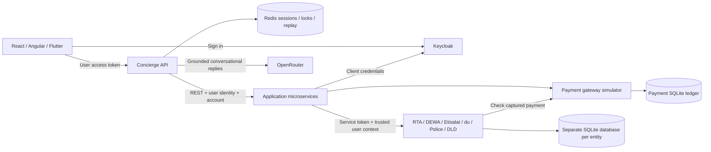

# Cityside — Super App Agent

A runnable city-services demo with a conversational concierge, independently persisted provider APIs, Keycloak authentication, Redis sessions, and a checkpointed LangGraph approval flow. RTA, DEWA, Etisalat, du, Dubai Police and Dubai Land Department are **simulated entities**. Payments use simulated funds; no real government or financial system is connected.

## Run the integrated demo

Requires Node.js 24+, npm, and Docker Compose. Install dependencies before starting the containers: the demo mounts this checkout and its installed backend dependencies read-only.

```bash
npm ci --ignore-scripts
cp .env.example .env  # first setup only; preserve an existing .env
npm run demo:up
npm run dev:react
```

Open [React](http://localhost:3000), sign in with Keycloak, and choose **bassem** or **demo-commuter**, password **demo123**. Each user has separate personal and household accounts. `demo:up` waits for the imported Keycloak realm and all application/provider health endpoints (up to three minutes). An OpenRouter key in the ignored `.env` enables generated replies; the demo works without a key. Set `ENABLE_LIVE_LLM=false` for deterministic replies.

`npm run dev:angular` serves the Angular shell at http://localhost:3001. Flutter has local-demo sign-in and account/history controls. Use Flutter 3.47+ and Dart 3.13+; web compilation and widget checks are covered in the current report. Native execution remains unverified.

```bash
npm run demo:wait       # readiness only; also run automatically by demo:up
npm run demo:verify:journeys # all provider payment and move-in flows
npm run demo:verify     # real local Keycloak + REST + payments + Redis checks
npm run test:redis      # distributed locks, ownership, JSON persistence and replay
npm run demo:verify:manual   # bundled routes + cancellation + authenticated MCP
npm run demo:verify:security # access/ID token separation and logout revocation
npm run demo:verify:restart  # resume a saved LangGraph approval after restart
npm run demo:check:openrouter # HTTPS reachability and configured-key authentication
npm run check          # ESLint, docs/secrets, Node tests and workspace builds
npm run demo:logs
npm run demo:down       # stops containers; preserves databases
```

Do not run the integrated stack and `dev:backend` simultaneously: both use ports 4000–4006. [Full setup, credentials and troubleshooting](docs/development/local-development.md).

## What runs



| Layer | Components | Persistence / responsibility |
| --- | --- | --- |
| Shells | Cityside React, Angular, Flutter | Presentation, sign-in and account selection; browsers use code + PKCE |
| Concierge | `services/agent-core` | LangGraph prepare/review/execute graph, authenticated MCP, manual routes and bound approvals |
| Application APIs | ride, food/utilities, wallet, catalog/housing, profile, telecom | Validate user JWTs and selected accounts; call providers using their own client credentials |
| Provider APIs | `services/provider-simulator`, seven independently configured instances | Versioned REST, OpenAPI 3.1, scoped service authorization, account-owned SQLite state and idempotency |
| Identity | Seeded Keycloak realm | End-user authentication and distinct confidential service accounts |
| Session store | Redis with append-only persistence | Owner/account binding, transcript, surfaces, reconciliation state, TTL, leases and shared SSE replay |

The food-named application service still owns utilities for compatibility. `service-telecom` integrates both telecom entities. Profile/preferences and food orders use account-scoped application SQLite storage. The lightweight fixture runner remains available for historical scenarios and tests; it is not the isolated integration stack.

## Provider APIs and OpenAPI

| Simulator | Port | OpenAPI | Main resources |
| --- | --- | --- | --- |
| RTA | 4101 | [Contract](services/provider-simulator/openapi/rta.openapi.json) | parking, rides, Salik, EV charging, residential permits |
| DEWA | 4102 | [Contract](services/provider-simulator/openapi/dewa.openapi.json) | meter consumption, bills, connections |
| Etisalat | 4103 | [Contract](services/provider-simulator/openapi/etisalat.openapi.json) | subscriptions, plans, bills |
| du | 4104 | [Contract](services/provider-simulator/openapi/du.openapi.json) | subscriptions, plans, bills |
| Dubai Police | 4105 | [Contract](services/provider-simulator/openapi/police.openapi.json) | fines and settlements |
| Land/tenancy | 4106 | [Contract](services/provider-simulator/openapi/dld.openapi.json) | tenancy and move-in proposals |
| Payment gateway | 4107 | [Contract](services/provider-simulator/openapi/payments.openapi.json) | wallets, top-ups, capture, declines, refunds, transaction history |

Each exposes `/health` and `/openapi.json`. Protected resources use `/v1/accounts/{accountId}/…`; writes require `Idempotency-Key`. See [provider integration guide](docs/demo/provider-backends.md) for grants, examples, exact payment semantics and limits.

## Model behavior and limits

OpenRouter replies use the last 12 conversation messages and current service results. The actual generated text reaches HTTP/SSE clients; provider failures are shown explicitly. Keys remain server-side. The key used in the [latest verification](docs/reports/2026-10-24-demo-completion.md) was rejected with HTTP 401. Set a valid key privately in the environment or ignored `.env`, recreate agent-core, then run `npm run demo:check:openrouter`. Health reports configuration, not successful provider authentication. The default model is `openrouter/free`. Demo requests enforce zero-priced provider routing, a 24 KiB context budget, and per-actor call/concurrency limits. Remote TTS is disabled by default.

LangGraph runs prepare → persisted review interrupt → confirmed execution, with Redis checkpoints in integrated mode. Routing remains deterministic; the model supplies conversation text. Official AG-UI/A2UI, scheduled/compensating workflows, production consent, remote mini-app loading and real government integrations remain outside this demo. The legacy AG-UI/A2-UI names describe a project-specific JSON surface and event protocol.

The demo uses known credentials, local HTTP, Redis AOF `everysec`, and embedded databases. It is intended for local development. [Security boundaries](SECURITY.md), [remaining work](TODO.md), [current verification](docs/reports/2026-10-24-demo-completion.md).

React service links also work directly, for example [Wallet](http://localhost:3000/services/wallet), without a prior concierge proposal or model call. The bundled route registry and authenticated MCP transport are described in [the demo target decision](docs/adr/ADR-0011-local-demo-target.md) and [MCP guide](docs/development/mcp.md).

## Documentation

[Documentation index](docs/INDEX.md) · [System overview](docs/architecture/system-overview.md) · [Provider contracts](docs/architecture/service-contracts.md) · [Session and stream behavior](docs/architecture/event-stream.md) · [Testing](docs/development/testing.md) · [Change history](docs/CHANGELOG.md)

License: MIT.
