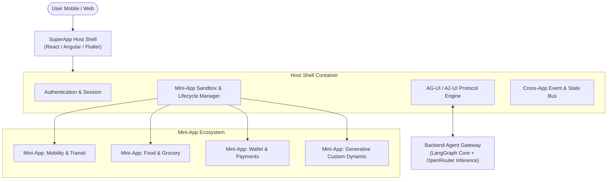

# ADR-0001: SuperApp and Mini-App Architecture with Agentic Concierge

## Status
Accepted / Under Review

## Context
Modern digital ecosystems often evolve from single-purpose applications into multi-service SuperApps (similar to WeChat, Grab, Tata Neu, Alipay). A SuperApp hosts a multitude of independent domain experiences, commonly known as **Mini-Apps** (e.g., Ride Hailing, Food Delivery, Banking, Booking, eCommerce, Healthcare).

Traditional SuperApps rely on rigid hierarchical navigation menus, category grids, and deep-link routing. In this project, we are building a next-generation **Agentic SuperApp**:
1. **Agent Concierge**: An autonomous backend agent orchestrates user intentions, context, and multi-step workflows across mini-apps.
2. **Mini-App Ecosystem**: Independent teams develop, release, and deploy mini-apps independently without redeploying the core host shell.
3. **Multi-Platform & Multi-Flavor**: The SuperApp must support mobile-responsive web (PWA / desktop web side-by-side) and native/hybrid mobile viewports using multiple frontend technologies (Angular, React, and Flutter).
4. **Agent-Managed UI**: The agent decides which mini-app or UI fragment to present, how to combine mini-app capabilities into a single seamless composite view, and handles conversational + direct-manipulation hybrid interactions.

## Decision

We adopt a **Host-Shell & Mini-App Ecosystem** governed by a central **Backend Agent Orchestrator**:

### 1. Host Shell Responsibilities
- **Lifecycle & Security Isolation**: Mounts, unmounts, sandboxes, and governs mini-apps.
- **Agent Communication Channel**: Connects over WebSocket / HTTP SSE to the Agent backend.
- **Protocol Dispatcher (AG-UI & A2-UI)**: Parses declarative UI payloads streamed or dispatched by the agent and renders them using native component registries or federated mini-app remotes.
- **Universal Navigation & Dock**: Provides standard host chrome (search bar, agent microphone/text prompt bar, notification hub, universal auth profile).

### 2. Mini-App Specification & Packaging
Each Mini-App satisfies a standardized lifecycle interface:
- `bootstrap(container, context)`
- `mount(container, props)`
- `unmount(container)`
- `handleAgentIntent(intent, payload)`

Mini-apps are packaged either as:
- **Web Remotes (Module Federation / Web Components)**: For Web & Mobile PWA (React & Angular).
- **Embedded Federated Packages**: For Flutter environments (Flutter Add-to-App or dynamic Dart code push / server-driven component mapping).

### 3. Agent-Driven Mini-App Orchestration
Rather than the user manually hunting through nested menus, the agent performs:
1. **Intent Recognition & Slot Filling**: E.g., *"Book a cab to Downtown Restaurant and reserve a table for two at 8 PM"*.
2. **Multi-App Composition**: The Agent splits the goal into two sub-tasks (Mobility Mini-App + Restaurant Reservation Mini-App) and can present a composite UI card combining both experiences side-by-side.
3. **Progressive Disclosure**: Mini-app views start as compact cards (A2-UI widgets) and can expand into full-screen mini-app runtimes upon request.

## Consequences

### Positive
- **Independent Team Velocity**: Domain teams develop, test, and deploy mini-apps independently without redeploying the shell.
- **Context-Aware Unified Experience**: The Agent bridges boundaries between services, removing silos.
- **Omni-Channel Consistency**: Unified protocol allows React, Angular, and Flutter hosts to render identical agent-driven workflows.

### Negative / Trade-offs
- **Complexity in State Synchronization**: Managing cross-mini-app state and auth tokens requires a secure Event Bus.
- **Bundle Size & Asset Isolation**: Multiple frontend frameworks in a single runtime can lead to high memory footprint if not carefully sandboxed (mitigated by Module Federation and shared runtime dependencies, or running Flutter/Web in isolated view controllers).
- **Latency**: Agent round-trips via LLMs must be optimized using streaming SSE, prompt caching, and fast local intent resolvers.
