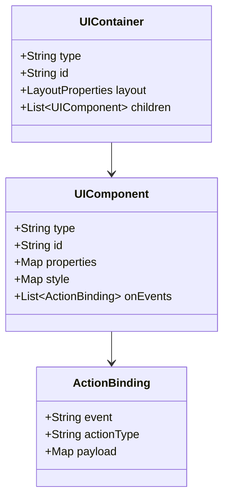
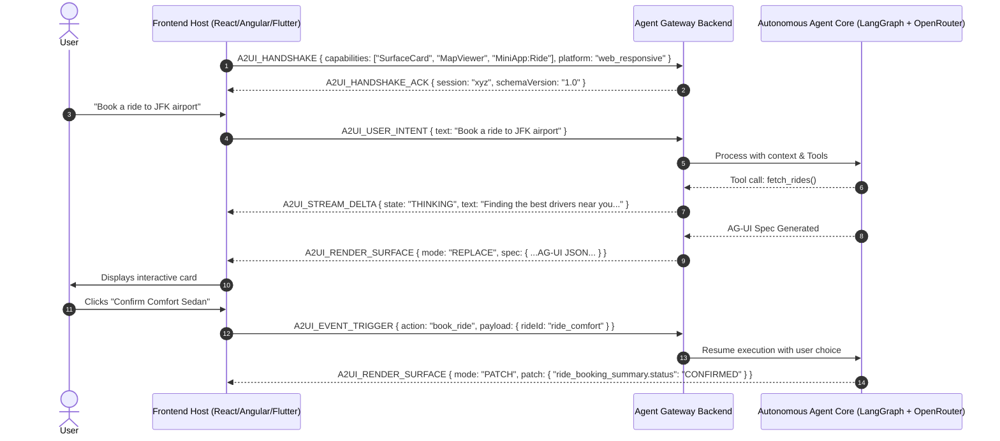

# ADR-0002: AG-UI and A2-UI Protocol Specification

## Status
Accepted / Under Review

## Context
In an agent-driven SuperApp, the user interface cannot be strictly static or hardcoded. The application requires two complementary UI paradigms:
1. **AG-UI (Agent-Generated UI / Adaptive Generative UI)**: The agent dynamically constructs layouts, forms, comparison tables, interactive charts, and contextual controls on-the-fly based on intent, runtime data, and conversation state.
2. **A2-UI (Agent-to-User Interface Protocol)**: The bidirectional communication and contract protocol governing how the agent instructs client apps (React, Angular, Flutter) to render components, stream UI updates, handle user actions (clicks, form submits), and maintain state consistency.

Without a standardized protocol:
- Frontend implementations become brittle and tightly coupled to specific LLM prompts.
- Streaming responses cannot progressively render UI components without breaking JSON syntax.
- Multi-flavor frontends (Angular, React, Flutter) would diverge in how they interpret agent commands.

## Decision

We establish two formal specifications: the **AG-UI Declarative Schema** and the **A2-UI Action & Event Protocol**.

---

### 1. AG-UI Schema (Declarative Component Model)

AG-UI uses a strict, framework-agnostic JSON format describing component hierarchies, data bindings, layout constraints, and interactive triggers.



#### AG-UI Payload Example:
```json
{
  "version": "1.0.0",
  "sessionId": "sess_89a3f2b",
  "view": {
    "type": "SurfaceCard",
    "id": "ride_booking_summary",
    "layout": {
      "direction": "vertical",
      "spacing": "medium",
      "padding": "16"
    },
    "children": [
      {
        "type": "Heading",
        "id": "title",
        "properties": {
          "text": "Select Ride Option",
          "level": 2
        }
      },
      {
        "type": "ChoiceGroup",
        "id": "ride_options",
        "properties": {
          "selectedId": "ride_comfort",
          "options": [
            {
              "id": "ride_economy",
              "title": "Economy Cab",
              "subtitle": "4 mins away • 4 seats",
              "price": "$14.50",
              "badge": "Fastest"
            },
            {
              "id": "ride_comfort",
              "title": "Comfort Sedan",
              "subtitle": "7 mins away • Leather seats",
              "price": "$22.00",
              "badge": "Top Rated"
            }
          ]
        }
      },
      {
        "type": "Button",
        "id": "btn_confirm_ride",
        "properties": {
          "label": "Confirm Comfort Sedan ($22.00)",
          "variant": "primary",
          "fullWidth": true
        },
        "onEvents": [
          {
            "event": "onPress",
            "actionType": "AGENT_ACTION_DISPATCH",
            "payload": {
              "action": "book_ride",
              "selectedOption": "${ride_options.selectedId}",
              "destination": "Downtown Metro"
            }
          }
        ]
      }
    ]
  }
}
```

---

### 2. A2-UI Protocol (Bidirectional Agent-Client Wire Protocol)

The A2-UI Protocol operates over **Server-Sent Events (SSE)** or **WebSocket**, facilitating 4 core message phases:



### 3. Protocol Message Types

| Message Type | Direction | Purpose |
|--------------|-----------|---------|
| `A2UI_HANDSHAKE` | Client $\to$ Agent | Declares client component registry, device viewport (mobile/web), and supported mini-apps. |
| `A2UI_USER_INTENT` | Client $\to$ Agent | Sends user query (text, voice transcript, image, or deep-link). |
| `A2UI_STREAM_DELTA` | Agent $\to$ Client | Progressive thoughts, intermediate rationale, or partial streaming tokens. |
| `A2UI_RENDER_SURFACE` | Agent $\to$ Client | Complete or differential declarative UI tree to render. |
| `A2UI_EVENT_TRIGGER` | Client $\to$ Agent | Dispatches user interaction (button press, form submit, slider change) back to the agent event loop. |
| `A2UI_LAUNCH_MINIAPP`| Agent $\to$ Client | Commands the shell to mount a full mini-app bundle (e.g. navigation route, federated MFE remote). |
| `A2UI_CLIENT_ERROR` | Client $\to$ Agent | Informs agent of UI render failure or validation errors so the agent can self-heal. |

## Consequences

### Positive
- **Strict Decoupling**: Backend agents generate generic declarative UI instructions without knowing React, Angular, or Flutter specifics.
- **Progressive Streaming**: The A2-UI protocol allows streaming text while compiling the final AG-UI schema in a valid boundary.
- **Extensible Component Registry**: Any new widget (e.g. 3D viewer, biometric confirmation) can be added to the registry; the agent is simply informed via the handshake.

### Negative / Trade-offs
- **Schema Validation Overhead**: Every AG-UI payload must be validated via JSON schema (e.g. Zod / Ajv) on both agent emission and frontend consumption to avoid malformed UI trees.
- **Styling Customization Boundaries**: To prevent LLM-generated CSS bugs, styling is constrained to design system design tokens (spacings, semantic color variants, typography scale).
