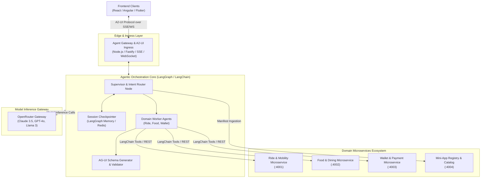

# ADR-0003: Backend Architecture — Microservices vs. Modular Monolith with Agent Orchestrator

## Status
Accepted / Under Review

## Context
The SuperApp backend must support:
1. **Agentic Core**: Built on an agentic orchestration platform (**LangGraph / LangChain**), managing multi-agent state graphs, conversational memory, supervisor routing, and generating AG-UI / A2-UI payloads.
2. **Model Gateway**: Integrating **OpenRouter** as the model inference layer (`OPENROUTER_API_KEY` in `.env`) providing raw System-1 / LLM completions (Claude 3.5, GPT-4o, Gemini) without conflating model inference with agent lifecycle.
3. **Multiple Mini-App Domains**: Each mini-app (Ride Hailing, Food Delivery, Payment/Wallet, User Profile) has distinct data models, business rules, transaction boundaries, and scalability requirements.
4. **Question**: *Is microservices strictly required for the backend, or is a modular monolith more appropriate for the demo while scaling to microservices in production?*

## Analysis: Microservices vs. Modular Monolith for Agentic SuperApps

| Dimension | Microservices Architecture | Modular Monolith Architecture | Hybrid Agent Gateway Pattern (Chosen) |
|-----------|----------------------------|-------------------------------|---------------------------------------|
| **Team Independence** | High (Independent deploy per mini-app domain) | Medium (Shared repository & deployment pipeline) | High (Each mini-app exposes an independent OpenAPI / gRPC service) |
| **Agent Tool Integration** | Agent connects to service mesh via OpenAPI / Tool Registry | Agent invokes in-process functions | Agent Gateway acts as intelligent BFF & Tool Orchestrator |
| **Operational Overhead** | High (Docker, Kubernetes, Service Discovery, Observability) | Low (Single process, single DB/container) | Balanced (Containerized microservices with optional unified dev runner) |
| **Fault Isolation** | High (Failure in Food service does not crash Ride service) | Low (Crash impacts all domains) | High (Agent handles upstream service degradation gracefully) |
| **Latency** | Network hop per service call | In-memory function call | Fast internal network / gRPC for tool invocation |

## Decision

We adopt the **Agentic Gateway Pattern with Domain Microservices**:

### Key Architectural Components

#### 1. Agent Gateway (Backend-For-Frontend + Ingress)
- Exposes standard REST endpoints and SSE / WebSocket streams for the A2-UI protocol.
- Manages authentication (JWT, OAuth) and verifies user identity across mini-app domains.
- Translates client handshake capabilities into system prompts for the LLM.

#### 2. Agent Core: LangGraph Orchestrator & OpenRouter LLM Layer
- **LangGraph State Machine**: Implements cyclical multi-step reasoning, supervisor-worker routing, human-in-the-loop breakpoints, and state checkpointing.
- **OpenRouter Inference Gateway**: Provides standardized API access to raw LLM models (Claude 3.5 Sonnet, GPT-4o, Gemini 2.0). OpenRouter acts solely as the inference provider, while LangGraph manages the agentic brain, state, tools, and execution graphs.
- **Dynamic Tool Calling**: Worker agents bind to tools dynamically loaded from Domain Microservices.
- **Schema Enforcement**: Formulates and validates AG-UI payloads before streaming to the client.

#### 3. Domain Microservices
- **Independent Services**: Each service exposes its domain operations as standard REST/OpenAPI endpoints.
- **Dynamic Tool Registry**: The Catalog Service publishes available tools and schemas to the Agent Core at boot time.
- **Pluggability**: To add a new Mini-App (e.g. Travel & Flight Booking), developers launch a new microservice that registers its manifest with the Catalog Service without modifying core agent code.

#### 4. Developer Experience: Dual-Mode Runtime
To enable smooth developer onboarding while preserving production-grade microservices architecture:
- **`compose` mode**: Runs Docker containers for Gateway, Agent, and individual Microservices (Ride, Food, Wallet, Catalog).
- **`standalone` mode**: An all-in-one lightweight runner executing services within a single Node.js workspace for instant local prototyping without heavy virtualization.

## Consequences

### Positive
- **True SuperApp Extensibility**: New mini-apps and backend services can be added dynamically.
- **Model Agnostic**: OpenRouter allows switching between LLMs seamlessly without code refactoring.
- **Resilient Fallback**: If a domain microservice is unreachable, the Agent informs the user gracefully through AG-UI error cards rather than crashing the SuperApp.

### Negative / Trade-offs
- Requires microservice routing, Docker Compose configuration, and environment variable management.
- Need structured schema validation to ensure OpenRouter responses map strictly to AG-UI contracts.
