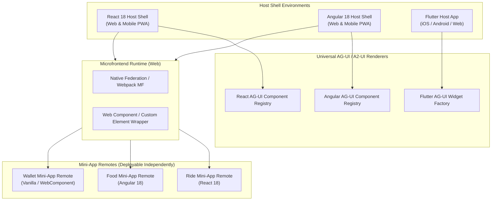

# ADR-0004: Microfrontend (MFE) and Mini-App Runtime Strategy

## Status
Accepted / Under Review

## Context
A defining characteristic of a SuperApp is hosting autonomous, independently developed **Mini-Apps**. In modern frontend engineering, this concept maps directly to **Microfrontends (MFE)**.
The user requested an evaluation of whether Microfrontends are required for the frontend, taking into account:
1. Multiple frontend flavors (**React**, **Angular**, **Flutter**).
2. Mobile-responsive viewports alongside desktop web viewports.
3. The Agent's role in dynamically discovering, presenting, and switching between Mini-Apps.

## Evaluation: Are Microfrontends Required?

| Approach | Architecture | Independence | Multi-Framework Sharing | Performance & Complexity | Verdict |
|----------|--------------|--------------|-------------------------|--------------------------|---------|
| **1. Monolithic Frontend** | Single codebase with directory-based mini-apps (`/mini-apps/ride`, `/mini-apps/food`). | Low. Deploying one mini-app requires rebuilding the entire host shell. | Impossible to mix Angular, React, and Flutter in one seamless web runtime. | Low build complexity, but breaks SuperApp governance principles. | **Rejected** for production SuperApp |
| **2. Pure Iframe / Webview Sandboxing** | Host shell embeds mini-apps inside HTML `<iframe>` or native Mobile WebViews. | High. Total isolation. | Any framework can run inside its own URL sandbox. | Poor performance on mobile, clunky animations, difficult agent state coordination, heavy memory overhead. | **Secondary / Fallback** |
| **3. Federated Microfrontends + Web Components + Universal SDUI Engine** (Chosen) | Webpack/Vite **Module Federation** / **Native Federation** for React/Angular web remotes, paired with an **AG-UI / SDUI universal rendering engine** across React, Angular, and Flutter. | High. Independent build, versioning, CDN deployment per mini-app. | Clean interop: Shell exposes shared design system & A2-UI bridge; remotes render as Web Components or native widget trees. | Optimum performance, seamless gesture transitions, low memory footprint. | **Adopted** |

## Decision

We adopt a **Hybrid Federated Microfrontend and Component Manifest Strategy**:

### 1. Web Platforms (React & Angular Hosts)
- **Module Federation (Native Federation)**: Mini-apps are compiled as independent remote modules.
- **Framework Agnostic Isolation (Web Components)**: When an Angular mini-app is loaded inside a React host (or vice-versa), it is wrapped in standard Web Components (Custom Elements) with encapsulated Shadow DOM styling.
- **Shared Dependencies**: Common libraries (such as the A2-UI protocol client, design tokens, and lightweight utilities) are shared via singleton scopes to prevent redundant bundle downloads.

### 2. Flutter Mobile & Cross-Platform
- Flutter manages its own native rendering pipeline via Skia / Impeller and does not share DOM trees.
- For Flutter, mini-apps operate via:
  1. **Direct AG-UI / SDUI Widget Tree**: The Agent streams AG-UI declarative JSON, which Flutter dynamically maps into native Flutter widgets (`StatelessWidget` / `StatefulWidget` tree) with 120 FPS native responsiveness.
  2. **Flutter Add-to-App / Dynamic Feature Modules**: Mini-app packages registered at compile-time or downloaded on-demand.
  3. **In-App WebView Fallback**: For complex third-party web mini-apps, a sandboxed bi-directional WebView is used.

### 3. Progressive Mini-App Lifecycle
Mini-apps expose a unified lifecycle managed by the Agent:
1. **Manifest Registration**: The mini-app defines its metadata, deep links, tool intents, and capability schema.
2. **Card Mode (Inline AG-UI)**: The agent renders a contextual summary card in the chat/feed.
3. **Full-Screen Immersion**: When the user taps the card or the agent detects an immersive task, the Host Shell dynamically mounts the full mini-app remote into the active viewport.
4. **Context Passing**: Host shell injects session state, user authentication, and agent conversational context into the mini-app via standard props / event bus.

## Consequences

### Positive
- **Independent Release Cycles**: Food, Ride, and Payment teams can release updates 10 times a day without coordinating host releases.
- **True Polyglot Support**: Allows demonstrating React, Angular, and Flutter side-by-side or individually as chosen by the platform target.
- **Agent Interactivity**: Mini-apps are not opaque black boxes; they can emit events to the Agent and receive agent updates.

### Negative / Trade-offs
- Setting up Module Federation across different build tools requires standardized build scripts.
- Shadow DOM styling requires careful distribution of global design tokens (CSS variables) to ensure consistent look-and-feel.
