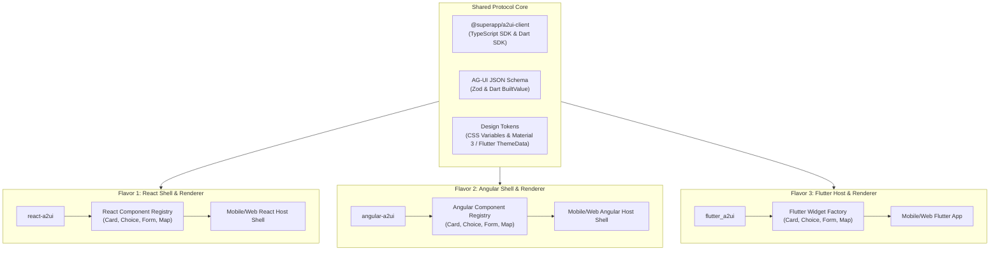

# ADR-0005: Multi-Flavor Frontend Adapters (React, Angular, Flutter) & Responsive Split-Screen Architecture

## Status
Accepted / Under Review

## Context
The SuperApp must support three leading frontend ecosystems:
1. **React**: Popular for rich web ecosystems, ecosystem velocity, and PWA capabilities.
2. **Angular**: Enterprise-grade structure, built-in dependency injection, and clean separation of concerns.
3. **Flutter**: High-performance cross-platform native mobile (iOS, Android) and web compilation from a single Dart codebase.

Furthermore, the user experience must be **mobile-first responsive**, with the ability on tablet and desktop screens to present **side-by-side responsive layouts** (e.g., Conversational Agent Concierge on the left/bottom, active Mini-App or AG-UI Canvas on the right/center).

## Decision

We establish a **Shared Protocol SDK & Tri-Flavor Component Catalog Architecture**:



---

### 1. Viewport Adaptation & Side-by-Side Responsive Layout

The SuperApp layout adapts dynamically to the device screen size:

#### Mobile Viewport (< 768px):
- Single-column stacked or bottom-sheet mode.
- Top: SuperApp global header & mini-app selector.
- Center: Active mini-app or AG-UI dynamic card feed.
- Bottom: Floating Agent prompt / voice bar with expandable A2-UI concierge sheet.

#### Tablet & Desktop Viewport ($\ge$ 768px):
- Dual-column side-by-side workspace:
  - **Left / Navigation Column (35-40% width)**: Persistent Conversational Agent Concierge, session timeline, and prompt suggestions.
  - **Right / Canvas Column (60-65% width)**: Full-featured Mini-App viewport or deep AG-UI interactive workspace (e.g. detailed map, checkout flow, data analytics).

```
+--------------------------------------------------------------------------+
|  SUPERAPP AGENT HEADER  [Search Services...]       [Profile] [Wallet: $85]|
+------------------------------------+-------------------------------------+
|  AGENT CONCIERGE (35%)             |  MINI-APP / AG-UI CANVAS (65%)      |
|                                    |                                     |
|  [Agent]: I found 3 ride options   |  +--------------------------------+ |
|  to JFK Airport.                   |  | Live Interactive Map           | |
|                                    |  |                                | |
|  [AG-UI Summary Card]              |  |   [ Car Icon @ Route ]         | |
|  - Economy: $14.50 (4 min)         |  |                                | |
|  - Comfort: $22.00 (7 min)         |  +--------------------------------+ |
|                                    |  | Ride Confirmation & Driver Bio | |
|  [User]: Let's take the Comfort.   |  | Rating: 4.9 ★  Plate: ABC-1234  | |
|                                    |  +--------------------------------+ |
|  +-------------------------------+ |                                     |
|  | [Prompt/Mic Input: Type...]   | |                                     |
|  +-------------------------------+ |                                     |
+------------------------------------+-------------------------------------+
```

---

### 2. Tri-Flavor Component Registry Specification

Each frontend flavor implements an identical set of standard AG-UI primitive renderers:

| AG-UI Type | React Implementation | Angular Implementation | Flutter Implementation |
|------------|----------------------|------------------------|------------------------|
| `SurfaceCard` | `<Card className="ag-card">` | `<ag-card>` | `Card(elevation: 2, ...)` |
| `Heading` / `Text` | `<Typography variant={...}>` | `<ag-text [level]="...">` | `Text(..., style: textTheme)` |
| `ChoiceGroup` | `<RadioGroup / Segmented>` | `<ag-choice-group>` | `SegmentedButton` / `RadioListTile` |
| `Button` | `<Button variant="primary">` | `<button ag-button>` | `FilledButton` / `ElevatedButton` |
| `FormInput` | `<Input type="text" ...>` | `<input ag-input>` | `TextFormField` |
| `MapViewer` | `<MapLibre / Leaflet Wrapper>`| `<ag-map-viewer>` | `flutter_map` / Google Maps |
| `DataTable` | `<DataGrid rows={...}>` | `<ag-data-table>` | `DataTable` / `PaginatedDataTable` |
| `MiniAppHost` | `<FederatedRemoteLoader>` | `<ng-component-outlet>` | `DynamicFeatureContainer` |

---

### 3. Rendering Engine Contract

When an `A2UI_RENDER_SURFACE` event arrives, the engine performs:
1. **Schema Validation**: Validates the incoming tree structure against the AG-UI specification.
2. **Component Lookup**: Maps `type` to the registered component constructor/widget.
3. **Data Binding**: Evaluates `${variable}` interpolations against the session state.
4. **Action Wire-up**: Binds interaction handlers (`onPress`, `onChange`, `onSubmit`) to the A2-UI client's `dispatchAction()` method.

## Consequences

### Positive
- **Cross-Framework Parity**: The backend agent emits one standardized schema; React, Angular, and Flutter render natively without framework-specific prompt engineering.
- **Responsive by Design**: Naturally handles mobile touch interactions, gestures, and responsive side-by-side desktop productivity.
- **Maintainability**: New components only require creating one matching widget per framework.

### Negative / Trade-offs
- Maintaining three parallel frontend implementations requires adhering strictly to shared contract tests.
- Design token synchronizations must be automated via Style Dictionary or shared CSS variables.
