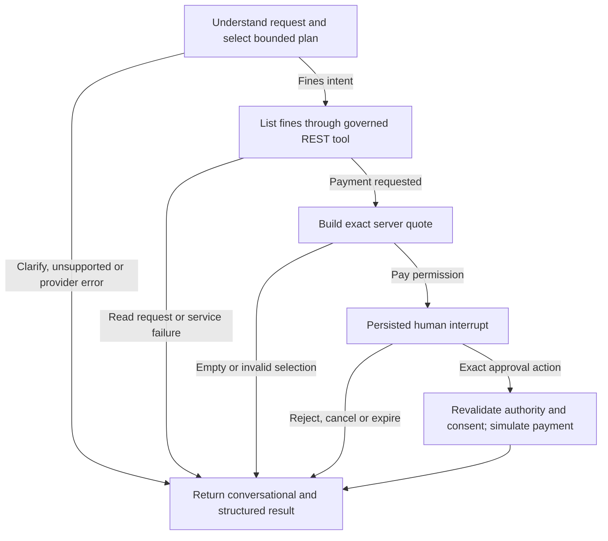

# Agent flow

`services/agent-core/src/orchestrator/graph.ts` uses native `StateGraph`, annotations, conditional edges, `interrupt`, `Command` and the official SQLite saver. There is no custom executor or workflow specification.

The plan selects only `list_fines`, `pay_fines`, `clarify` or `out_of_scope`, with at most ten fine IDs. Tool discovery is an in-process list of typed descriptors. Payment always reads current backend details and constructs an integer-fils quote; the model cannot supply amount, permission or consent. The graph has no backward edges, uses a recursion limit of twelve, and makes at most one planning call and two business tool calls per normal turn. Model timeout is fifteen seconds; tool timeout is three seconds. There is no automatic model or write fallback.

State contains a bounded twelve-message history, validated plan, fine details, pending approval, human decision, receipt, status and response text. The thread ID is server-generated and its subject/workload binding and one-day expiry live in SQLite. An approval has a random ID, exact quote, stable operation key and five-minute expiry. The approval node has no side effects before `interrupt`: resume re-enters that node. The following execute node checks fresh request authority and persisted consent before invoking the tool.

Access tokens, workload secrets and model keys are kept in request-local `AsyncLocalStorage` or adapter configuration, never graph config/state. Checkpoints use synchronous durability. They preserve execution position, not exactly-once business effects. The simulator commits its idempotency receipt and all fine changes in one SQLite transaction. The agent records the original operation before dispatch and preserves that identity on reconciliation.

`POST .../recover` continues a failed native graph node. For an unknown payment it re-enters execution only with the original persisted approval and operation key; expired/revoked authority still fails closed. This retry is valid specifically because this REST simulator durably implements idempotency. Other adapters must declare and prove their retry/reconciliation semantics. Unknown outcomes block new requests and cancellation that would obscure the unsettled action.

Typed chat assent cannot resume an interrupt. Only a validated action with the exact approval ID can resume it. Reject/cancel actions execute no payment. Session cancellation prevents subsequent turns. Inspect and recover do not extend authority or approval expiry.
