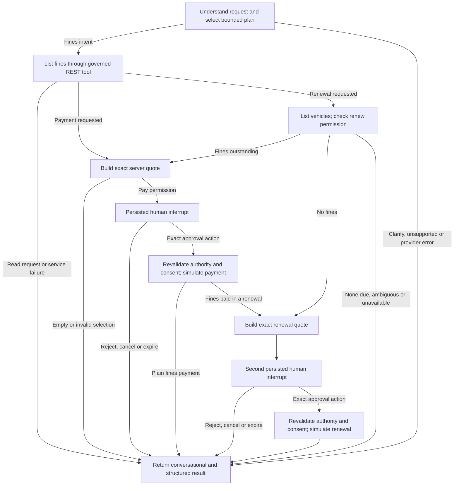

# Agent flow

`services/agent-core/src/orchestrator/graph.ts` uses native `StateGraph`, annotations, conditional edges, `interrupt`, `Command` and the official SQLite saver. There is no custom executor or workflow specification.

The plan selects only `list_fines`, `pay_fines`, `renew_registration`, `clarify` or `out_of_scope`, with at most ten fine IDs and an optional vehicle ID. Tool discovery is an in-process list of typed descriptors. Payment always reads current backend details and constructs an integer-fils quote; the model cannot supply amount, permission or consent. The graph has no backward edges, uses a recursion limit of twelve, and makes at most one planning call and two business tool calls per normal turn. Model timeout is fifteen seconds; tool timeout is three seconds. There is no automatic model or write fallback.

The focused tool wrapper stops waiting at its deadline and signals cancellation to the adapter. A dispatched write whose result is not confirmed remains unknown and can be recovered only with its original operation identity. The deadline cannot forcibly stop in-process work that ignores the signal; adapters must cooperate with cancellation and preserve idempotency.

For compatibility domain writes, both local and HTTP adapters treat authentication failures, rate limits, and responses indicating a prior effect or conflicting operation identity as unknown outcomes. These responses do not establish that the original write was absent.

Compatibility domain adapters dispatch only the registered write routes with route-specific receipt checks; unrecognized mutations are rejected before a local handler or HTTP service is called. Adding a write requires registering its route and receipt validation together.

Compatibility wallet payment and top-up confirmations require a settled transaction of the expected type and currency (USD for the offline fixture, AED for integrated providers), with an exact requested amount and a valid nonnegative balance. An inconsistent receipt leaves the write unknown and stops the rest of a composite checkout. Currency labels in retained surfaces still need standardization.

The compatibility ride-and-meal review displays and binds the selected driver, restaurant, item, separate meal price and delivery fee, total and wallet currency. It rechecks the current options before charging, and each service checks its reviewed terms before booking. The three effects remain separate: a later refusal can leave an earlier payment or booking completed and requires reconciliation.

Compatibility ride booking confirmations require the selected driver, a confirmed or dispatched status and any supplied pickup and destination to match. A mismatched booking is unknown and prevents subsequent checkout effects.

Compatibility food order confirmations require the selected restaurant, exact item quantities, accepted status and any supplied delivery address to match. A mismatched order remains unknown and blocks a replacement checkout.

The local and integrated simulators use different successful ride and food statuses and item shapes; the adapter accepts their documented forms while applying the same selected-resource checks. The integrated food receipt includes the requested delivery address.

Compatibility parking activation confirmations match the selected zone, vehicle and duration; extension confirmations match the ticket and require the reported prior and resulting durations to differ by the requested increment. Both require an active meter with usable display fields. The prior duration is reported by the same fixture and is not independent evidence of the earlier state.

For integrated parking, the application verifies the wallet capture identity, account, amount, currency, merchant and reference before calling the parking provider. A later refusal or inconsistent meter leaves the overall outcome unconfirmed, because the wallet may already have been charged.

Integrated activation also matches the meter fee to the capture. Extension first checks that the current active meter belongs to the account's vehicle, then verifies the returned zone, vehicle, fee and expiry against the pre-charge meter and requested increment.

Compatibility move-in approval binds the displayed tenancy and premise, rechecks both before dispatch, and sends the reviewed premise to the fixture for a further check. Confirmations match those identifiers and require the utility connection, deposit waiver and residential permit statuses claimed by the success surface. Inconsistent responses remain unknown and stop the following parking action.

The integrated move-in path validates the tenancy proposal, utility connection and permit in sequence. Once the first provider has responded successfully, a later refusal, failure or inconsistent result leaves the overall outcome unconfirmed and stops subsequent provider calls; it does not claim that prior effects were rolled back.

Before dispatching any consequential tool, the wrapper independently revalidates the caller, requires the same subject and workload, and checks the current tool permission. This second check is within the tool deadline; if it finishes after the deadline, the tool is not dispatched. Identity-check failures do not expose provider text. Read-only tools use the already authenticated request context.

Fine references are bound at the graph boundary from the resident's current message, independently of which planner is used. For supported “pay them” or “pay it” follow-ups, only the immediately preceding user turn supplies a selection; an intervening user request does not revive an older one. The graph rejects planner-invented references, preserves named ones if the planner omits them, and refuses a payment review if a selected fine is unavailable. Without a selection, the ordinary payment review includes the outstanding fines.

After authentication, the focused API allows ten seconds to read a body on conversation creation, message, approval, cancellation, recovery and simulator write routes, regardless of ongoing upload activity. It rejects bodies over 8,192 bytes or past the deadline before dispatch, and closes those connections. Creation, cancellation and recovery accept an empty body and ignore any body contents within the limit. This deadline does not cover authentication, routes that do not read a body, or graph execution; it is not a connection quota.

Before dispatching these actions after an upload, the API authenticates again, requires the subject and workload to match the initial authentication, and checks the current permission. The test authority can model changes between checks; JWT verification alone does not establish production revocation or federation behavior. Consequential graph execution also rechecks authority before the simulated write.

If the connection has closed while initial authentication or the post-upload authority check is pending, the focused API stops before dispatching the action. It does not cancel authentication itself or interrupt graph work already dispatched; an already committed simulated write continues to completion and remains recoverable under its original identity.

The local server admits at most 64 concurrent public handlers and 16 simulator handlers carrying the workload key. Simulator requests still independently authenticate the resident and check permission, consent and quote. Excess requests receive `SERVER_BUSY` with HTTP 503 and a closed connection; a slot remains occupied until its handler settles, even if its client disconnects. Health probes and CORS preflight are outside these pools. This limit does not bound sockets before headers, authenticate-time duration, other processes or a reverse proxy.

Each focused conversation admits at most 128 new messages recorded after this limit is installed; a failed or interrupted admitted message still counts. Admission and the request record are committed together. At the limit, a new message receives `MESSAGE_LIMIT_REACHED` with HTTP 429, while inspection, replay of a completed request, approval, cancellation and recovery remain available subject to the separate recovery rate limit. This local message limit does not count pre-upgrade messages, bound other request records or delete historical data.

Recovery has a separate limit of 16 admitted attempts per conversation in a rolling minute; an attempt counts even if it fails or is interrupted. A new recovery over the limit receives `RECOVERY_RATE_LIMIT_REACHED` and HTTP 429 with `Retry-After: 60`; if streaming already began, the code appears in an error event instead. Inspection, completed-request replay and an approval waiting for a decision remain available. After the window, recovery may retry only the original operation as usual. Events survive restart and expired events for that conversation are removed on a later admitted attempt. This is not a global quota or a historical-retention policy.

State contains a bounded twelve-message history, validated plan, fine details, pending approval, human decision, receipt, status and response text. The thread ID is server-generated and its subject/workload binding and one-day expiry live in SQLite. An approval has a random ID, exact quote, stable operation key and five-minute expiry. The approval node has no side effects before `interrupt`: resume re-enters that node. The following execute node checks fresh request authority and persisted consent before invoking the tool.

Access tokens, workload secrets and model keys are kept in request-local `AsyncLocalStorage` or adapter configuration, never graph config/state. Checkpoints use synchronous durability. They preserve execution position, not exactly-once business effects. The simulator commits its idempotency receipt and all fine changes in one SQLite transaction. The agent records the original operation before dispatch and preserves that identity on reconciliation.

`POST .../recover` continues a failed native graph node. For an unknown payment it re-enters execution only with the original persisted approval and operation key; expired/revoked authority still fails closed. This retry is valid specifically because this REST simulator durably implements idempotency. Other adapters must declare and prove their retry/reconciliation semantics. Unknown outcomes block new requests and cancellation that would obscure the unsettled action. Across conversations, SQLite reserves at most one pending or unknown write per resident and binds a retry to its original consent. New payment or renewal reviews and previously opened approvals cannot dispatch another write while that reservation is unresolved; read-only requests and other residents remain available. An explicit initial refusal releases its reservation. Legacy unresolved rows are bound automatically only if exactly one matching consent exists; ambiguous rows require inspection. This guard is for the single-process local demo and is not distributed locking. The focused agent admits at most 64 active conversations per resident and 1,024 overall. An expired conversation with a linked unresolved operation still counts; cancelled or ordinary expired conversations do not. Admission returns `THREAD_LIMIT_REACHED` with HTTP 429 when full. A rolling one-hour creation limit admits at most 128 successful creations per resident and 4,096 overall, returning `THREAD_RATE_LIMIT_REACHED` with HTTP 429 when full. This limit counts successful creations after the upgrade, survives restart and cancellation, and removes expired rate records on a subsequent successful creation. These limits do not delete historical conversations or provide distributed quotas. The approved conversation is linked to its operation before execution. If that exact operation remains pending or unknown when the conversation expires, an authenticated access by its owner extends that conversation by one day so it remains inspectable; this does not extend consent or grant authority. On upgrade, a link is recovered only from a saved matching approval and operation owner. Older unresolved records without that evidence require separate inspection.

## Fines then registration renewal

A renewal request is the one multi-service journey. The vehicles node first refuses a resident who lacks `vehicles:renew`, so nobody is asked to clear fines for a renewal they cannot make. Outstanding fines go through the ordinary payment review and approval; once they are paid the graph builds a renewal quote and waits at a second interrupt. Each approval has its own ID and operation key, and answering one never answers the other.

For renewal, the graph binds an exact `veh-` reference named in the current resident message to the owned vehicle list; an unavailable reference or multiple named vehicles requires clarification. A planner-supplied reference that the resident did not name is rejected before business tools run. The compatible model receives the request with exact vehicle references withheld. When no reference is named, one due vehicle can still be selected; multiple due vehicles require clarification.

The two effects are separate and nothing is atomic across them, so the outcome says what actually happened: `complete` when both finished; `partial` when the fines were paid but the renewal was declined, expired, refused (for example `FINES_OUTSTANDING` when a new fine appeared) or lost its authority, with the fines receipt kept and the reply stating that the registration was not renewed; `unknown` when the renewal response was lost, which blocks any replacement renewal and cancellation until `POST .../recover` re-enters it with the original persisted approval and operation key. A refusal the simulator or the authority check states clearly is not treated as unknown.

Typed chat assent cannot resume an interrupt. Only a validated action with the exact approval ID can resume it. Reject/cancel actions execute no payment. Session cancellation prevents subsequent turns. Inspect and recover do not extend authority or approval expiry.
