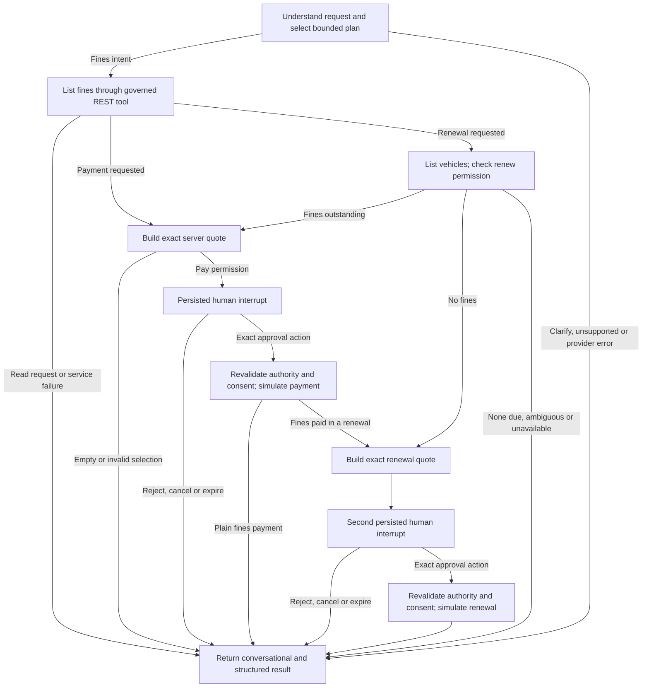

# Agent flow

`services/agent-core/src/orchestrator/graph.ts` uses native `StateGraph`, annotations, conditional edges, `interrupt`, `Command` and the official SQLite saver. There is no custom executor or workflow specification.

The plan selects only `list_fines`, `pay_fines`, `renew_registration`, `clarify` or `out_of_scope`, with at most ten fine IDs and an optional vehicle ID. Tool discovery is an in-process list of typed descriptors. Payment always reads current backend details and constructs an integer-fils quote; the model cannot supply amount, permission or consent. The graph has no backward edges, uses a recursion limit of twelve, and makes at most one planning call and two business tool calls per normal turn. Model timeout is fifteen seconds; tool timeout is three seconds. There is no automatic model or write fallback.

The focused tool wrapper stops waiting at its deadline and signals cancellation to the adapter. A dispatched write whose result is not confirmed remains unknown and can be recovered only with its original operation identity. The deadline cannot forcibly stop in-process work that ignores the signal; adapters must cooperate with cancellation and preserve idempotency.

For compatibility domain writes, both local and HTTP adapters treat authentication or authority denials, changed eligibility, rate limits, and responses indicating a prior effect or conflicting operation identity as unknown outcomes. Provider writes and settlement claims apply the same authority-denial rule: a current refusal does not establish that the original write was absent. Read-only denials retain their status, and a documented business refusal can still be treated as definitive.

Compatibility domain adapters dispatch only the registered write routes with route-specific receipt checks; unrecognized mutations are rejected before a local handler or HTTP service is called. Adding a write requires registering its route and receipt validation together. A write refusal that also contains transaction, receipt or other recognized effect evidence remains unknown, so subsequent steps and replacement attempts require reconciliation. The provider client and settlement coordinator apply the same rule, preserving the original settlement claim instead of releasing it. A successful-looking write response with a top-level code is also unconfirmed, since current success contracts do not include one. The focused simulator adapter accepts an admitted refusal only in its exact bounded error envelope; malformed or contradictory replies leave the original operation unconfirmed. Authority denials received after dispatch also leave writes unconfirmed; read-only denials remain visible. A changed fixture service lifetime also leaves the original write unknown: the new lifetime cannot establish whether the earlier operation took effect.

Compatibility wallet payment and top-up confirmations require a settled transaction of the expected type and currency (USD for the offline fixture, AED for integrated providers), with an exact requested amount and a valid nonnegative balance. An inconsistent receipt leaves the write unknown and stops the rest of a composite checkout. Currency labels in retained surfaces still need standardization.

For an integrated wallet payment, confirmation also requires the transaction to match a captured, unrefunded wallet charge for the same account, amount, merchant and original request reference.

New integrated wallet payments that include an external booking reference retain that reference in the receipt and separately bind the original operation identity to the capture, transaction, retry key and inspection. If the retry record is lost, a surviving capture with either identity holds replacement. Older reference-only captures do not contain that operation binding: while such a captured payment remains in an account, new superapp wallet debits and missing-operation inspections are held because the prior operation cannot be distinguished from a replacement. A matching original replay can still be verified by its saved reference; there is no automatic legacy-evidence repair. The payment overview separately reports the legacy review hold and the broader account-wide wallet review status, which also covers unreadable transaction records and payment journals without their charge. Missing or unrecognized provider status is shown as unavailable. The React payment panel explains the account-wide hold and points to payment history in English and Arabic. A clear account-wide status does not establish that a particular operation is safe to retry. The recovery case list keeps readable cases available when a raw charge is unreadable and separately pages through account-owned unreadable charges, unreadable transactions, journal entries missing their charge and reference-only wallet captures that cause a hold, with up to 25 per page. A resident can open the original capture inspection from an identified reference-only capture; that inspection does not authorize a replacement payment or clear the hold. Cursors are scoped to the owner and account and exclude later row positions; records remain live, and deletion or SQLite row-id reuse may change a traversal, so refresh when reviewing current evidence. The list withholds malformed identifiers and does not return raw damaged bodies, move funds or clear a hold. The React recovery panel presents these records in English and Arabic; an older or malformed response is shown as unavailable. Integrated superapp wallet-payment replays, including direct provider calls with other idempotency keys, recheck the saved charge, transaction and balanced journal before returning success. The checks and replay record are read within the provider transaction, and a direct replay must match the requested amount. If the replay record is missing, a matching charge or transaction, unreadable evidence, or an orphaned charge journal holds a new debit for inspection; evidence is checked within the account and the provider transaction. This protects the local stored evidence, not against loss or coordinated alteration of all records.

Authenticated compatibility domain calls carry the original operation identity in a validated operation header, separate from diagnostic tracing headers. Application services use that identity for provider operations, preserving the reference checked by the wallet adapter even when tracing assigns another request ID.

Integrated domain writes also carry the checked eligibility version to the application service and onward to the provider. Each boundary validates the version and compares it with current owner and workspace eligibility before admitting the write. The version is a restriction, not a credential or a substitute for authentication. These independent checks do not form an atomic transaction across services.

The compatibility ride-and-meal review displays and binds the selected driver, restaurant, item, separate meal price and delivery fee, total and wallet currency. It rechecks the current options before charging, and each service checks its reviewed terms before booking. The three effects remain separate: a later refusal can leave an earlier payment or booking completed and requires reconciliation.

Before a compatibility action reserves an integrated composite checkout, an existing saved graph must still be waiting at review and its saved view must match the approved surface. The same check runs immediately before any compatibility action resumes the graph. A missing or divergent review is refused before dispatch; the resident must start a new review.

Standalone ride reviews display the fixed synthetic pickup and destination and bind them and the selected fare to dispatch. Changed fares or incomplete older reviews require a new review; route selection is not yet supported in this journey.

Compatibility ride booking confirmations require the selected driver, a confirmed or dispatched status and any supplied pickup and destination to match. A mismatched booking is unknown and prevents subsequent checkout effects.

Compatibility food order confirmations require the selected restaurant, exact item quantities, accepted status and any supplied delivery address to match. A mismatched order remains unknown and blocks a replacement checkout.

Each standalone food choice carries its restaurant identity in the approved surface. Dispatch uses that reviewed binding and refuses an older or incomplete review without it; the food service still checks that the selected dish belongs to that restaurant.

Standalone food reviews show the total including delivery and retain the separate item and delivery amounts. Before dispatch, the displayed total and delivery fee must agree with those bound components. Order creation checks both components against the review, and the adapter verifies them in the receipt. A changed component requires a new review, even if the total is unchanged.

The standalone demo review displays its fixed synthetic delivery address, and order dispatch uses the address bound to the selected choice and visible review. Older reviews without this binding must be reopened; choosing a different delivery address is not yet supported in this journey.

The integrated food application atomically stores each order with an account-scoped operation identity and request fingerprint. Repeating the same identity and terms returns the original snapshot, including after an application restart; changed terms are refused, and missing original evidence remains unconfirmed. A matching receipt must also have a confirmed status, named destination and restaurant, distinct valid items, and a total in exact minor units covering the item prices. If any account-owned order has no valid operation binding matching a coherent stored receipt, an unrecognized operation is held for inspection and no new order is placed, since that order could be its original effect. Existing verified replays and other accounts are unaffected. This conservative hold also applies to legacy unbound orders; it cannot identify an effect if both the order and its binding are lost. This does not by itself reconcile the other effects in a composite journey.

New integrated and offline food orders require an explicit delivery address. The food-order tool and `dining.order.create` capability version 3.0.0 advertise that requirement. New food-operation bindings retain the validated request alongside its fingerprint, including the delivery address already present in the receipt. Inspection and new-order admission check the fingerprint and compare the receipt with the requested restaurant, items, address and any supplied item price, delivery fee and total. Older bindings without the request remain inspectable under their original receipt checks; inspection alone cannot reconstruct their original terms. A retry with the original matching request and receipt upgrades an older binding atomically without creating another order, including an older request that omitted the address and used the former default. These local records are not a tamper-evident external archive.

Provider calls preserve existing derived idempotency keys when they fit the provider limit. Longer derived keys use a deterministic SHA-256 digest of the complete operation identity, provider and route, so the supported maximum operation identity remains usable without truncation or a new retry identity.

New food-operation records bind the original receipt digest. An altered receipt, malformed operation record or older record without that binding remains unconfirmed and requires inspection; the application does not create a replacement order from it. The digest detects inconsistent local records; it is not a tamper-evident audit archive.

An authenticated account can inspect `GET /orders/operations/{operationId}` for a verified original food order. This lookup never places an order. A missing operation does not establish that no order was placed, and missing or inconsistent receipt evidence remains unconfirmed.

The integrated ride service also provides `GET /rides/operations/{operationId}` for an account-owned operation. It compares the provider's saved operation response with the stored booking and does not dispatch a ride. Even matching records must describe a confirmed booking with a named driver and route and a positive fare in exact fils. Malformed evidence is unconfirmed and holds new bookings for that account; another account remains independent. A missing operation does not establish non-application. This comparison checks consistency of local records, not an independent audit archive.

The integrated wallet service provides `GET /wallet/operations/{operationId}` to inspect an original superapp wallet charge using its payment reference. For a payment without an explicit `referenceId`, that reference is the original operation identity. The lookup verifies the saved response, account-scoped charge and transaction, and balanced finalized debit journal entry; it returns no historical balance. A missing record does not prove non-application, and unreadable, missing, refunded or inconsistent evidence remains unconfirmed. Inspection does not dispatch a payment or create a wallet journal entry.

Local application database initialization retries a busy journal-mode transition for up to five seconds. A cross-process check exercises simultaneous first opens and the same food operation against one database; it is not distributed deployment or cross-service recovery evidence.

Integrated ride-booking replays, including direct provider calls, verify the stored booking and its requested driver, route and reviewed fare before returning success. The provider reads the replay and booking together in its transaction; missing or altered evidence stays unconfirmed. When an account has a booking that cannot be matched to a valid saved response, missing-operation inspections and new bookings are held for reconciliation; verified replays and other accounts are unaffected. If both the booking and its retry record are lost, this evidence cannot establish the earlier effect.

The local and integrated simulators use different successful ride and food statuses and item shapes; the adapter accepts their documented forms while applying the same selected-resource checks. The integrated food receipt includes the requested delivery address.

The composite confirmation uses the selected restaurant's name and the confirmed ride and meal receipt estimates. An absent or invalid estimate is displayed as unavailable rather than substituted with a fixed time.

The composite review displays its fixed demo ride destination and binds it to the approval and booking request. A receipt for a different destination remains unconfirmed and prevents the meal from being dispatched.

That same reviewed destination is the composite meal delivery address. The food receipt must match it; a conflicting receipt remains unconfirmed and the original checkout requires reconciliation.

Before an integrated composite checkout dispatches, the gateway saves its original operation identity and approved terms in the owner's persistent session and marks it unconfirmed. Persistent session storage is required for this path. A successful completion or definite refusal before any effect clears the marker; an uncertain or partial result retains it, blocks further actions in that session and prevents deleting that session. New attempts also retain the original session, an owner-scoped conversation-list reference and an owner- and account-scoped Redis fence without a time limit. The fence blocks another composite approval for that account, and `GET /api/composite/fence?accountId=…` identifies the original session. Upon completion or verified resolution the session returns to ordinary history retention. An older fenced attempt gains the conversation-list reference when its session is claimed; until then the fence endpoint can identify it. Standalone operations are not blocked, and attempts created before the fence was introduced may lack it. Redis durability depends on the deployment's storage configuration.

For an unresolved integrated attempt, `GET /api/composite/reconciliation?accountId=…&sessionId=…` compares the saved review with independent wallet, ride and food operation lookups. Each step is `MATCH` or `UNCONFIRMED`; missing, inconsistent or unavailable evidence never proves that an effect did not occur. Inspection is owner- and account-scoped, does not dispatch or retry an effect, and does not clear the session's reconciliation marker, even when all three steps match.

New integrated attempts atomically record a prepared dispatch marker alongside the review and fence, then mark dispatch as starting before calling the runtime. Inspection reports `dispatch: NOT_STARTED` when the original prepared marker matches, or when the matching ordered step record proves no service action began even though dispatch was marked as starting. Otherwise it reports `UNCONFIRMED`. This is a snapshot, so an explicit `POST /api/composite/reconciliation/cancel-undispatched` with the account, session and original operation identity rechecks the markers and current eligibility under the session lock before cancelling. A successful cancellation records the original terms and releases the fence without a service call; repeating it is idempotent. A missing or inconsistent step record after dispatch was marked as starting remains blocked, as do attempts where any service step started. Redis persistence and recovery must preserve the markers and fence consistently; this local demo does not establish durable cross-service transactions or high availability.

New attempts also persist an ordered `startedStep` before each wallet, ride and food action. Inspection reports `NONE`, `WALLET`, `RIDE` or `FOOD` only while the progress record matches the original fence and dispatch marker; older, missing or inconsistent records report `UNAVAILABLE`. A started step may or may not have taken effect, and provider evidence must still be checked. A failed or lost progress update stops the next action and retains the original checkout.

The owner can request `POST /api/composite/reconciliation/continue` with the account, session, original operation identity and explicit `RIDE` or `FOOD` step. Under the session lock, the gateway checks the progress record, matches all preceding effects to the saved review, checks current prices and the permission version saved with the original attempt, and records the next step before sending it with the original operation identity. When eligibility enforcement is active, older attempts without that saved permission version cannot start a continuation. Repeating a step already matched by provider evidence returns `ALREADY_CONFIRMED` without another write. A started step with missing or inconsistent evidence remains held; it is not retried or assumed absent. Each call advances at most the requested step, and the owner resolves the complete checkout separately after all evidence matches. Provider reads are separate observations rather than a distributed transaction. The signed-in isolated browser test exercises an uncertain wallet response, a blocked second session, lost ride and food responses, original-step recovery and a new checkout after resolution; it uses test-injected response loss and does not establish multi-process failover.

The owner may explicitly request `POST /api/composite/reconciliation/resolve` with the account, session and original operation identity. The gateway locks the session, rechecks all three sources and rechecks current workspace eligibility; only three matches with current permission clear the marker and fence and save the original terms as a session resolution. Repeating the same resolution is idempotent. The observations are separate provider reads, not a distributed transaction; partial or unavailable evidence remains blocked and requires further recovery work.

An application server closes its local database each time it stops, including when a test reuses the server for another isolated run.

The React payment panel maps a `PAYABLE_CHANGED` rejection to localized guidance to review the obligation again. The provider's rejection remains sanitized at the gateway; the panel does not need to display the provider's text.

Compatibility parking activation confirmations match the selected zone, vehicle and duration; extension confirmations match the ticket and require the reported prior and resulting durations to differ by the requested increment. Both require an active meter with usable display fields. The prior duration is reported by the same fixture and is not independent evidence of the earlier state.

For integrated parking, the application verifies the wallet capture identity, account, amount, currency, merchant and reference before calling the parking provider. A later refusal or inconsistent meter leaves the overall outcome unconfirmed, because the wallet may already have been charged.

Integrated activation also matches the meter fee to the capture. Extension first checks that the current active meter belongs to the account's vehicle, then verifies the returned zone, vehicle, fee and expiry against the pre-charge meter and requested increment.

Compatibility move-in approval binds the displayed tenancy and premise, rechecks both before dispatch, and sends the reviewed premise to the fixture for a further check. Confirmations match those identifiers and require the utility connection, deposit waiver and residential permit statuses claimed by the success surface. Inconsistent responses remain unknown and stop the following parking action.

The integrated move-in path validates the tenancy proposal, utility connection and permit in sequence. Once the first provider has responded successfully, a later refusal, failure or inconsistent result leaves the overall outcome unconfirmed and stops subsequent provider calls; it does not claim that prior effects were rolled back.

Before dispatching any consequential tool, the wrapper independently revalidates the caller, requires the same subject and workload, and checks the current tool permission. This second check is within the tool deadline; if it finishes after the deadline, the tool is not dispatched. Identity-check failures do not expose provider text. Read-only tools use the already authenticated request context.

Fine references are bound at the graph boundary from the resident's current message, independently of which planner is used. For supported “pay them” or “pay it” follow-ups, only the immediately preceding user turn supplies a selection; an intervening user request does not revive an older one. The graph rejects planner-invented references, preserves named ones if the planner omits them, and refuses a payment review if a selected fine is unavailable. Without a selection, the ordinary payment review includes the outstanding fines.

After authentication, the focused API allows ten seconds to read a body on conversation creation, message, approval, cancellation, recovery and simulator write routes, regardless of ongoing upload activity. It rejects bodies over 8,192 bytes or past the deadline before dispatch, and closes those connections. Creation, cancellation and recovery accept an empty body and ignore any body contents within the limit. This deadline does not cover authentication, routes that do not read a body, or graph execution; it is not a connection quota.

Before dispatching these actions after an upload, the API authenticates again, requires the subject and workload to match the initial authentication, and checks the current permission. The test authority can model changes between checks; JWT verification alone does not establish production revocation or federation behavior. Consequential graph execution also rechecks authority before the simulated write.

If the connection has closed while initial authentication or the post-upload authority check is pending, the focused API stops before dispatching the action. It does not cancel authentication itself or interrupt graph work already dispatched; an already committed simulated write continues to completion and remains recoverable under its original identity.

The local server admits at most 64 concurrent public handlers and 16 simulator handlers carrying the workload key. Simulator requests still independently authenticate the resident and check permission, consent and quote. Excess requests receive `SERVER_BUSY` with HTTP 503 and a closed connection; a slot remains occupied until its handler settles, even if its client disconnects. Health probes and CORS preflight are outside these pools. This limit does not bound sockets before headers, authenticate-time duration, other processes or a reverse proxy.

Each focused conversation admits at most 128 new messages recorded after this limit is installed; a failed or interrupted admitted message still counts. Admission and the request record are committed together. At the limit, a new message receives `MESSAGE_LIMIT_REACHED` with HTTP 429, while inspection, replay of a completed request, approval, cancellation and recovery remain available subject to the separate recovery rate limit. This local message limit does not count pre-upgrade messages, bound other request records or delete historical data.

Recovery has a separate limit of 16 admitted attempts per conversation in a rolling minute; an attempt counts even if it fails or is interrupted. A new recovery over the limit receives `RECOVERY_RATE_LIMIT_REACHED` and HTTP 429 with `Retry-After: 60`; if streaming already began, the code appears in an error event instead. Inspection, completed-request replay and an approval waiting for a decision remain available. After the window, recovery may retry only the original operation as usual. Events survive restart and expired events for that conversation are removed on a later admitted attempt. This is not a global quota or a historical-retention policy.

State contains a bounded twelve-message history, validated plan, fine details, pending approval, human decision, receipt, status and response text. The thread ID is server-generated and its subject/workload binding and one-day expiry live in SQLite. An approval has a random ID, exact quote, stable operation key and five-minute expiry. The approval node has no side effects before `interrupt`: resume re-enters that node. The following execute node checks fresh request authority and persisted consent before invoking the tool.

Access tokens, workload secrets and model keys are kept in request-local `AsyncLocalStorage` or adapter configuration, never graph config/state. Checkpoints use synchronous durability. They preserve execution position, not exactly-once business effects. The simulator commits its idempotency receipt and all fine changes in one SQLite transaction. The agent records the original operation before dispatch and preserves that identity on reconciliation.

`POST .../recover` continues a failed native graph node. For an unknown payment it re-enters execution only with the original persisted approval and operation key; expired/revoked authority still fails closed. This retry is valid specifically because this REST simulator durably implements idempotency. Other adapters must declare and prove their retry/reconciliation semantics. Unknown outcomes block new requests and cancellation that would obscure the unsettled action. Across conversations, SQLite reserves at most one pending or unknown write per resident and binds a retry to its original consent. New payment or renewal reviews and previously opened approvals cannot dispatch another write while that reservation is unresolved; read-only requests and other residents remain available. An explicit initial refusal releases its reservation. Legacy unresolved rows are bound automatically only if exactly one matching consent exists; ambiguous rows require inspection. This guard is for the single-process local demo and is not distributed locking. The focused agent admits at most 64 active conversations per resident and 1,024 overall. An expired conversation with a linked unresolved operation still counts; cancelled or ordinary expired conversations do not. Admission returns `THREAD_LIMIT_REACHED` with HTTP 429 when full. A rolling one-hour creation limit admits at most 128 successful creations per resident and 4,096 overall, returning `THREAD_RATE_LIMIT_REACHED` with HTTP 429 when full. This limit counts successful creations after the upgrade, survives restart and cancellation, and removes expired rate records on a subsequent successful creation. These limits do not delete historical conversations or provide distributed quotas. The approved conversation is linked to its operation before execution. If that exact operation remains pending or unknown when the conversation expires, an authenticated access by its owner extends that conversation by one day so it remains inspectable; this does not extend consent or grant authority. On upgrade, a link is recovered only from a saved matching approval and operation owner. Older unresolved records without that evidence require separate inspection.

## Fines then registration renewal

A renewal request is the one multi-service journey. The vehicles node first refuses a resident who lacks `vehicles:renew`, so nobody is asked to clear fines for a renewal they cannot make. Outstanding fines go through the ordinary payment review and approval; once they are paid the graph builds a renewal quote and waits at a second interrupt. Each approval has its own ID and operation key, and answering one never answers the other.

For renewal, the graph binds an exact `veh-` reference named in the current resident message to the owned vehicle list; an unavailable reference or multiple named vehicles requires clarification. A planner-supplied reference that the resident did not name is rejected before business tools run. The compatible model receives the request with exact vehicle references withheld. When no reference is named, one due vehicle can still be selected; multiple due vehicles require clarification.

The two effects are separate and nothing is atomic across them, so the outcome says what actually happened: `complete` when both finished; `partial` when the fines were paid but the renewal was declined, expired, refused (for example `FINES_OUTSTANDING` when a new fine appeared) or lost its authority, with the fines receipt kept and the reply stating that the registration was not renewed; `unknown` when the renewal response was lost, which blocks any replacement renewal and cancellation until `POST .../recover` re-enters it with the original persisted approval and operation key. A refusal the simulator or the authority check states clearly is not treated as unknown.

Typed chat assent cannot resume an interrupt. Only a validated action with the exact approval ID can resume it. Reject/cancel actions execute no payment. Session cancellation prevents subsequent turns. Inspect and recover do not extend authority or approval expiry.
