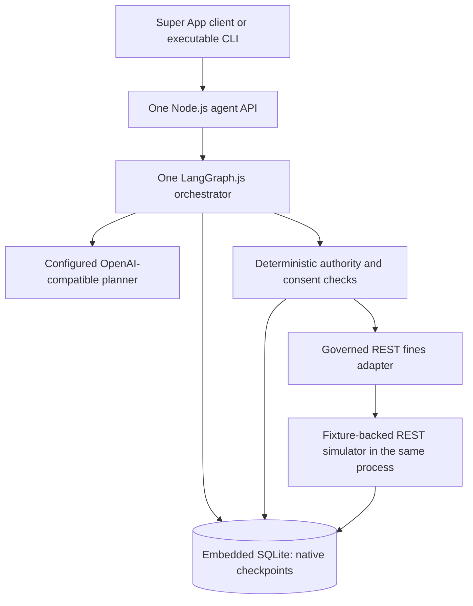

# Super App Agent architecture

The default local demo is `services/agent-core/src/orchestrator/main.ts`, run with `npm start`: one independent TypeScript application using first-party LangGraph.js and embedded SQLite. Government services are simulated by JSON-fixture REST handlers in the same process. No separate workflow executor or database service is required.

| Existing component | Decision and reason |
| --- | --- |
| TypeScript strict mode, Node 24, LangGraph.js | Keep; already match the application |
| React, Angular, Flutter and shared component contracts | Keep; preserve working shells and return a validated compatibility surface |
| Agent orchestration | Simplify to an acyclic graph with a bounded model-selected fines plan |
| Persistence for the focused entry point | Replace custom Redis checkpoints with official `SqliteSaver`; one local file also stores minimal operational and simulated business state |
| External government/payment simulators | Simplify to JSON fixtures plus narrow HTTP handlers in the agent process; no external database or simulator service |
| Existing integrated provider, payment, broker and Redis stack | Isolate as the compatibility demo, available through its existing commands; do not delete working integrations or mutate their contracts |
| Separate workflow engine, generic DSL, registry service | Remove from the target design; none is added to runtime |
| MCP, A2A, SOAP and controlled browser adapters | Defer new implementations until a real service needs them; retain existing authenticated MCP in the compatibility demo |
| AG-UI, official A2UI and remote mini-app architecture | Defer protocol migration; SSE and existing Cityside component schemas cover this slice |
| PostgreSQL, distributed locks, HA | Defer; use a single process and persistent local SQLite volume |

The simulator intentionally shares the process and file to minimize setup. It still receives an HTTP request and independently checks user authority, workload key, consent, quote and idempotency. This demonstrates security boundaries without adding deployable components. It is not a production agency or financial system.

Run only one agent process against a database file. The in-process transition guard is not a distributed lock. A Kubernetes/OpenShift deployment needs one replica, Recreate rollout, a writable persistent volume, secrets supplied separately, and `/live` and `/ready` probes. Container and cluster execution require separate verification; the Dockerfile alone does not prove deployment.

The compatibility demo still uses `services/agent-core/src/index.ts` and its historical Redis flow. Its setup, scripts and domain services remain unchanged. Moving retained shell journeys onto the focused API is incremental application work, not permission to recreate a workflow platform.

See [flow](agent-flow.md), [integrations and API](integrations.md), [security](security.md), [testing](testing.md) and [remaining work](../TODO.md).

First-party API references checked during implementation: [LangGraph interrupts](https://docs.langchain.com/oss/javascript/langgraph/interrupts), [checkpointers](https://docs.langchain.com/oss/javascript/langgraph/checkpointers), [JavaScript SQLite saver](https://reference.langchain.com/javascript/langchain-langgraph-checkpoint-sqlite). Existing LangGraph 1.5.2 is retained; SQLite saver 1.1.0 is pinned. No managed deployment or tracing service is required.

## Incremental adoption boundary

Reuse the primary React shell and the validated compatibility surface. Bind one fines conversation to the focused API before migrating another journey. Display the exact quote and bind approve/reject/cancel to its saved approval ID; after a disconnect or restart, inspect the thread and reconcile the original operation. Preserve manual routes and existing ownership checks on journeys that remain on the compatibility entry point.

Local model and container qualification follow the same service contract. Deterministic test adapters remain explicitly selected; they do not prove live identity or model quality. A further service is added as a small governed adapter and native graph path after the fines interaction is qualified. Task ordering and completion criteria live only in [TODO.md](../TODO.md).
