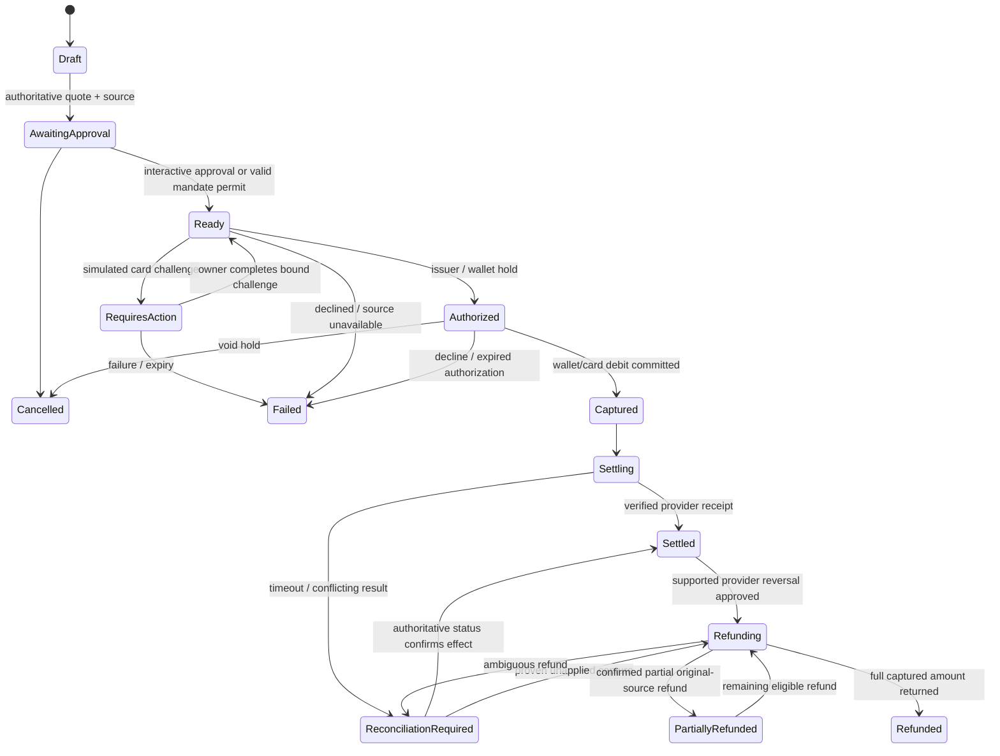

# Payment accounts, funding and automation — demo plan

Status: **implementation in progress**. Requested 24 October 2026, after implementation baseline `283521a`. PAY-01–PAY-05 and the initial preview-only SIM-01 are delivered; new saved-card order execution and automation remain planned. Current wallet effects now use a balanced journal; [migration evidence](../reports/2026-10-24-payment-ledger.md). [Execution evidence](../reports/2026-10-24-payment-accounts.md). Progress is tracked in [the payment backlog](../../TODO.md#payment-accounts-and-automation-demo--planned-backlog). This document defines the full intended behavior and boundaries; checked-in OpenAPI describes the running APIs. The current setup panel produces non-executable reviews and does not authorize funds movement.

## Scope and starting point

The extension covers linked biller accounts, payment from wallet or saved synthetic cards, wallet/mobile/toll top-ups, fines, payment history and explicitly approved automatic payments/services. It remains a local open-source demo with synthetic funds and identities. React is the first reviewable UI; Angular and Flutter get explicit parity tasks. The local text/voice modules may explain or draft a rule, while deterministic APIs own consent and execution.

The code already has separate personal/household workspaces, a 1500 AED seeded wallet per workspace, integer-fils payment capture, decline/refund, persistent request idempotency and provider payment-proof checks. Compatibility application payments default to `wallet` in `packages/backend-kit/src/application.ts`; the gateway also accepts simple `demo_approved`/`demo_declined` flags. The initial saved-card/biller-link registry and fresh quote preview are now implemented through additive APIs. The payment provider now has a balanced journal, projection checks and internal available-funds holds. Stored interactive authorization reviews now support finite wallet/card holds and one-time challenges, with local obligation uniqueness and actual lifecycle-use producers. Admitted wallet/card bill/fine/recharge capture/settlement plus selected-card wallet funding are implemented; one-source sequential grouped checkout and source-backed original-source refunds are implemented; finite consent records are implemented; per-execution authority and a scheduler remain open; signed stored-order and retained legacy/parking event delivery is implemented; general simulator fault controls remain separate. Providers expose revisioned current/closed payables and labelled prior-cycle history. Existing delegated writes allow only one exact AED 1–10 synthetic credit; they cannot pay bills or run recurring rules.

The planned extension preserves signed identity/account checks, resource ownership, provider independence, approval digests, current grant checks and the strict no-preview Keycloak constraint. An existing permission or a generated explanation must not silently expand into automatic spending.

## Accounts and ownership

| Concept | Meaning and planned behavior |
| --- | --- |
| Workspace account | Existing owner-bound personal/household account; all child records use its ID. Household remains owned by one demo user; multi-person shared authorization is a separate feature. |
| Linked biller account | Provider-owned utility premise, telecom subscription/prepaid number, toll tag or vehicle/fine reference; link only an authenticated owner's seeded resource. Provider ID + external reference + workspace must be unique. |
| Wallet | One AED wallet per workspace, with posted balance, holds and available balance. No implicit cross-workspace transfer, overdraft or wallet self-funding. |
| Saved card | Local issuer token plus synthetic nickname/last-four/expiry/status and preset behavior. UI chooses a known demo preset; it never requests PAN, CVV, bank login or real card data. |
| Payment order | One authoritative payable/quote, selected funding token, approval or mandate execution, attempts, capture and provider settlement status. A checkout groups orders but does not make them atomic. |
| Automation mandate | Versioned consent bound to owner/workspace, verified actor, eligible biller/resource, operations, funding sources, time window, purpose and finite budgets. It authorizes only bounded future execution. |

Link verification is a local simulated ownership check, not real agency enrollment. Removing an account/card must resolve or block active holds and dependent mandates; history keeps a masked snapshot. Changing the default card changes future drafts only; existing mandates keep their explicitly approved source until renewed. A separate optional fallback must be individually approved, never inferred.

## Proposed responsibilities and reuse

| Component | Disposition |
| --- | --- |
| `services/provider-simulator/src/{engine,database,contracts}.ts` | Modify payments persistence/contracts and provider bill/fine/recharge lifecycles; introduce typed payment tables through migrations. Keep each provider database private. |
| `packages/backend-kit/src/application.ts`, `service-wallet`, `service-telecom` | Modify payment orchestration to use stored orders, authoritative quotes and selected methods instead of hardcoded wallet/simple funding flags. |
| `services/delegation` | Extend only after the mandate/binding threat-model gate: derive exact per-execution operations from approved mandates with reserved budgets and short-lived credentials. |
| New payment domain modules and local issuer adapter | Create deterministic tokenized-card authorization/challenge/capture/refund state and balanced ledger entries. Keep them separate from the LLM and generic provider branching. |
| New automation worker | Create a small persistent SQLite job/occurrence store and local worker with leases/fencing; use existing broker APIs for bounded execution. Redis remains conversation infrastructure, not the scheduler's only durable state. No new external workflow vendor is required for this demo. |
| New simulator controller | Create run-scoped business clock, scenario fixtures and fault controls behind local authenticated demo-admin access. Ordinary browser requests cannot choose outcomes. |
| React `App`, `A2UIRenderer`, `DelegationPanel`; Angular/Flutter equivalents | Reuse navigation, identity, review and audit patterns; add payments/accounts/rules/run-history screens and tested status components. A mandate editor has its own consent contract rather than reusing a five-minute grant unchanged. |
| `scripts/e2e`, provider/delegation tests, OpenAPI generator | Extend isolation, deterministic fixtures, signed identity, effect assertions and paced recordings. Preserve existing provider journeys and dated evidence. |

APIs for owned biller links, saved methods, current obligation summaries and preview-only quotes are implemented. Stored authorization review/action APIs are implemented; capture/settlement admission and consent-record APIs are implemented; runs and notifications remain planned. Create additive account-scoped resources first. If an existing charge request must change incompatibly, version its contract explicitly; compatibility routes must map into the same order/ledger, never a parallel balance. Legacy free-credit flags remain explicit fixtures during migration and are not permitted as funding authority for new automated flows.

## Financial invariants and state

All authoritative amounts, holds, limits, fees and refunds use bounded safe integer AED fils. Decimal formatting is presentation-only. A local append-only double-entry journal records opening balances, external clearing, wallet liability, capture and reversals; journal postings balance per transaction/currency. Available wallet funds equal posted funds minus active holds. Display projections must reconcile to the journal. Existing balances become exactly one opening entry during migration, without reseeding or replaying old charges.

The model is a simulation of payment accounting, not a bank, actual card-network integration or financial compliance certification. Refunds reference original funding and postings, not an arbitrary new destination.

This is an order summary; capture/refund/challenge attempts have separate durable states. Partial refunds track cumulative confirmed amounts and remaining refundable value. A timeout is an unknown outcome, not a new decline. Automatic retries use the same logical order and attempt identity until the prior outcome is resolved. A new confirmed attempt after a terminal decline remains subject to the same unpaid-obligation guard and budgets.

Capture and bill settlement remain separate transactions. No database transaction spans an HTTP call. Use durable orders plus transactional outbox/inbox, authenticated local event delivery, status lookup and reconciliation. There is no claim of global exactly-once execution: at-least-once transport, unique business keys and idempotent effect handling must prove no duplicate debit/settlement in tested failures. A refund cannot silently leave a paid bill and restored spendable money. The implemented gateway claim now binds existing HTTP captures to their merchant/reference, capture/order metadata and exact source attempt; claim admission and refund eligibility serialize in the gateway transaction. Stored bill capture now integrates source reservation and claims; other payable types retain separate integration work. The provider records application and idempotent acknowledgement. Pending/unknown claims block refunds and cannot be blindly expired or released; authoritative non-application or a supported provider reversal is required. This replaces reliance on an asynchronously retrieved, potentially stale GET proof. Claim/ack/release credentials must be narrowly scoped; the current read-only settlement client is not automatically granted them. Legacy unapplied captures may be refunded after authoritative confirmation. New stored-order refunds remain blocked pending PAY-17; unknown outcomes block replacement charges.

Quotes bind owner/workspace, linked biller, payable IDs and revisions, currency/amount/fees, funding method/version and expiry. Manual and automated payments compete on the same payable reservation before capture. Fine lists use exact owned IDs and current discount/amount versions. Changed quotes, unavailable sources and paid/cancelled obligations require a new decision. Full bill/fine settlement is the initial scope; provider partial bill settlement is not assumed. Checkout shows per-line results and does not hide successful earlier effects after a later failure.

## Automation and authority

Rules are opt-in and disabled until approved. Creation/expansion/source changes require explicit authenticated consent. Show target, trigger, first/next run, funding/fallback, per-payment and daily/monthly caps, occurrence count, expiry, cooldown and purpose before approval. Allow pause/resume, narrower limits, skip-next, expiry and revoke. Resume must recheck consent/entitlements and not replay all missed charges.

A long-lived mandate is policy data, not a user refresh token. The worker authenticates as its own workload; the trusted authority checks current mandate, membership/entitlements, quote and reservations before deriving a short-lived exact-operation grant. The existing RFC 7523 broker and provider verification remain the credential boundary. Payment/resource permissions, audiences and token-to-job/order/grant binding need a new tested contract. No wildcard provider-write enablement, preview features, JS mapper or actor-claim shortcut is allowed.

Budget/count reservations are atomic and include in-flight work. Definitive failure releases a reservation under explicit accounting rules; unknown outcomes keep it reserved. Refunds do not silently restore monthly spending permission. Checks cover concurrent mandates and interactive payments against shared funds. An execution permit has a documented authorization point: revoke/pause prevents new admissions and cancels queued work; an operation already admitted may finish and must be shown as in-flight. Neither revocation nor stopping a worker reverses a captured payment. Define/test the final grant check, revocation fence and recovery behavior before enabling automatic money movement.

| Rule | Initial demo policy |
| --- | --- |
| Bills | DEWA/Etisalat/du linked invoices, due-date or invoice-issued trigger, full current bill within caps, pre-run notice. |
| Wallet auto-top-up | Explicit saved card, low available-balance threshold, fixed/target reload within limits, cooldown and re-arm only on a new qualifying external debit. No self-triggered credit loop. |
| Toll/mobile recharge | Specific tag/prepaid subscription, bounded threshold/reload and source. RTA and telecom adapters expose actual synthetic usage events. |
| Fines | Review by default. Optional separate mandate explicitly limits owned vehicle, eligible synthetic fines, amount and count. No broad “pay any fine” default. |
| Parking | Existing owned active session only; bounded zone/plate, hours, tariff, cost and stop time; departure/maximum duration/revocation stop extensions. |
| Service renewal | Explicitly supported subscription renewal, one period at a time with current eligible tariff. Plan upgrades, new utility/tenancy activation, rides and dining remain review-required unless a later separately bounded rule is added. |

Insufficient wallet funds do not silently charge a saved card. Fallback and top-up-before-payment chains require separate explicit approval, independent budgets, depth/cycle limits and a visible combined total. The initial default is to stop and notify. A card challenge during unattended execution becomes Requires action and notifies the owner; a worker cannot complete the challenge as the human.

Store business timestamps in UTC with an explicit IANA schedule zone (default Asia/Dubai), calendar-period budgets and documented month-end behavior. Jobs persist across restarts and browser logout; session/Redis expiry does not erase a mandate. Logout ends a browser session, while mandate pause/revoke ends future automation; provide a clear combined “sign out and pause automation” option. Account/card revocation and loss of entitlement also stop new jobs. A unique occurrence identity plus per-payable reservation prevents duplicate scheduler deliveries and manual/automatic double payment. Notifications remain local/in-app; no email/SMS service is needed.

## Simulator design

The first [operator preview clock](../development/simulator.md) is implemented with a fixed separate data path, persistent owner/run/generation and once-only descriptive due events. It is not a network admin panel and never dispatches financial/provider work. Later execution scenarios must preserve this isolation and bind a trusted business clock to their own run context.

Use an injectable persisted **business clock** for due dates, cooldowns, usage and scheduler occurrences. Keep JWT/signature/credential validation on real security time. Run IDs isolate all seed data, clocks, jobs, issuer balances and fault scripts. Time advance emits bounded deterministic events and waits for observable job outcomes; it does not create permissions. Reset affects only the selected isolated run and never the user's normal volumes.

Provide named, reproducible card presets for approve, insufficient limit, hard decline, expired/disabled, interactive challenge, pending capture and refund failure. Script errors before/after authorization, debit commit, response and provider settlement. Include delayed, dropped, duplicate, out-of-order and forged events; callback success must never substitute for authoritative state. Scenario controls are authenticated and feature-gated, not request-body flags or arbitrary callback URLs.

Seed multiple bills/cycles and owned service resources; simulate invoice changes/withdrawal, fine discounts/expiry, toll/mobile consumption, parking departure and subscription renewal. Persist scenario traces with correlation IDs and masked method metadata, excluding bearer tokens and raw secrets. A run inspector explains order/attempt/mandate/budget/ledger/provider state and routes unknown outcomes to reconciliation rather than offering “try again” with a fresh charge.

## Release gates and sequence

1. Accounts/methods, migrations, order/ledger and manual wallet/card payments pass before automation spends money.
2. Mandate policy and the exact delegated credential extension pass security/consent/concurrency tests before scheduler payment execution is enabled.
3. Persisted worker and controlled simulator pass restart, redelivery and ambiguous-effect recovery before full auto-services are enabled.
4. All supported shells show truthful source, challenge, partial/unknown and revocation states. Existing twelve E2E journeys stay green.
5. New paced recordings wait for asserted state, then retain six-second reviews/eight-second receipts. Simulated time and scenario failures are clearly labelled.

[TODO](../../TODO.md) contains independently verifiable slices, dependencies and acceptance criteria. Production PSP/agency contracts, real cards/banks, compliance certification, public hosting, native-platform delivery and disabled CI activation remain separate existing release requirements.

## Design references

Idempotency keys and parameter-conflict checks are established retry patterns; this plan additionally needs business-obligation uniqueness across distinct keys. [Stripe API reference](https://docs.stripe.com/api/idempotent_requests).

The event simulator deliberately includes duplicates, retries and reordered delivery, consistent with documented webhook delivery behavior. This is a local adapter contract; no Stripe SDK, account, API key or external payment request is introduced. [Webhook documentation](https://docs.stripe.com/webhooks#event-delivery-behaviors).

SQLite permits a single simultaneous writer; the local worker/payment design must handle contention and commit boundaries explicitly rather than infer distributed atomicity. [SQLite transactions](https://www.sqlite.org/lang_transaction.html).

## Delivered grouped checkout

[PAY-16](../development/checkout-groups.md) persists one owner-approved source/version, exact total and immutable child orders. Current paid items are excluded. Sequential dispatch stops on challenge/decline/unknown and retains prior receipts. Resume reconciles the original child before later payments; cancellation fences new dispatch while captures retain recovery. The legacy civic action persists this original plan and recharge intent, preserving its compatibility wallet default or explicit selected source. Cross-provider settlement remains non-atomic.

## Delivered refund boundary

[PAY-17](../development/payment-refunds.md) requires explicit owner approval and durable source cancellation/credit removal before original-source return. Bills/fine sets allow only full synthetic cancellation; unused recharge and card-funded wallet value allow cumulative partial returns. The wallet funding reversal cannot consume holds or overdraw. Gateway issuer/journal/claim/original-order updates commit together; source response loss retains the original refund ID and blocks another request. Original settlement fences are never released for reapplication. Events, a reconciliation workbench and statements remain separate slices.

## Stored-order financial status events

[PAY-18 infrastructure](../development/payment-events.md) appends immutable event bindings in the same SQLite commit as financial/source transitions. Persisted leased workers deliver signed callbacks to a deduplicating gateway inbox with original local binding/version checks. Source events are inspection hints; user-authorized original-order recovery still performs authoritative provider lookup before a receipt. No user bearer token enters the worker. Named issuer presets and retained legacy/parking event coverage are delivered; broader simulator controls remain open; no callback activates an automatic rule.

## Reproducible issuer decisions

[SIM-03](../development/issuer-scenarios.md) configures eight finite outcomes through an authenticated isolated-run operator, with pristine/path/identity confinement. Each authorization freezes run ID/policy revision. Pending capacity survives provider restart without capture; a separate issuer decision and customer execution are required. Source/version, expiry, challenge and refund guards remain independent. Normal/copied databases cannot be armed and ordinary payment bodies cannot select run outcomes. General operator lifecycle controls and remaining event-path qualification stay separate.

## Versioned consent foundation

[AUTO-01](../development/payment-mandates.md) stores one finite actor/audience/operation/target policy with exact sources, explicit fallback, purpose, trigger, window, caps, counts and cooldown. Exact digest approval is owner-only; any revision withdraws previous consent. Immutable masked history and lifecycle locks commit together. Source providers independently confirm current ownership/eligibility. Every record returns `executionEnabled: false`: AUTO-03 must derive and admit exact operations with current consent and budget reservations, and AUTO-05 must provide durable jobs before automatic writes exist.

## Exact conversational funding review

[PAY-07](../development/payment-surfaces.md) now binds displayed payable revisions/amounts, explicit source/version and stored order/digest across the service workspace. Wallet/card bills, exact fines, saved-card wallet reload and civic groups require review, authorization/challenge and a separate capture action. Cancellation and unknown recovery retain original identities; source selection and natural-language assent never spend. Automatic callers retain their separate admission/permit gates.

[PAY-19 recovery](../development/payment-reconciliation.md) adds owned evidence decisions, guarded same-operation continuation, separately approved refund reviews and append-only local audit. Missing provider outcomes remain blocked. Automatic budgets, workers and general simulator failpoints retain separate gates.
