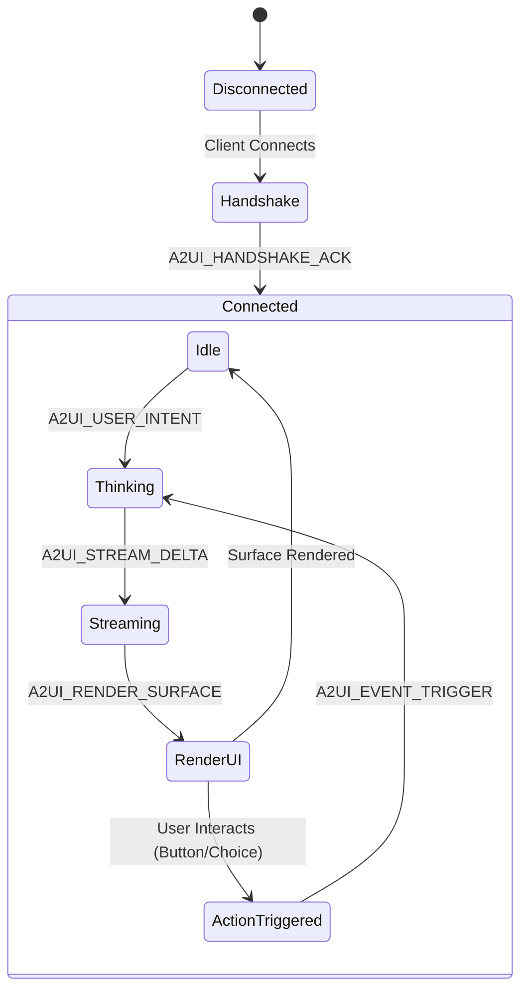

# AG-UI & A2-UI Protocol Specification Reference

This document defines the formal data structures and wire protocols for **AG-UI** (Agent-Generated UI) and **A2-UI** (Agent-to-User Interface).

---

## 1. AG-UI (Agent-Generated UI) Declarative Specification

AG-UI defines the declarative layout and component hierarchy rendered on the client. It uses a component tree model where every node has a `type`, `id`, `properties`, optional `style`, and `onEvents` handlers.

### 1.1 JSON Schema Definition (TypeScript Interface)

```typescript
export type ComponentType =
  | 'SurfaceCard'
  | 'Heading'
  | 'Text'
  | 'Badge'
  | 'ChoiceGroup'
  | 'Button'
  | 'FormInput'
  | 'MetricWidget'
  | 'MapViewer'
  | 'DataTable'
  | 'MiniAppEmbed';

export interface ActionBinding {
  event: 'onPress' | 'onChange' | 'onSubmit';
  actionType: 'AGENT_ACTION_DISPATCH' | 'LAUNCH_MINIAPP' | 'HOST_NAVIGATE';
  payload: Record<string, any>;
}

export interface UIComponentNode {
  type: ComponentType;
  id: string;
  properties?: Record<string, any>;
  style?: {
    variant?: 'primary' | 'secondary' | 'outline' | 'ghost' | 'danger' | 'success';
    padding?: 'none' | 'small' | 'medium' | 'large';
    direction?: 'horizontal' | 'vertical';
    spacing?: 'small' | 'medium' | 'large';
    fullWidth?: boolean;
    align?: 'start' | 'center' | 'end' | 'between';
  };
  children?: UIComponentNode[];
  onEvents?: ActionBinding[];
}

export interface AGUISurfacePayload {
  version: '1.0.0';
  sessionId: string;
  timestamp: string;
  view: UIComponentNode;
}
```

### 1.2 Core Component Catalog Reference

#### 1. `SurfaceCard`
A container card with rounded corners, elevation/shadow, and border styling.
- **Properties**: `title` (optional), `subtitle` (optional), `collapsible` (boolean).
- **Children**: Any list of `UIComponentNode`.

#### 2. `ChoiceGroup`
Single or multi-select options group (e.g., selecting ride tier or food size).
- **Properties**:
  - `name`: string
  - `selectedId`: string
  - `multiple`: boolean
  - `options`: Array of `{ id: string, title: string, subtitle?: string, price?: string, badge?: string, icon?: string }`

#### 3. `MetricWidget`
Displays KPI-style highlighted metrics (e.g., ETA, price total, wallet balance).
- **Properties**:
  - `label`: string
  - `value`: string | number
  - `change`: string (e.g. "+5%")
  - `trend`: "up" | "down" | "neutral"

#### 4. `MapViewer`
Renders an interactive map with pins, route polylines, and vehicle markers.
- **Properties**:
  - `center`: `[latitude, longitude]`
  - `zoom`: number
  - `markers`: Array of `{ id: string, lat: number, lng: number, title: string, icon?: string }`
  - `routePolyline`: Array of `[lat, lng]`

#### 5. `Button`
An interactive button triggering an agent action or mini-app navigation.
- **Properties**: `label`: string, `variant`: string, `disabled`: boolean, `loading`: boolean.
- **onEvents**: Required `onPress` binding.

---

## 2. A2-UI Wire Protocol (Agent-to-User Interface)

A2-UI defines how messages flow between the client host and the backend Agent Gateway.

### 2.1 Transport Options
1. **Server-Sent Events (SSE)**: Standard HTTP streaming connection (`GET /api/a2ui/stream?sessionId=...`) for server-to-client streaming, paired with standard `POST /api/a2ui/action` for client-to-server events.
2. **WebSocket (WS)**: Full-duplex persistent connection (`ws://<host>:4000/api/a2ui/ws`).

### 2.2 Message Types and Envelopes

All wire messages wrap in a standard envelope:

```typescript
export interface A2UIMessage<T = any> {
  id: string;             // UUID of the message
  type: A2UIMessageType;  // Type enum
  sessionId: string;      // Conversational session identifier
  timestamp: number;      // Unix timestamp (ms)
  data: T;                // Typed payload
}
```

#### Message Type Catalog



#### 1. `A2UI_HANDSHAKE` (Client $\to$ Gateway)
Declares client device context and supported widgets:
```json
{
  "type": "A2UI_HANDSHAKE",
  "sessionId": "sess_123",
  "data": {
    "platform": "react",
    "viewport": {
      "width": 1280,
      "height": 800,
      "category": "desktop"
    },
    "supportedComponents": [
      "SurfaceCard",
      "ChoiceGroup",
      "Button",
      "MapViewer",
      "DataTable",
      "MiniAppEmbed"
    ],
    "locale": "en-US"
  }
}
```

#### 2. `A2UI_STREAM_DELTA` (Gateway $\to$ Client)
Streams the agent's step-by-step thinking or progressive natural language explanation:
```json
{
  "type": "A2UI_STREAM_DELTA",
  "sessionId": "sess_123",
  "data": {
    "phase": "REASONING",
    "text": "Checking driver availability near your location..."
  }
}
```

#### 3. `A2UI_RENDER_SURFACE` (Gateway $\to$ Client)
Instructs the client to render or update an AG-UI surface:
```json
{
  "type": "A2UI_RENDER_SURFACE",
  "sessionId": "sess_123",
  "data": {
    "mode": "REPLACE",
    "surface": {
      "version": "1.0.0",
      "sessionId": "sess_123",
      "view": {
        "type": "SurfaceCard",
        "id": "ride_card",
        "children": [...]
      }
    }
  }
}
```

#### 4. `A2UI_EVENT_TRIGGER` (Client $\to$ Gateway)
Dispatched when the user clicks a button, changes a form input, or interacts with a widget:
```json
{
  "type": "A2UI_EVENT_TRIGGER",
  "sessionId": "sess_123",
  "data": {
    "originComponentId": "btn_confirm_ride",
    "action": "book_ride",
    "payload": {
      "rideOption": "ride_comfort",
      "fare": "$22.00"
    }
  }
}
```

#### 5. `A2UI_LAUNCH_MINIAPP` (Gateway $\to$ Client)
Commands the SuperApp host shell to transition to or split-screen a full Mini-App:
```json
{
  "type": "A2UI_LAUNCH_MINIAPP",
  "sessionId": "sess_123",
  "data": {
    "miniAppId": "org.superapp.ride",
    "entryRoute": "/active-trip/trip_99812",
    "viewportMode": "canvas_pane",
    "context": {
      "driverId": "drv_442",
      "destination": "JFK Airport"
    }
  }
}
```
