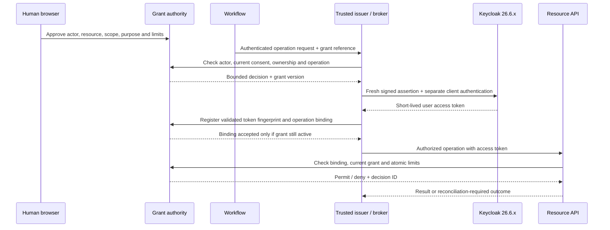

# Secure identity delegation — analysis and proposed implementation

**Reviewed:** 24 October 2026. **Status:** original planning analysis; the bounded local implementation is now accepted under [ADR-0012](../adr/ADR-0012-secure-delegation-demo.md), following the instruction to start. **Target:** local synthetic demo. Production/security release approval remains separate. [OBO backlog](../../TODO.md#production-gate-separate-from-the-demo).

This records the pre-implementation analysis of the supplied blueprint and tagged sources. The [implementation guide](../development/delegation.md) and [execution evidence](../reports/2026-10-24-delegation-demo.md) now describe the separate broker, grant authority, private-key exchange, provider enforcement, consent controls and deliberate limits. The gap table below is the earlier baseline. No custom mapper or preview feature was installed; production certification is not claimed.

## Assessment and version correction

The approach is feasible in principle: supported JWT Authorization Grant can turn an independently authorized external assertion into a Keycloak user access token. It supplies identity federation, not the application's consent, spending authority or resource ownership policy. Those controls must be implemented in the issuer and APIs. Adding an `act` object alone would leave the most important authorization gaps open.

The supplied feature table needs one correction. JWT Authorization Grant became supported in 26.6. Native `token-exchange-delegation` was introduced as **experimental in 26.7**, then promoted to **preview in 26.8**; it is absent from the 26.6.4 feature registry. The no-preview/no-experimental constraint therefore still excludes it. Do not upgrade to a different minor release to obtain native delegation as part of this proposal. [26.6 release](https://www.keycloak.org/2026/04/keycloak-2660-released), [26.7 release](https://www.keycloak.org/2026/07/keycloak-2670-released), [26.8 release](https://www.keycloak.org/2026/10/keycloak-2680-released), [26.6.4 feature registry](https://github.com/keycloak/keycloak/blob/26.6.4/common/src/main/java/org/keycloak/common/Profile.java).

The checked-in demo already pins `quay.io/keycloak/keycloak:26.6.4`, but runs `start-dev` with HTTP and seeded credentials. That is a compatibility baseline, not an approved production image. Before implementation, triage current advisories and select an exact maintained 26.6.x patch/digest. If no acceptable patch satisfies the version constraint, stop the activation decision and document the conflict. No vulnerability applicability is asserted by this analysis.

Use tagged guides and source for compatibility claims; the unversioned online guides move with newer releases. Supported standard token exchange can be evaluated separately for suitable trust domains; it must not be described as supported native actor delegation.

## Baseline implementation and gaps before this change

| Boundary | Current repository behavior | Required change |
| --- | --- | --- |
| Realm/bootstrap | `services/keycloak/realm-export.json` and `scripts/configure-demo-keycloak.ts` configure browser/service clients, roles and seeded users | Explicit JWT-grant IdP, confidential client, policies, user links and safe idempotent reconciliation |
| Interactive identity | React/Angular PKCE; Flutter demo password login | Retain interactive lane; do not require delegated claims on normal user tokens |
| API verification | `packages/backend-kit/src/jwt.ts` checks RS256, issuer, audience, lifetime, optional global scopes and configured introspection | Endpoint-specific principal/scope/audience/grant policies; typed actor context |
| Provider transport | `provider-client.ts` uses cached client credentials and `X-User-Subject` / `X-User-Name` | Cryptographically verified user identity plus grant-backed authority at the provider boundary |
| Provider authorization | `services/provider-simulator/src/index.ts` checks machine `azp`, provider role and SQLite ownership using the forwarded human header | Separate machine and delegated profiles; derive delegated resource owner from verified token identity |
| Accounts | `context.ts` derives account IDs from the internal Keycloak user subject | Preserve existing UUIDs and ownership; external assertion subject must not rekey accounts |
| Approval | `approvals.ts` binds expiring one-time approval to a session, revision and offered action | Durable, revocable grant plus independent action/quote approval and atomic limits |
| Workflow state | LangGraph and Redis persist sessions, approval state and checkpoints | Persist grant references/versions and operation state; obtain fresh authority on resume |
| Audit | Bounded approval history and request logging | Durable grant/issuance/decision/effect audit with restricted access and retention |

The existing `cityside-verifier` introspection client is included in relevant access-token audiences because of the demo's 26.6.4 introspection behavior. Preserve and explicitly test this requirement in the new lane. The **assertion** has one canonical Keycloak audience; the **access token** may need a tightly approved set containing the resource API and verifier. A private-key JWT used for **client authentication** has its own audience rules. These three JWT uses must not share unchecked claim templates.

## Authorization model

Effective authority is the intersection of current human entitlements, authenticated workload entitlements, client scopes/audiences, active grant constraints, approved action/quote, and remaining atomically enforced limits. A model, chat message, surface or workflow checkpoint cannot expand that intersection.

Keep three explicit credential lanes:

1. Interactive human requests: normal user authentication, ownership and any required action approval.
2. Delegated workload requests: linked human subject, actual authenticated OAuth client, verified grant binding and current consent, plus normal ownership and action rules.
3. True machine requests: narrowly scoped service/status/settlement-proof operations with no human impersonation. Specify their resource authorization independently.

Do not assign all provider machine roles to human users to make delegated tokens pass current checks. Refactor the policy instead. A failed delegated request must not fall back to service credentials plus a user header or to legacy fixtures.

### Grant contract

The authoritative grant record should contain an opaque ID and version, realm/tenant, existing internal Keycloak user ID, external issuer/subject link, actual OAuth actor client, separately verified initiating workflow identity where needed, purpose, capability versions/scopes, audiences, resource/action restrictions, validity window, status/revocation revision and audit history. Financial authority additionally needs currency/minor-unit limits, per-operation and cumulative limits, recipient restrictions, quote/approval references and durable consumption/reservation records.

Choose a durable store and transaction model explicitly. SQLite is a possible isolated-demo implementation; it does not establish production HA. Redis session/checkpoint state is not the authoritative consent or budget ledger. Grant administration must derive the owner from authenticated identity and account membership, not a submitted `sub`. Review CSRF/origin controls, actor registry permissions, grant narrowing/renewal, required step-up authentication and administrative link changes.

### Two binding decisions must precede coding

**Actor binding:** an IdP allowlist is not sufficient evidence that a signed assertion intended for client A cannot be exchanged by another allowed client B. Carrying an intended actor in a signed custom claim only helps if it is enforced. Start with one confidential client and one constrained issuer trust compartment; prove wrong-client rejection. Expansion requires reviewed per-client trust isolation or verified server-side policy. The agent must never hold the issuer's assertion-signing key or freely select the external user subject.

**Token-to-grant binding:** `delegation_grant_id` in an assertion is not guaranteed to appear in the resulting access token. An arbitrary request header containing a grant ID is only an untrusted lookup selector. It cannot establish that this token was issued for that grant. Choose one reviewed approach:

| Option | Binding mechanism | Consequence |
| --- | --- | --- |
| Controlled issuer/token broker — recommended first prototype | Broker performs exchange, validates the issued token, and registers a SHA-256 token fingerprint against grant version, user, actual client, target audience/scopes and operation in the authorization service | Registration is restricted to the trusted broker; APIs hash and look up the presented token, then check current grant state. No raw tokens in the registry. Broker availability and registration races must fail closed |
| Direct agent exchange | A proven server-side extension or equivalent verified registration mechanism binds trusted assertion grant data to the issued token | More Keycloak integration work; an informational `act` mapper alone does not supply this binding. Requires a separate design/security gate |
| Ordinary user OAuth plus verified application audit | Keep normal user authorization; record workload provenance in application audit | Simpler alternative if custom token actor claims and unattended delegation are unnecessary |

The broker proposal changes the supplied direct agent-to-Keycloak sequence and therefore needs explicit architectural acceptance. If the broker authenticates as `delegation-broker`, `azp` and any `act.sub` must identify that broker. A workflow/AI agent is a separately authenticated initiator in the grant/audit record, not a fabricated OAuth client identity. Per-workload OAuth clients are a separate credential-management choice. A fingerprint binding does not make a bearer token sender-constrained; decide whether the deployment also requires a supported, tested proof-of-possession profile. mTLS client authentication alone is not proof of access-token sender binding.

The diagram is a candidate single-hop broker execution path, not an implemented flow. If tokens are returned to workloads instead, define the extra boundary, caller authentication, exposure controls and stolen-token threat before acceptance.

## Keycloak and assertion implementation constraints

The JWT grant requires prelinked users and a configured confidential client/IdP relationship; it creates a transient session without a refresh token. Keycloak does not provide an interactive consent step in this grant. Check the precise linking, audience, replay and policy behavior against the [tagged 26.6.4 guide](https://github.com/keycloak/keycloak/blob/26.6.4/docs/guides/securing-apps/jwt-authorization-grant.adoc). User links must retain existing internal UUIDs, never auto-link by email, and handle disabled users, required actions, unlinking and account deletion safely.

Proposed issuer policy: RS256 for compatibility with the existing verifier; fresh cryptographically random `jti`; canonical single Keycloak audience; explicit `iat`, `nbf`, `exp`; a **90-second maximum assertion lifetime** bounded further by grant/approval expiry; a separately specified small clock skew. These are proposed application limits, not claims about defaults. Cap access-token lifetime independently and test that it never exceeds the applicable authorization window. Use HTTPS allowlisted JWKS, controlled rotation and separate keys for issuer signing, client authentication and Keycloak token signing. Never honor caller-provided `jku`, arbitrary key URLs, unsigned assertions or custom audience escape hatches.

Apply `downscope-assertion-grant-enforcer` with a policy bound to the intended IdP/client and inspect actual token authority. The tagged executor handles JWT grants but also retains default client scopes whose `includeInTokenScope` is false. Therefore an apparently downscoped scope string can still coexist with mapper-derived roles or audiences. Test omitted/empty scope, defaults, full-scope settings and every resulting role/audience, rather than testing only a string subset. [26.6.4 executor source](https://github.com/keycloak/keycloak/blob/26.6.4/services/src/main/java/org/keycloak/services/clientpolicy/executor/DownscopeAssertionGrantEnforcerExecutor.java).

Source review also motivates probes for long `exp` with fresh `iat`, replay-cache behavior across nodes/restarts and retries after failed/ambiguous exchange. These are test hypotheses, **not reproduced vulnerabilities**. Enforce the issuer's own hard lifetime limit regardless of a console setting. [26.6.4 assertion validator](https://github.com/keycloak/keycloak/blob/26.6.4/services/src/main/java/org/keycloak/authentication/authenticators/client/AbstractBaseJWTValidator.java).

### Optional Java actor mapper

Defer the mapper until the stock grant and binding prototype works. If `azp` plus verified application audit meets the requirement, record why no custom mapper is needed. If required, implement only a Java access-token mapper gated by exact grant type and approved client, sourcing actor from authenticated server context. It must not infer delegation from arbitrary form fields, unverified assertions, mutable user attributes or shared session notes. Concurrent grants must not contaminate one another.

Tagged code passes grant type into client-session context and applies access-token mappers during issuance. That supports a feasibility hypothesis; only an exact-image integration test can establish the required user/client context, claim behavior and failure handling. [Grant base](https://github.com/keycloak/keycloak/blob/26.6.4/services/src/main/java/org/keycloak/protocol/oidc/grants/OAuth2GrantTypeBase.java), [token manager](https://github.com/keycloak/keycloak/blob/26.6.4/services/src/main/java/org/keycloak/protocol/oidc/TokenManager.java), [mapper API](https://github.com/keycloak/keycloak/blob/26.6.4/services/src/main/java/org/keycloak/protocol/oidc/mappers/AbstractOIDCProtocolMapper.java).

Pin the compatible Java toolchain/dependencies, package the service descriptor, install the JAR under `/opt/keycloak/providers/`, and build the optimized image. Verify class loading, access-token/introspection visibility, lightweight-token settings and absence from ID tokens, user-info and unrelated flows. A supported extension mechanism does not make this custom provider Keycloak-maintained. [26.6.4 developer guide](https://www.keycloak.org/docs/26.6.4/server_development/index.html).

## Revocation, effects and workflow recovery

Keycloak token introspection and current grant validation answer different questions. An active token may refer to revoked consent. For the initial delegated demo, check current grant state on every delegated API call, fail closed on authority-store outage, and avoid positive authorization caches. Validate before minting/registration and again immediately before an effect. A previously signed assertion may race with revocation and still exchange successfully; the API must deny it. Do not promise that revocation prevents all token issuance without proving stronger coordination.

Define the authorization linearization point: grant-version check and limit reservation must be atomic with respect to revocation and competing actions. Specify what happens to an action already authorized when revocation occurs. An already committed external effect cannot be undone merely by revoking consent. Use reserve/commit/release records and idempotency keys; unknown effects require status reconciliation before another reservation or retry. The sum of captures and outstanding reservations must remain within the approved budget across sessions and processes.

Delegated token caches must include issuer/realm, human subject, actual actor, grant ID/version, audience, scopes, resource/operation and approval constraints; a client-only cache is unsafe. Prefer per-operation, memory-only credentials initially. Never persist raw assertions, access/refresh tokens or private keys in Redis, LangGraph, SQLite operation records, traces, videos or receipts. Resume from grant references and reauthorize; expiry/withdrawal must prevent pending work from executing. Preserve existing idempotency and reconciliation-required semantics.

## Threat model and acceptance evidence

| Threat | Required defense and evidence |
| --- | --- |
| Agent impersonates arbitrary user | Isolated issuer key; authenticated actor; independent owner/entitlement/consent lookup; cross-user and arbitrary-sub rejection |
| Confused deputy / grant substitution | Actual OAuth client binding; token fingerprint or verified claim binding; reject client A→B and token G1→G2 substitution |
| Scope/role/audience escalation | Client policy plus full effective-authority inspection; no hidden default mapper escalation; reject wrong API/resource/tenant |
| Replay / stolen bearer credentials | One-time assertions, short lifetimes, caller isolation, redaction and reviewed sender-binding decision; cache/failover and replay tests |
| Revocation or budget race | Online grant validation, atomic reservations/version checks, concurrent effects/revoke tests, fail closed on authority outage |
| Key compromise / SSRF | Separate key domains, pinned algorithms and configured JWKS endpoints, restricted egress, rotation/retirement and emergency disable drills |
| Audit repudiation or leakage | Durable restricted audit linking user, actor, grant version, decision, operation and effect; no raw JWTs; test deny-path and logging failures |
| Cross-flow claim contamination | Mapper only for approved JWT grant/client; concurrent users/grants, interactive/machine flow and ID-token absence tests |
| Resource exhaustion | Bounded assertion/token sizes, rate/concurrency/deadline limits, controlled JWKS refresh, authority-store backpressure and observability |

The exact-image acceptance suite must cover all supplied positive/negative criteria plus the following distinctions:

- Linked valid user succeeds minimally; unknown/unlinked/disabled/required-action users fail; existing account ownership survives linking.
- Forged signature, unknown/wrong `kid`, wrong issuer, unapproved IdP/client, missing/multiple/wrong audience, missing/reused `jti`, expired/not-yet-valid/overlong timestamps and disallowed algorithms fail as specified.
- Requested scope expansion fails; absent/empty scope and hidden default mappers do not introduce extra roles/audiences. Access-token introspection works only under the approved verifier profile.
- Missing, expired, revoked, cross-user, wrong-actor, wrong-purpose/resource/tenant or substituted grant fails. A grant cannot exceed the user's own entitlement. API grant checks fail even if Keycloak introspection still says active.
- Untrusted `act`, nested actor chains, subject overrides and grant headers cannot confer authority. Single-hop only; no inherited authority through arbitrary agent chains.
- Key rollover is tested separately for issuer, client authentication and Keycloak JWKS; replay and authority state are tested through node restart/failover.
- Cross-session limits, revoke-versus-reserve, effect timeout/restart, duplicate submissions and reconciliation preserve budgets and exactly-once business outcomes where claimed.
- Manual HTTP, MCP, workflow resume and every retained shell call the same enforcement. Record real token provenance without capturing credentials.

Use independent expected outcomes and inspect business state, not only HTTP status or claim presence. Evidence must identify source revision, image digest, Java/Node versions, realm export/policy revision, commands, denial reason categories and any exceptions. No OBO integration test was executed for this analysis.

## Delivery order and stop gates

| Phase | Tasks | Exit condition |
| --- | --- | --- |
| A — decisions and approval | OBO-01–OBO-05 | Accepted demo scope, threat model, actor/grant binding and data contracts; implementation explicitly authorized |
| B — isolated compatibility proof | OBO-06–OBO-13 | Stock exact-image JWT grant, link/scope/replay/introspection evidence; mapper decision supported by a small test |
| C — read-only vertical slice | OBO-14–OBO-22 | One actor, user and owned read resource; broker/issuer + current grant enforcement across the provider boundary |
| D — controlled writes and retained paths | OBO-23–OBO-28 | Separately approved bounded write, atomic limits, recovery and shell/MCP parity |
| E — acceptance and demo handover | OBO-29–OBO-33 | Full attack matrix, recovery/rotation, truthful paced recordings and reconciled docs |
| F — production, if separately requested | OBO-34–OBO-36 | Production platform, external review and operational evidence; no implicit deployment approval |

Recommended first read is an existing owned balance/status capability, with the actual catalog scope chosen in OBO-04; do not invent a scope unsupported by current contracts. Then use a single explicitly approved low-value simulator mutation. Scheduling and multi-hop delegation remain separate decisions. Keep the new demo profile opt-in and synthetic until its acceptance gates pass.

Rollback must disable new delegation issuance, revoke active grants/bindings, cancel pending delegated execution and remove the optional mapper/policies with a tested migration. Preserve interactive login, existing UUIDs and unrelated service lanes. Do not silently restore header-based impersonation on delegated endpoints. Production additionally requires persistent Keycloak database, TLS/hostname/proxy configuration, restricted networks, non-root optimized images, vault/KMS controls, backups/restore, HA/replay-state validation and an incident runbook; localhost `start-dev` is insufficient.

The detailed [TODO tasks](../../TODO.md#production-gate-separate-from-the-demo) refine existing P0/P1/P2 requirements; checking a demo task does not close their broader production acceptance criteria. This proposal does not re-enable GitHub workflows or authorize a production rollout.

## Standards references

[RFC 7523](https://www.rfc-editor.org/rfc/rfc7523.html) defines JWT authorization grants/client assertions. [RFC 8693](https://www.rfc-editor.org/rfc/rfc8693.html) defines token exchange and actor semantics; an RFC 8693-shaped `act` claim does not independently prove delegated authorization. The supplied blueprint remains the proposal input; the tagged Keycloak references above qualify version-specific assumptions.
