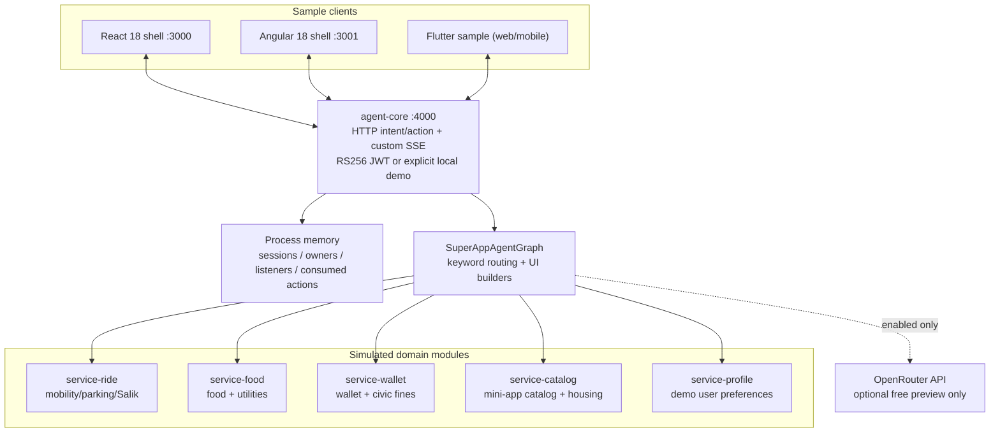

# As-built system architecture

**Snapshot:** `main` after PR #1 (23 October 2026). This document describes the checked-in code, not an aspirational platform. For the future architecture see [target-architecture](target-architecture.md).

## Summary

The demonstration puts a Concierge-style user interface over five **in-process business simulators**. The top-level user interaction is HTTP plus custom SSE events. A class named `SuperAppAgentGraph` performs keyword matching, invokes imported functions, constructs surfaces, and pauses in practice by presenting action buttons. It is not an installed LangGraph StateGraph and has no durable checkpointing.

The business functions are imported directly from `services/*/src/index.ts` into `services/agent-core/src/langgraph/graph.ts`. Starting each module's HTTP server does not mean the graph communicates over HTTP or MCP.

## Component inventory

| Component | As-built responsibility | Important caveat |
| --- | --- | --- |
| `agent-core/src/index.ts` | `/health`, `POST /api/a2ui/intent`, `POST /api/a2ui/action`, `GET /api/a2ui/stream` | Custom protocol, process-local state and stream listeners |
| `agent-core/src/auth.ts` | Verify RS256 JWKS tokens and issuer/audience/expiry; nonproduction opt-in demo identity | No user-facing PKCE, downstream delegation or token revocation |
| `agent-core/src/langgraph/graph.ts` | Keyword intent router; scenario orchestration; static UI builders/actions | No LangGraph package/graph/checkpointer; model output not used |
| `agent-core/src/openrouter.ts` | Optional model completion preview; free-router default | Not tool-calling or LLM-driven planning |
| `service-ride` | Ride/parking/Salik/EV simulation | Shared process-scoped state; civic functions are fixtures |
| `service-food` | Food and utility-bill simulation | Function/domain names do not match clean business boundaries |
| `service-wallet` | Wallet/fines/payment simulation | Not a financial transaction system; combined settlement not atomic |
| `service-catalog` | Mini-app metadata, demo Ejari/move-in and tool listings | Example remote URLs and descriptors, not validated remote runtime |
| `service-profile` | Demo profile/preferences/prompts | No durable, per-user profile isolation |
| `packages/protocol-core` | Project-defined UI component tree and SSE envelopes | Not official AG-UI/A2UI conformance |
| `services/agentgateway/config.yaml` | Aspirational gateway config | No proof the config runs with selected image or that graph traffic flows through it |
| `services/keycloak/realm-export.json` | Development-only realm seed | Includes insecure local credentials/open origins; not production ready |

## Runtime topologies

### In-process development runner

`npm run dev:backend` loads `scripts/dev-backend.ts`, starts six Node HTTP servers in one process and calls business functions directly. React can connect independently with `npm run dev:react`. Identity defaults to *reject*: add `DEMO_AUTH=true` locally to use the mock shell. This runner does not launch the Compose gateway or Keycloak.

### Docker Compose (configured, not release certified)

`docker-compose.yml` describes five services, agent-core, a Keycloak dev instance, an agentgateway container and React frontend. Backend host bindings are loopback-only by default. The graph's direct imports mean there is still *no verified data-plane integration*. The gateway image is unpinned `latest`, the configuration declares sample MCP servers, and gateway listener CORS currently contains a wildcard. Validation of actual startup, config schema and protocol interoperability is open.

### Published deployment

**None demonstrated by source.** There are no documented persistent store/migration or production rollout manifests in this snapshot.

## Request and action lifecycle

1. Frontend sends `POST /api/a2ui/intent` with `sessionId` and text. The backend requires a valid identity, limits text length, associates the session ID with the authenticated subject, and uses its in-memory state map.
2. `SuperAppAgentGraph.executeIntent` inspects words in the prompt. It optionally calls OpenRouter with profile context when both API key and `ENABLE_LIVE_LLM=true` are set; the **result is ignored** for selecting actions.
3. The graph calls TypeScript domain functions directly, derives an example UI tree and stores it as `state.currentSurface`.
4. Backend returns JSON and broadcasts `A2UI_RENDER_SURFACE`/`A2UI_STREAM_DELTA` to subscribers of that session. The SSE endpoint also issues a handshake ACK and keepalive.
5. User clicks an offered surface action; frontend posts `/api/a2ui/action`. Backend validates identity/owner, whether the action appears on the current surface, certain bound resource fields, and blocks reusing the same surface+action in that process.
6. `resumeWithAction` runs a hardcoded conditional branch and renders the next surface.

**Not implemented:** durable interrupts/resume, exactly-once effects, ordered replay, cross-node routing, quote-bound payment approval, service-side user/consent authorization, transaction compensation, proactive/autonomous journeys.

## Boundaries and data classification

- **Control:** project-owned HTML/native shells, custom declarative UI, and UI button actions.
- **Identity:** mock `demo-local` only by explicit opt-in in nonproduction; signed JWT verification for configured issuer/audience.
- **State:** global process maps (`sessions`, `sessionOwners`, `sseClients`, `consumedActions`) and module-level simulator variables; restart loses state.
- **Trust:** displayed UI is not authority. Only actual domain policies and auditable delegated consent can authorize business mutations (future).
- **Data:** demo records and amounts are fictional examples. No verified connection to UAE PASS, DubaiNow, TAMM, DEWA, Police, Salik or a real wallet.

## Technology mapping

- Frontends: React 18/Vite; Angular 18 sample; Flutter/Dart sample.
- Backend: Node.js/TypeScript, built-in HTTP server; Fastify appears as a declared dependency in some service packages, not as evidence that agent-core uses Fastify.
- Tests: Node test runner with type-stripping.
- Model access: optional OpenRouter compatible completion call.
- Target engines and protocols: LangGraph, AG-UI, A2UI, MCP, A2A, agentgateway.dev. These are **future integration tasks**, not a statement of implemented compliance.

## See also

- [Service contracts](service-contracts.md)
- [Agent-runtime behavior](agent-runtime.md)
- [Frontend/mini-app guide](frontend-and-miniapps.md)
- [Security](../../SECURITY.md)
- [Target architecture](target-architecture.md)
