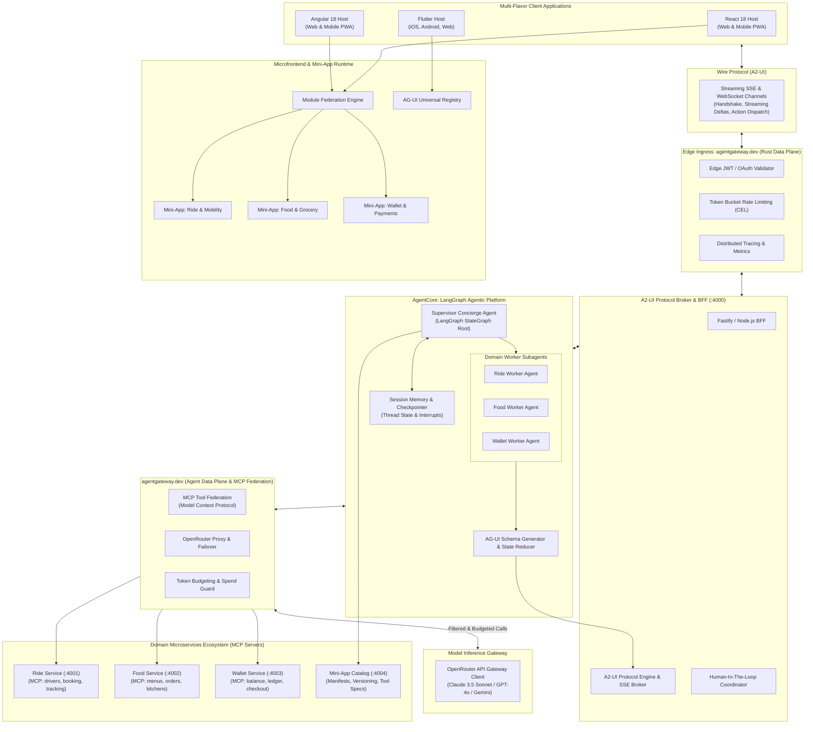
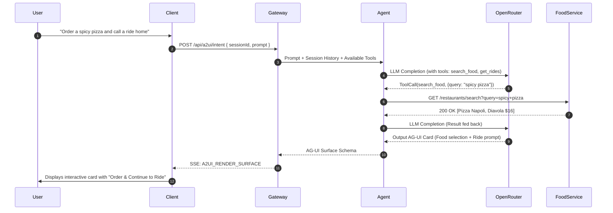

# SuperApp Agent: End-to-End System Architecture

## 1. Executive Summary

The **SuperApp Agent** is an enterprise-grade prototype demonstrating an AI-orchestrated multi-service application (SuperApp) hosting autonomous **Mini-Apps** (Mobility, Food, Payments). Unlike traditional SuperApps that rely purely on rigid navigation directories, this system introduces a **Backend Agent as the central Concierge and UI Orchestrator**. 

The backend agent is orchestrated by an **Agentic Platform powered by LangGraph / LangChain**, using **OpenRouter** as the underlying **Model Inference Gateway** (providing System-1 raw LLM reasoning from Claude 3.5 Sonnet, GPT-4o, or Gemini 2.0). The agent communicates with client applications using two specialized protocols:
- **AG-UI (Agent-Generated UI / Adaptive Generative UI)**: A declarative JSON schema that enables the agent to dynamically build layouts, choice groups, cards, data visualizations, and interactive widgets on-the-fly.
- **A2-UI (Agent-to-User Interface Protocol)**: A bi-directional, streaming wire protocol (over SSE / WebSocket) supporting real-time thought streaming, UI surface replacement/patching, and action loop execution.

The frontend is architected as a **polyglot multi-flavor ecosystem**, offering reference implementations in **React 18**, **Angular 18**, and **Flutter**, all supporting **mobile-first responsive design** with **desktop side-by-side split viewports**.



---

## 2. Structural Layering & Component Breakdown

### 2.1 Backend Layer (Agent Gateway, LangGraph Core & Microservices)
1. **Agent Gateway (`services/agent-gateway`)**:
   - Acts as the single entry-point for frontend clients.
   - Handles the initial `A2UI_HANDSHAKE`, establishing device constraints (screen size, platform, supported components).
   - Manages stateful conversational sessions and translates client interactions into agent executions.
2. **AgentCore Orchestration Platform (LangGraph / LangChain)**:
   - **StateGraph Architecture**: Cyclical execution graph with supervisor-subagent delegation.
   - **Human-In-The-Loop**: LangGraph interrupts pause execution when user action is required on the UI (e.g., checkout confirmation), resuming upon `A2UI_EVENT_TRIGGER`.
   - **Checkpointers**: Preserves conversational thread state and mini-app execution context across sessions.
3. **Model Inference Gateway (OpenRouter)**:
   - Configured via `OPENROUTER_API_KEY` in `.env`.
   - Provides System-1 raw LLM completions (Claude 3.5, GPT-4o, Gemini 2.0). OpenRouter acts strictly as the model provider, while LangGraph manages the agentic brain, state, tools, and execution graphs.
4. **Domain Microservices (`services/service-*`)**:
   - **`service-ride`**: Manages vehicle types, pricing algorithms, driver availability, and route simulation.
   - **`service-food`**: Manages restaurant listings, dynamic menus, dietary filters, and delivery tracking.
   - **`service-wallet`**: Manages secure transactions, digital payment tokens, and balance verification.
   - **`service-catalog`**: Central registry of all installed mini-apps and their corresponding OpenAPI tool definitions.

---

### 2.2 Frontend Layer (Multi-Flavor & Microfrontends)
1. **Host Shells (`apps/shell-*`)**:
   - **`shell-react`**: React 18 + Vite + Tailwind CSS + Module Federation host.
   - **`shell-angular`**: Angular 18 + Standalone Components + Native Federation host.
   - **`shell-flutter`**: Flutter 3.x cross-platform application with dynamic widget reflection.
2. **Mini-App Remotes (`mini-apps/*`)**:
   - Independent microfrontend modules that can be loaded dynamically into the host shells.
   - Packaged with standard Web Component wrappers for cross-framework compatibility.
3. **Responsive Side-by-Side Dual Pane**:
   - **Mobile Mode**: Stacked card flow with persistent agent trigger and bottom sheet.
   - **Desktop/Tablet Mode**: Left pane displays conversational agent reasoning and AG-UI summaries; right pane displays the active, immersive mini-app canvas (maps, menus, transaction histories).

---

## 3. Communication Flows

### 3.1 Initial Handshake and Capability Discovery
1. The client connects to `GET /api/a2ui/connect` via Server-Sent Events.
2. Client sends `A2UI_HANDSHAKE` declaring its platform (`react`, `angular`, or `flutter`), viewport category (`mobile`, `tablet`, `desktop`), and available component registry (`SurfaceCard`, `ChoiceGroup`, `MapViewer`).
3. The Agent Gateway caches the client capabilities in the session context so that the LLM is instructed only to output components the client can render.

### 3.2 Conversational Action Execution Loop


---

## 4. Repository Structure Plan

```
super-app-agent/
├── .env.example                     # OpenRouter API Key & Microservice ports
├── package.json                     # Monorepo root scripts & workspaces
├── pnpm-workspace.yaml              # PNPM workspace definition
├── turbo.json                       # Turborepo build & dev pipeline configuration
├── docker-compose.yml               # Container orchestrator for all microservices & hosts
│
├── docs/                            # Comprehensive documentation & ADRs
│   ├── adr/                         # Architectural Decision Records
│   └── architecture/                # Deep-dive architecture & protocol specs
│
├── packages/                        # Shared libraries
│   ├── protocol-core/               # AG-UI schema, A2-UI protocol types, validation (Zod)
│   ├── ui-tokens/                   # Shared design tokens, CSS variables, typography
│   ├── react-a2ui/                  # React AG-UI renderer & hook library
│   └── angular-a2ui/                # Angular AG-UI renderer & directive library
│
├── services/                        # Backend Microservices
│   ├── agent-gateway/               # Main A2-UI Ingress & OpenRouter Agent Core (:4000)
│   ├── service-ride/                # Mobility Microservice (:4001)
│   ├── service-food/                # Food & Dining Microservice (:4002)
│   ├── service-wallet/              # Payments & Wallet Microservice (:4003)
│   └── service-catalog/             # Mini-App Registry & Tool Discovery (:4004)
│
├── apps/                            # Frontend Host Shells
│   ├── shell-react/                 # React 18 Host Shell (Web & Responsive Mobile)
│   ├── shell-angular/               # Angular 18 Host Shell (Web & Responsive Mobile)
│   └── shell-flutter/               # Flutter 3.x Host Shell (Cross-platform)
│
└── mini-apps/                       # Federated Mini-App Remotes
    ├── miniapp-ride/                # Ride Mini-App Remote
    ├── miniapp-food/                # Food Mini-App Remote
    └── miniapp-wallet/              # Wallet Mini-App Remote
```
