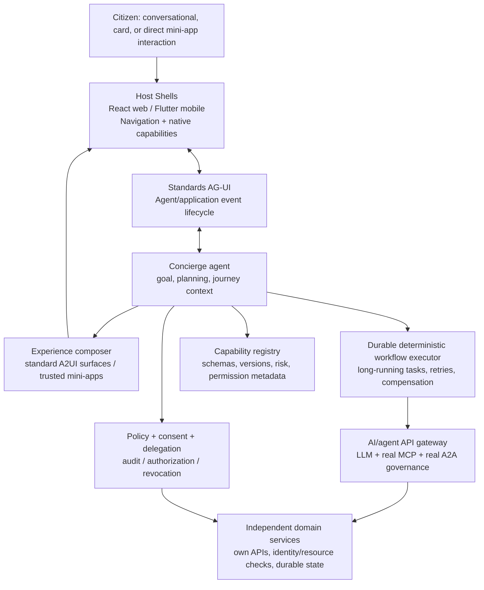

# Target architecture: Option A, Agent-Centric Super App

**Status:** **Proposed**—not implemented by the current demonstration. This describes design direction for future ADRs and implementation plans, not current production readiness.

## Goal and decision boundary

The Super App should behave like a **goal-oriented Concierge**: users describe needs, the agent discovers capabilities, assembles journeys, selects the UI and manages progress across mini-apps. The platform must still provide non-agent navigation/access paths and preserve domain authority over resources and transactions.

Agent-centric **means primary experience ownership**, **not** unrestricted business authority or mandatory inference on every interaction.

*This diagram is a desired decomposition. It does not assert the current repo runs a real LangGraph, MCP or A2A gateway.*

## Platform responsibility split

| Responsibility | Primary owner | Agent authority |
| --- | --- | --- |
| User goal, context, progress | Concierge agent | Plan/adjust/explain |
| Mini-app navigation/layout | Shell + renderer | Request, subject to host policy |
| Capability discovery | Versioned registry | Discover eligible actions |
| Scheduled/retryable orchestration | Deterministic workflow engine | Submit authorized workflow |
| Authentication and consent | Identity/policy services | Request scopes, never self-grant |
| State-altering business operation | Domain microservice | Submit scoped call with approval proof |
| LLM/MCP/A2A governance | Data plane/gateway | Use allowed endpoints/tools with trace |
| Audit and observability | Shared platform + domains | Emit correlated events; no fabricated “verified” status |

## Proposed autonomy modes

- **Assisted:** user initiates and approves all mutations.
- **Delegated:** agent may perform actions bound to explicit consent, scope, resource, expiry and budget.
- **Proactive:** event-driven jobs run within previously established permissions and durable workflow policy; revocable at any time.

HITL authorization must use immutable server-side quotations, actor+subject binding, short validity and an auditable decision; model text is not an authorization proof. High-risk tasks require confirmation independently of generated UI.

## UI architecture

- Standard **AG-UI** manages lifecycle, messages, tool/run events and shared state between application and agent.
- Standard **A2UI** describes presentational UI with approved components; static/service-originated and agent-proposed JSON can use the same renderer.
- Web: generic Lit Web Component backed by the approved A2UI catalog; optional independent mini-app Web Components for complex UI.
- Mobile: Flutter native renderer for the same semantic UI definition, with explicit platform capability gating.
- Shell retains navigation, identity, back-stack, accessibility and device permissions.

## Backends, adapters and persistence

- A gateway may govern real LLM/MCP/A2A traffic but is not a substitute for API ingress, Keycloak/OIDC federation, business authorization or transaction state.
- A durable executor persists workflow version, task attempts, checkpoint/wait state, deadlines, idempotency keys and compensation progress (exact engine selection is separate).
- Agent state includes bounded memory and lifecycle; storage must be user/tenant isolated and revocable.
- The catalog maps stable capability IDs to typed API/tool endpoints, version and supported UI surfaces.
- Domain bounded contexts should be separated: mobility, utilities, fines, payments, identity, tenancy, etc. The current simulator mixes several for convenience.

## Prioritized architectural gates

1. **Security foundation:** real end-user login, delegated authorization, domain policy checks and durable records.
2. **Capability boundary:** contracts, registry, service adapters, governance and threat models.
3. **Durable execution:** reliable cross-domain workflows and compensation/reconciliation.
4. **Agent cognition:** real framework/runtime with tests, tool-selection evaluation and cost envelopes.
5. **Standards UI:** official AG-UI/A2UI bindings, vetted renderer catalog, mobile/web parity.
6. **Operations:** HA/DR, monitoring, load testing, offline/air-gap packaging if required.

See [TODO](../../TODO.md), [security](../../SECURITY.md) and ADRs for current decision status.
