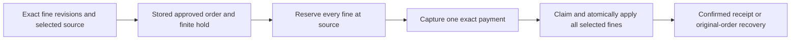

# Pay an exact set of fines

PAY-14 adds wallet and saved-card execution for individual fines or a selected set of 1–20 current fines for one owned vehicle. Provider-owned revisions and lifecycle gates now cover bill and fine capture, completing PAY-06's selected demo criteria. This is a synthetic local Police simulator, with no real agency or real money integration.

## Use

1. Sign in, choose a workspace, open **Payment accounts**, and link its discovered Traffic fines reference.
2. Choose wallet or a saved demo card under **Payment source**. Check the fines under **Select traffic fines to pay together**, then choose **Review selected fines**. Individual fines remain available in the ordinary obligation selector too.
3. Read every fine ID, current amount/discount, source, fee and total. Create the stored authorization review and explicitly approve its exact terms. Complete a bound demo card challenge if required. Approval only reserves finite funds.
4. Choose **Pay AED …**. A **Fines paid** receipt appears only when the source confirms application to the exact admitted selection. Wallet funding debits once; card funding consumes issuer capacity and leaves wallet funds unchanged.
5. Refresh/reload to inspect the same receipt. A pending captured payment uses **Inspect or resume payment** on its original order. Starting a replacement payment, cancelling captured funds or treating a timeout as decline is unsafe and denied.

Restricted/black-point fines require additional review and cannot be selected for this payment flow. Expired, withdrawn or already-paid fines cannot be charged. A changed discount/amount/revision requires a fresh review. A selection containing a newly closed item becomes unavailable; that does not claim the whole set was paid. Multi-provider grouped checkout, refunds/reversals and automatic fine payment remain separate backlog work.

## Contract and reservations

Payment contract **1.4.0**, payment-provider OpenAPI **2.7.0**, Police OpenAPI **2.5.0**. DEWA/telecom remain 2.4.0, RTA 2.1.0 and DLD 2.0.0. Core adds `POST /api/payments/fine-selection-preview` with `accountId`, `items: [{payableId, expectedRevision}]`, `methodId`, `expectedMethodVersion`. As with bill preview, it accepts no mutation `requestKey`, fees, caller amount or raw card data.

Police adds `POST /v1/accounts/{accountId}/fine-selections` with `{items}` and a provider `Idempotency-Key`. It returns a source-owned `FINE_SET` payable whose ID binds workspace and sorted fine IDs; amount, discount, status, restriction and revision derive from current constituent obligations. Duplicate IDs, nesting, another owner, different vehicles, stale revisions and unavailable fines deny. Selection definitions persist but authorize no financial effect. Execution reads fresh source state rather than trusting a retried POST snapshot.

The existing payment-order approve/challenge/execute/recover APIs handle the selection. The source's admission reserves every constituent fine in `provider_admission_items` with a unique active key per workspace/payable. A single-fine payment and any overlapping set therefore compete at the source before capture, even with different gateway order/request IDs. Legacy fine settlement and trusted amendment use these same item guards.



PREPARED reservations expire; a durable gateway cancellation/failure with no capture can release an ADMITTED reservation. ADMITTED/APPLIED item locks never expire into a second payment while capture/application may have committed. The capture deadline is bounded by the review, funding hold and earliest discount/obligation expiry; capture at or after that deadline denies. A valid capture before the deadline may finish source application afterward against frozen admitted terms. All fine updates, proof consumption, source idempotency and receipt commit in one source transaction. A partial database failure rolls the entire set back and retains one recoverable captured payment.

## Existing callers and migration

Manual and conversational wallet fine payments now create the same provider selection and stored order. Conversation approval binds the displayed fine IDs and, in integrated mode, source revisions and total; it no longer rereads and silently selects all current fines after approval. Missing/substituted bindings deny. A conversation approval prepared by an older build without exact fine bindings must be refreshed before it can execute. Original bill-flow idempotency namespaces are preserved. New fine selection/admission/execution requires the signed-in owner; it does not grant an automation worker authority. Existing raw Police capture namespaces `fines:`, `payable:` and `admission:` return `STORED_BILL_ORDER_REQUIRED`, shared with bill migration. Generic unrelated synthetic capture fixtures remain separate compatibility behavior.

Item-lock migration is additive. Startup backfills constituent references from existing active/applied admissions without changing their bodies, amounts or state. Conflicting histories fail closed. Preserve source/payment databases together; do not remove locks, rewind one provider or release uncertain captures by TTL. No live-volume reset or new Keycloak feature/client is needed.

## Verification

```bash
npm run demo:verify:fine-checkout
npm run record:fine-checkout
npm run test:e2e
npm run demo:verify:payment-ledger
```

The first two use real local Keycloak/Redis and isolated provider/application databases, with model inference disabled. Recording holds last six seconds for review/authorization/challenge and eight seconds for confirmed receipts; assertions precede the holds. Successful videos are stored in dated run directories. [Recording](../recordings/fine-checkout/index.html) · [Evidence](../reports/2026-10-24-fine-checkout.md).
