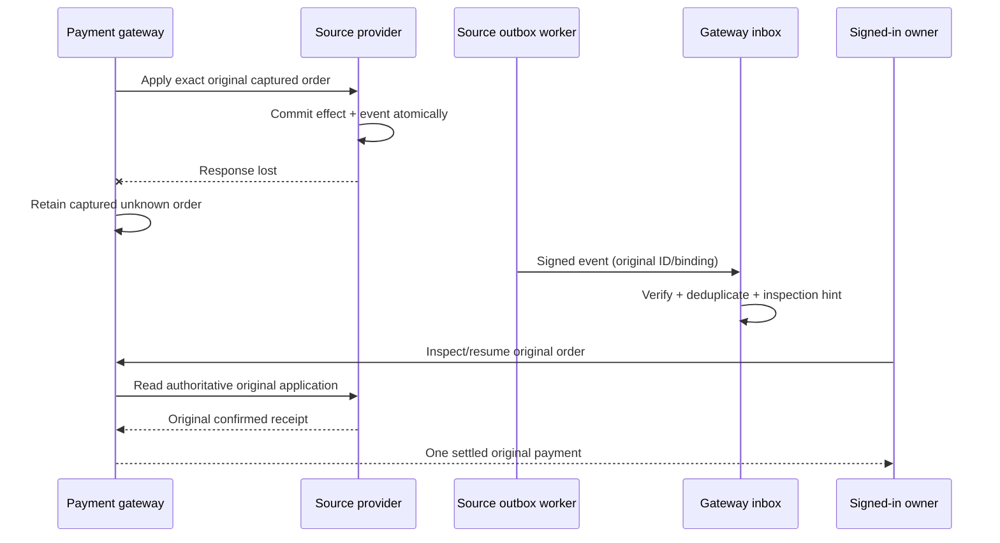

# Signed financial status events

PAY-18 now has a transactional outbox, signed local callbacks, a deduplicating inbox and an owned **Payment updates** view. This checkpoint covers stored payment orders, wallet-funding orders, refund orders, admitted provider application and provider reversal. PAY-18 remains unchecked until its remaining retained-path qualification passes; SIM-03 now supplies its named issuer-scenario dependency. SIM-03/SIM-04/SIM-05, unattended execution and the consolidated PAY-19 workbench are separate tasks.

## What the demo shows

A source can commit a bill payment while its response is lost. The gateway retains the captured original order as `RECONCILIATION_REQUIRED`. The source's committed outbox sends a signed notification; the UI offers **Inspect or resume original payment**. Only explicit owner recovery through the existing source lookup/admission path confirms the original receipt. The callback itself never captures, credits, refunds, marks a bill paid or consumes new consent.

Open **Payment accounts → Payment updates**, then refresh to inspect arrived notifications. The panel distinguishes the observed notification from current authoritative local payment/refund state. A later refund is displayed as REFUNDED even when an earlier APPLIED notification remains visible. Notification delivery failures are distinct from financial failure; an exhausted delivery attempt does not release captured funds or manufacture a receipt.

[Recorded response-loss/recovery flow](../recordings/payment-events/index.html) · [Executed evidence](../reports/2026-10-24-payment-events.md).



## Contract and authentication

Payment contract **1.9.0**, payment-provider OpenAPI **2.13.0**; the source REST resource contracts remain unchanged. Event schema version is 1 in `packages/protocol-core/src/payment-events.ts`.

`GET /v1/accounts/{accountId}/payment-events` requires the interactive owner. `GET /api/payments/overview` includes `events`: gateway pending/failed delivery counts, received count and up to twenty current per-subject update views. Source-provider outboxes stay private; the gateway count does not claim to include every source's undelivered queue. Existing records receive no fabricated backfill events.

`POST /internal/payment-events` is a fixed, private-purpose gateway callback with an independently signed event body. It accepts no user/service-header authority. Required headers are `X-Payment-Event-Source`, `X-Payment-Event-Key`, `X-Payment-Event-Time`, `X-Payment-Event-Nonce` and `X-Payment-Event-Signature`.

HMAC-SHA256 covers canonical JSON of `[POST, /internal/payment-events, source, keyId, timestamp, nonce, event]`. Canonical objects sort keys recursively. Signatures use constant-time comparison, a real-time ±60-second delivery window and bounded nonce/schema/body fields. Event occurrence time may be older during backlog replay; a fresh delivery signature is mandatory. Business-clock advancement cannot extend signature or JWT lifetime.

Separate producer keys cover `payments`, `rta`, `dewa`, `etisalat`, `du` and `police`. Configure `PAYMENT_EVENT_<PRODUCER>_KEY` (32+ characters) and `_KEY_ID` (default `v1`). The gateway receives each producer's verification key; each source container receives its own signing key. No user JWT, client secret, challenge answer, refund reason or card detail is persisted in events or worker state. Delivery has no Authorization header and uses only the configured gateway URL, never an event/caller URL.

Development uses public synthetic signing fixtures when keys are empty, matching the demo's existing seeded credentials. Those fixtures are not production authentication. Production requires configured keys and HTTPS and fails closed without them. No production deployment is activated by this feature.

For rotation, install a new current key/ID and retain the old value as `_PREVIOUS_KEY` / `_PREVIOUS_KEY_ID` at the gateway. Switch the source to the new current pair, allow outstanding signatures to expire, then remove the previous pair. Unknown/retired IDs deny even for a known event. Do not reuse one key across producers or print keys in inspection/export logs.

## Atomicity, delivery and consumer rules

Domain transitions append immutable safe event bindings in their existing SQLite transaction. The outbox identity is unique per account/subject/type/version; identical retries reuse the event, conflicting versions fail. If event persistence fails, the corresponding capture, credit, source application or reversal rolls back. Pending captured outcomes retain their original operation for recovery.

The worker claims a bounded batch of five events with a persisted 15-second lease, owner token and monotonically increasing generation. Network calls run concurrently outside the domain transaction, with five-second timeouts. Only a current, unexpired lease may acknowledge delivery. Crashed/expired leases can be reclaimed after restart. A lost callback response redelivers the original event ID with a fresh signature and nonce. Retries back off from one second up to one minute; twenty failed attempts become visible FAILED delivery. Automatic redrive of exhausted records and run controls remain later operator work.

The inbox verifies authentication, body, event ID, delivery nonce and exact original local account/order/refund/amount/digest/payment/admission/provider binding. Gateway-produced notifications additionally match their committed local outbox body. Unknown subjects cannot create accounts. Duplicate IDs produce one inbox result; changed ID/nonce/version terms conflict. Monotonic per-producer/subject/type views reject older versions, and current local terminal/refund state wins over delayed notifications.

Source notifications are deliberately inspection hints. Even an authenticated APPLIED payload cannot authorize a new financial effect or prove current bill settlement. Current ownership, consent, quote, hold, admission, provider status and original proof checks still apply at the interactive recovery endpoint. No unattended actor can answer challenges or inherit the user's bearer token from an event.

## Migration, inspection and rollback

The additive `payment_event_outbox`, `payment_event_inbox`, `payment_event_deliveries` and `payment_event_views` tables leave existing resource/idempotency rows, journals, issuer records and balances unchanged. Startup does not turn historical records into new events. Outbox domain content is immutable; delivery lease/attempt metadata may advance normally across restarts.

Pause delivery by stopping its provider process when investigating; retain the database and original event IDs. Restart resumes pending work after lease expiry. Use owned current status and existing payment/refund recovery to resolve effects. A callback outage is not proof of non-application. Restore source and gateway state together; do not delete inbox deduplication history, reset balances, release financial fences or replay old events as new payment instructions. Before rolling back code, retain queued events and confirm that the older version tolerates the additive tables; rollback does not undo committed money effects.

## Verification and remaining work

```sh
node --experimental-strip-types --import ./scripts/test-env.ts --test services/test/payment-events.test.ts
npm run demo:verify:payment-events
npm run record:payment-events
```

The browser uses real local Keycloak/Redis with temporary SQLite, actual callback HTTP and disabled model calls. A private test-only transport hook loses exactly one settlement response after real source commit; no ordinary request/admin URL can enable it. Reviews/attention pause six seconds and confirmed receipts eight seconds. The publisher preserves the last successful viewer if a run fails.

The fourteen focused tests cover transactional rollback at gateway/source, exact/forged/substituted callbacks, nonce/ID/version collisions, out-of-order and terminal/refunded states, two-connection leases, crash/reopen, backoff/exhaustion, lost acknowledgements and key rollover. Operator-controlled fault/replay scenarios, event coverage for legacy raw captures/parking, full retained-shell parity and exhaustive integrated faults remain open. This checkpoint is not a complete PAY-18 acceptance claim; the separate issuer-scenario guide records delivered SIM-03 criteria.

[Isolated issuer scenarios](issuer-scenarios.md) add operator-bound named outcomes and `AUTHORIZATION_PENDING`. Pending card capacity cannot capture/credit or dispatch later group lines; the original real-time deadline and separate customer execution remain enforced. Normal providers expose no run controls.
