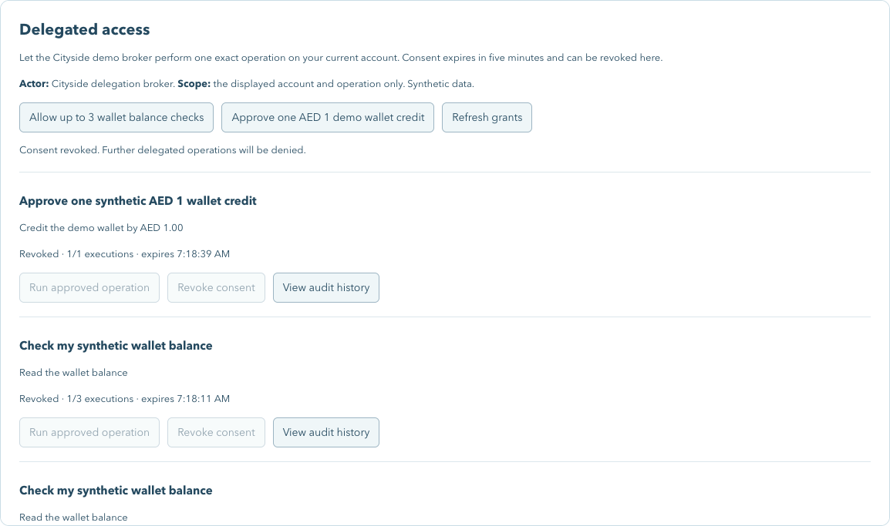

# Secure delegation demo — execution evidence

**Date:** 24 October 2026. **Target:** local synthetic demo only. **Source:** working tree based on `efee3a9`, with earlier E2E changes preserved; these results do not describe an independently approved production release. [Decision](../adr/ADR-0012-secure-delegation-demo.md) · [Runbook](../development/delegation.md) · [Task dispositions](../../TODO.md#proposed-secure-identity-delegation--obo).

## Implemented boundary

- Separate trusted broker on 4010; issuer/client keys and authoritative grant SQLite volume are mounted only there, not into agent-core.
- Actual supported RFC 7523 exchange with private-key client authentication, existing-user federation links and explicit downscoping. No preview features, JavaScript, custom Java mapper or native delegation enabled.
- Exact issuer/user/actor/account/provider/operation/body consent with expiry and count limit; narrowing/revocation increments version. Actual actor is broker `azp`; human/service initiator is audited separately.
- Broker validates issued claims and registers a SHA-256 token fingerprint against grant/version/operation. Tokens/assertions are not persisted or returned to the workflow/browser. Providers perform an independent uncached current-authority check after JWT/introspection validation.
- Signed interactive identity is forwarded through application/provider boundaries. The reference profile denies service-header human impersonation; captured-payment proof reads retain a narrow separate machine lane.
- React, Angular and Flutter consent/run/revoke/history controls; MCP inspection/execution/withdrawal reuse the same facade and cannot create consent.
- One exact synthetic wallet credit of AED 1–10, once per grant. Other delegated writes, arbitrary subjects and nested actor chains cannot acquire authority.

## Exact runtime and commands

Keycloak **26.6.4**, local image digest `sha256:0aae0de7fca85525f727d3354df17896092de8bb26ae4c12d89c77e5df8cbce4`, now pinned in Compose. Keycloak startup reported JVM/Quarkus dev profile; `start-dev`, local HTTP and H2 remain demo constraints. Node **26.3.0** on the host; reference services use Node 24 containers. No maintained-patch/security-scan or production support disposition is implied by the pinned test image.

| Command/check | Observed result |
| --- | --- |
| `npm run demo:delegation:realm` | Idempotent local IdP/client/policy/user-link reconciliation; existing UUIDs/data retained |
| `npm run demo:verify:delegation` | Linked exchange, owner read, authenticated runner, seven provider reads, cross-user and revoked-consent denial, one AED 1 effect, replayed result and limit enforcement pass |
| `npm run demo:verify:delegation:security` | Exact-image assertion/token/grant checks below pass, with one explicitly recorded lifetime observation |
| `npm run demo:verify` | User/account/session isolation, signed provider identity, machine impersonation denial, payment capture/replay/conflict/decline/refund, telecom and stale-action checks pass |
| `npm run demo:verify:journeys` | Parking, DEWA, both telecoms, fines/unified checkout and DLD/move-in provider flows pass |
| `npm run demo:verify:restart` | Owner/account, surface revision and wallet state survived core/Redis/payments restart; persisted approval resumed and executed one top-up |
| `npm run demo:verify:security` | Real access-token acceptance, ID-token rejection and new-request post-logout denial pass |
| `npm run test:e2e` | All 12 existing browser journeys/34 checks pass with isolated SQLite/Redis sessions and strict signed-user provider policy; live delegation backchannel blocked |
| `npm run record:delegation` | Nine asserted Chrome chapters, **63.56 seconds**, 1440 × 1050, six-second reviews/eight-second result holds; read and exact bounded write grants revoked afterward |
| `npm run demo:verify:manual` | Eleven manual routes, cancellation replay denial and actual authenticated MCP call pass |
| New delegation MCP tools | Existing-grant execution, withdrawal and denial after withdrawal pass; no consent-creation tool is exposed |
| Browser MCP inspection | React explicit consent → actual read → audit → revoke; execution disabled afterward; no token inspection/export |

Final `NG_BUILD_MAX_WORKERS=2 npm run check` passed: lint, strict harness types, local links in 44 Markdown documents, source-secret checks, **126 Node tests** and **all 18 workspace builds**. Flutter analysis reported no issues, all **6 tests** passed, and `flutter build web` succeeded. The SDK emitted a Cupertino-font expectation warning during icon tree shaking; no new Cupertino icons are used and native-device rendering remains unverified. The new workspace increased the previous build count from 17. Angular compiler processes were aborted inside the sandbox; the same build passed outside it with `NG_BUILD_MAX_WORKERS=2`. Test HTTP fixtures and Flutter SDK cache also required their normal local execution permissions.

## Real security observations

The test runner uses controlled keys inside the trusted broker container; it does not print JWTs. Valid exchange returns the existing internal user ID, actual broker `azp`, minimal `delegation.read` scope, only provider/verifier audiences, no custom `act` and no refresh token. It rejects reused/missing `jti`, missing expiration, expired/future assertion, unknown external subject, wrong issuer/audience, multiple audiences, wrong signing key/`kid`, requested scope expansion and assertion use by the runner client. A valid but unregistered token cannot access a delegated provider operation.

For revocation, the test binds a valid issued token to an owned grant, revokes that grant, confirms Keycloak introspection still reports the token **active**, and verifies that the provider rejects it through the current grant check. This distinguishes consent revocation from login/token-session revocation.

**Lifetime finding:** a controlled assertion with fresh `iat` and `exp` ten minutes later was accepted by 26.6.4 despite the configured 90-second maximum setting. Its resulting access token was independently capped at 90 seconds. This is observed behavior, not an asserted exploit or a security-advisory determination. The real broker issuer generates assertions with a hard 90-second maximum further bounded by grant expiry; its client also independently caps access tokens. Do not rely solely on that IdP console setting to enforce assertion duration. Cluster replay behavior and long-assertion behavior after elapsed time were not tested.

Store tests cover cross-user/client/account/operation binding substitution, exact write bodies/amounts, replay consumption, current withdrawal, expiry, narrowing/version invalidation, uncertain-effect blocking and two-connection/reopen serialization. They are separate from the real Keycloak tests and do not establish distributed external-effect atomicity.

## Browser evidence and recording

[Watch the current delegation recording](../recordings/delegation/index.html). [Dated chapter manifest](../recordings/delegation/runs/2026-10-24T03-12-57-597Z/chapters.json) records actual chapter times and successful completion; browser playback and seeking to the bounded-write chapter succeeded without a media error; the prior read-only run is retained. The recording uses synthetic `demo-commuter`, real Keycloak/Redis and the running provider stack, not the isolated twelve-chapter provider databases. It adds exactly one approved AED 1 synthetic credit. No browser trace, network dump, token, private key or raw assertion is recorded.

The Flutter consent widget test also verifies that initial inspection creates nothing, explicit consent does not execute, a separate run succeeds and withdrawal disables execution. The three shell implementations compile/analyze as reported by their gates; only React's new grant flow has actual browser evidence in this pass. Flutter native-device execution and complete Angular/Flutter grant-flow browser parity remain open. Existing dated twelve-chapter videos are preserved rather than relabeled as delegation coverage.

## Remaining release gates

Independent integration/security review, maintained patch/advisory triage, image scanning, optimized non-root production deployment, TLS/database/KMS/network controls, key rollover/retirement, multi-node replay and failover, external immutable audit/retention, load/chaos/SLOs and backup recovery remain open. General budgets, PSP settlement, entitlement/unlink/role-change lifecycle, tenant policy, automatic LangGraph scheduling/resume, multi-hop authority and automated operator reconciliation/compensation are not implemented by the bounded demo.

Unknown jobs block further execution; inspect the owned operations/history endpoints and reconcile the provider's idempotency/business record before repeating any uncertain effect. Revocation does not undo a committed effect. Production mode is explicitly refused; no production deployment, CI workflow enablement or production-ready claim follows from this report.
