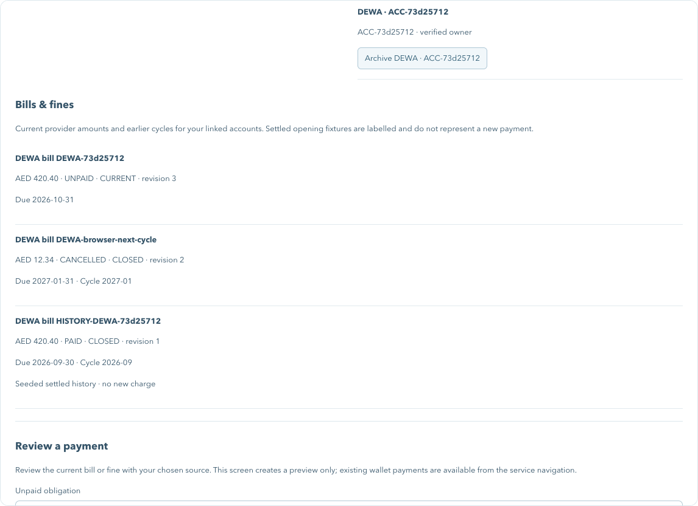

# Provider-owned payables — 24 October 2026

PAY-06 progress after journal baseline `58dc0dd` and the lifecycle/preview-clock additions. The publication commit identifies this source. The task remains open: immutable stored orders, pre-capture admission/reservation and settlement/refund claim serialization are required by PAY-07–PAY-10. This report does not certify saved-card execution or automation.

## Implemented behavior

- DEWA/Etisalat/du/Police own revisioned payable summaries and exact-revision review/settlement routes. Core consumes those revisions instead of hashing raw provider lists itself.
- Existing bill resources stay unchanged during one-time prior-cycle fixture admission. The original bill stays first for legacy adapters; labelled settled opening history creates no financial transaction.
- Trusted issuance and revision-checked amendment support additional bill cycles, amount/due changes, withdrawal, fine discount expiry and restrictions. No public lifecycle control or execution simulator is enabled.
- Current effective fine amounts also feed legacy fine lists. Paid history retains the captured value after discount expiry. Closed/restricted obligations cannot be reviewed or newly settled; source proofs must match account/merchant/currency/amount/revision.
- React displays linked current/history amounts, source versions, due/closed state, discount and opening-fixture labels. Withdrawn/expired/restricted obligations are excluded from review selection. Existing setup remains non-executable.

## Verification

The complete repository check passed **162 Node tests and 18 workspace builds**, lint, strict harness checking, source-secret checks and documentation links. Seven new payable tests cover all four source schemas, preserved current resources/history seeding, owned multi-cycle issuance, immutable identity and terminal states, amount/date bounds, discount/expiry business time, restricted fines, substituted proofs and persisted/two-connection revision rejection. All seven generated OpenAPI documents match runtime contracts and validate.

The real-Keycloak isolated browser verifies history labels, changed-price preview, stale source-review denial, withdrawn-cycle rendering/exclusion and absence of a public lifecycle mutation route. A separate isolated signed owner captures and settles the exact revision through real HTTP, proves capture/settlement replay and duplicate rejection, and has one transaction with the exact wallet debit. The setup owner remains unchanged. All twelve existing browser journeys pass, including bill/fine effects, already-paid checkout exclusion and owned vehicle discovery after fines are paid.

The updated normal local services were reloaded without clearing volumes. Readiness passes. `npm run demo:verify:inventory` passes against the running stack: provider revisions match core snapshots, prior-cycle fixtures are present, and wallet funds/transaction history are unchanged across the reads. The preview CLI and existing lifecycle foundations remain covered by the repository suite.

Remaining limits: no issuer/card authorization, immutable stored quote/order, pre-capture payable reservation, claim/refund serialization, mandate worker or enabled financial execution simulator. A new source settlement endpoint does not establish those guarantees. No new payment recording or shell-parity certification is claimed.

[Source contract and operating boundaries](../development/payables.md) · [Lifecycle/preview foundations](2026-10-24-lifecycle-simulator.md).
