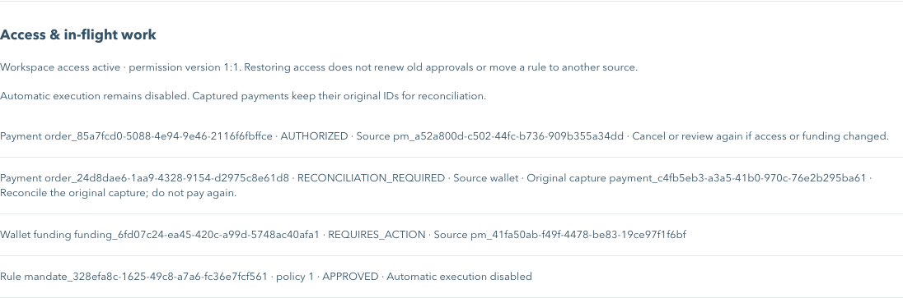
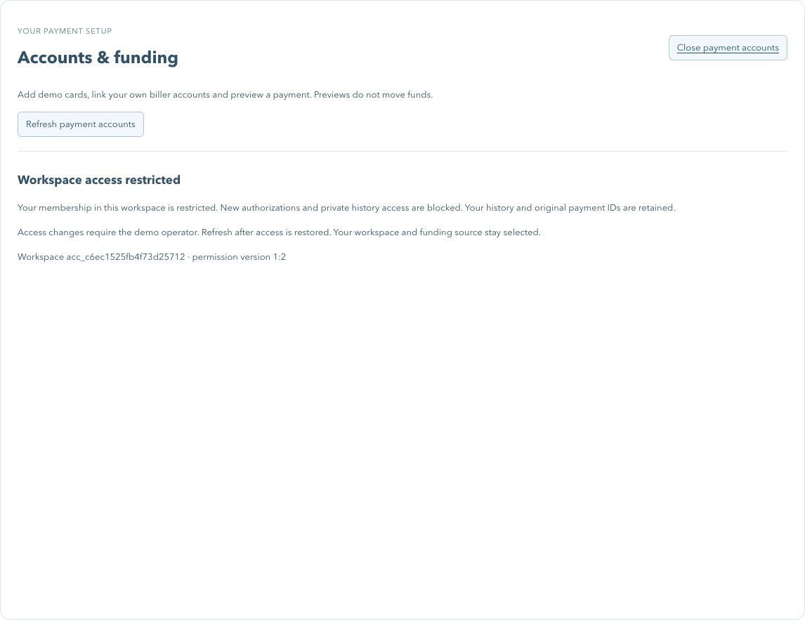
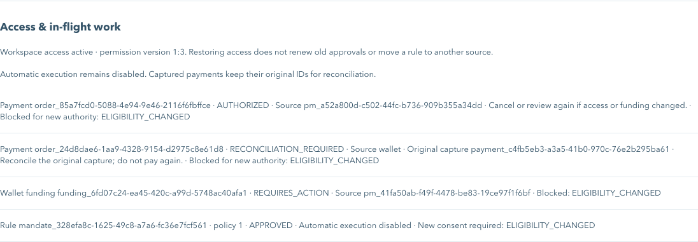

# Current owner/workspace and funding lifecycle — 24 October 2026

PAY-21 extends the delivered `c7184f3` baseline with current owner/membership permissions, immutable approval/grant epochs, machine-only operator/reader lanes and the React lifecycle view. All identities, funding and provider effects are local synthetic demo data. Automatic mandate execution remains disabled; this is not production security approval.

## Acceptance evidence

| Requirement | Evidence inspected/executed |
| --- | --- |
| Disabled card or archived biller stops new authority | Existing removal locks plus new card challenge/version and archived-link regressions; signed source disable/re-enable, stale source version and dependent removal/archive denials |
| Revoked membership or disabled owner stops new authority | Signed core, payment/source provider, broker, session and SSE denials; owner switch covers personal/household; permission change between source admission and final capture creates no debit |
| Restoration cannot revive earlier authority | Old payment, funding challenge, conversation action and broker grant return 409; immutable rule policy still references the original source/workspace; explicit revision is required |
| User disablement | A uniquely named temporary real Keycloak user is created, given the normal user role, signed in, disabled, then deleted; an already-issued token returns 401 at core and payment provider. Persistent demo users are never disabled |
| History and in-flight identity preserved | Restricted panel hides financial data; operator still sees original capture ID. Lost-settlement response recovers the original payment once after restoration. No additional debit, implicit fallback or rule reassignment |
| Restart and outage | Actual isolated payment-provider restart preserves revoked state/version, then restored state/version and original captured ID. Unavailable eligibility authority returns 503 at core and source. Two SQLite connections enforce CAS and rollback audit failure |
| Reader/operator isolation | Signed owner, unrelated owner and ordinary workload cannot enter the private lane; reader cannot mutate; owner override body and stale decision deny. Exact operator replay returns its historical response without changing current state |
| Retained security profile | Exact-image signed seven-provider delegation suite, one explicit legacy AED 1 credit, unbound-token/path substitution/current-grant revocation and provider restart pass. No preview features or actor mapper added |

The 15 new regressions cover session-resource validation, read-only legacy defaults, separate owner/membership scope, stable-key/CAS/audit rollback, stale approval/actor epochs, capture race, retained original capture, funding cancellation, archived biller, changed challenge source, explicit new rule consent, refund approval and eligibility-client denial/bootstrap/cache behavior.

## Browser and recording

`npm run record:payment-lifecycle` passed with real PKCE login and no browser errors. [The viewer](../recordings/payment-lifecycle/index.html) contains six-second review and eight-second restricted/restored outcome holds. Management changes are scripted through the separate machine-authenticated operator endpoint; no management control or credential is added to the browser. Separate identity-disable and outage probes run alongside the visible flow. The published WebM is **33.88 seconds** at 1440 × 1050. The recording does not claim every negative assertion is shown as a user interaction.

## Regression and normal-stack preservation

- `npm run check`: **386/386 Node tests**, **18/18 workspace builds**, ESLint, E2E TypeScript, 90-document local link checks and source-secret checks passed. Fifteen new regressions supplement the retained suite.
- `npm run test:e2e`: all twelve existing signed browser journeys passed, including original receipts, ownership, account switching/reload and sign-out.
- `npm run demo:verify:wallet-funding`: existing real-browser review/challenge/capture/credit/reload passed.
- `npm run demo:verify:automation-security`: exact-image trusted issuer container and isolated provider profile passed. Normal issuer keys were mounted read-only; no private key or delegated token was exported.
- `npm run demo:verify:payment-ledger`: normal three-wallet resources/idempotency, journal, claims, issuer, orders, funding, groups, refunds and event hashes preserved; one opening per wallet and projections still balance. The new normal permission/audit/request tables initialize with zero rows, without backfill. Non-empty permission durability is proven in the isolated tests rather than inferred from this empty normal baseline.
- `npm run demo:verify:delegation:restart`: 52 grants, 57 bindings, 58 jobs and 377 audit records byte-preserved.
- The actual loopback `demo:payment-access -- inspect` CLI successfully read normal-stack eligibility/in-flight work without mutation; private management changes were verified separately against isolated data.
- `npm run demo:wait` and `npm run demo:verify:inventory`: normal services ready; signed read models leave wallet and transaction history unchanged. Updated services run with eligibility enforcement enabled.

Current guide: [Owner/workspace lifecycle](../development/payment-lifecycle.md). Current contracts: payments **2.17.0**, shared payment **1.13.0**. Historical reports keep their original counts and source baseline.

## Remaining boundaries

The owner permission switch does not synchronize Keycloak administration into another database. Online introspection independently blocks disabled identities. Current local SQLite permission/capture fencing does not claim a distributed Keycloak/provider transaction. PAY-08/AUTO-03/AUTO-15 must still supply shared automatic reservations, execution permits and the worker revocation/admission boundary. Rules have `executionEnabled:false`; no scheduler or new unattended money authority is enabled. Angular/Flutter lifecycle UI parity remains QA-06.

Selected backlog after this slice: **24 delivered / 26 open**. PAY-08 remains the open payment foundation; AUTO-03 and the remaining automatic service, simulation and acceptance tasks keep their full criteria.
