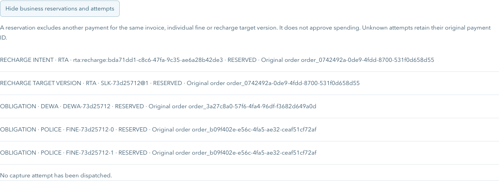
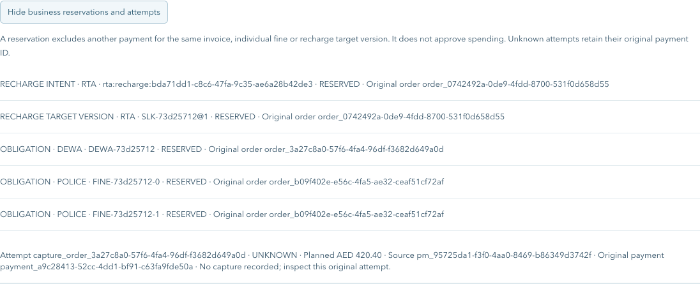
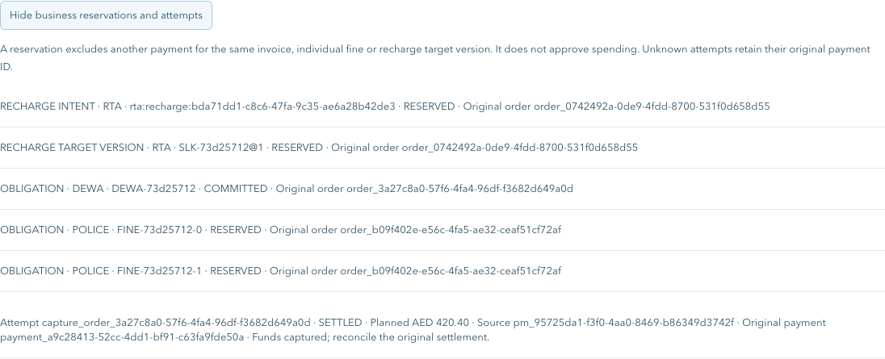

# Gateway business reservations and original attempts — 24 October 2026

This checkpoint advances PAY-08 from baseline `e1ac944`. It closes the early gateway exclusion gap for overlapping fine selections and recharge quotes, and persists an original capture attempt before provider dispatch. **PAY-08 remains unchecked** because actual automatic-caller/budget/occurrence qualification belongs to the still-open AUTO-03 path. The selected backlog remains 24 delivered / 26 open. All effects are local synthetic money and records.

## Behavior and evidence

| Requirement | Evidence |
| --- | --- |
| One reservation before charging | Provider/account/business ID keys exclude quote aliases/revisions, individual fines across overlapping selections, and recharge intent/target versions before a competing authorization or hold |
| Transport keys are separate | Signed parallel invoice creation produces one order and one 409. Exact creation-key replay retains the original response/order ID; changed payload conflicts; current reads independently show later state |
| Existing caller paths share exclusion | The signed panel order and ordinary manual fine API cannot reserve overlapping individual fines. Different SQLite connections also serialize against the same canonical keys |
| Original attempt survives uncertainty | Planned payment ID and immutable attempt identity commit with CAPTURING before admission POST. Injected response loss produces UNKNOWN; actual provider restart preserves it and blocks replacement creation |
| Original recovery, no extra debit | Recovery settles the same planned payment/attempt, spends the exact card amount once, leaves wallet funds unchanged and retains COMMITTED business exclusion |
| Safe release and rollback | Explicit uncaptured closure releases only its reservation. Capture persistence failure rolls back issuer/ledger/order/attempt commitment together. Unknown/committed attempts never expire into new authority |
| Conservative legacy upgrade | Non-empty overlapping legacy reviews and captured orders retain their financial/order bytes. Conflicting reviews remain BLOCKED and cancellable; inferred attempt metadata is labelled rather than presented as observed dispatch history |
| Owner and credential boundary | Lifecycle remains owner-scoped; wrong owner is denied. Caller-supplied automation origin/permit fields cannot create authority. No new workload role, signing key or unattended endpoint is enabled |

Eleven new focused regressions cover canonical aliases, competing connections, recharge versions, malformed constituent shapes, unknown expiry/reopen, atomic rollback, committed recovery, explicit cancellation, immutable identity fields, overlapping legacy migration and inferred old captures. Existing source-side admission tests remain and now also assert the earlier gateway denial. The pre-pending migration fixture excludes the later derived tables so it represents that actual historical schema; original financial/issuer/order/funding snapshots still match after upgrade.

## Reviewable UI and recording

The expandable **Business reservations and attempts** view shows resource/order IDs, reservation state, planned amount, recorded capture and original payment. It does not grant spending or release unknown work. A planned payment ID is not labelled as proof of capture.

`npm run record:payment-obligations` uses real local Keycloak PKCE, isolated SQLite and deterministic responses. Setup asserts concurrent requests and manual/panel overlap; visible chapters show five reservations, UNKNOWN pre-capture work after restart, original-ID recovery and cancellation of unspent work. Six-second review and eight-second outcome holds follow the assertions. Setup probes are not claimed as visible user clicks.

[Recording viewer](../recordings/payment-obligations/index.html).

## Validation

`npm run check` passed **397/397 tests**, **18/18 workspace builds**, ESLint, E2E TypeScript, local links in **92 Markdown documents** and the source-secret check. The new signed recording passed without browser errors and measured **33.32 seconds**, at 1440 × 1050. The retained twelve signed browser journeys passed. `demo:verify:payment-ledger` preserved normal three-wallet financial/order bytes and the empty derived table hashes; `demo:wait` and signed `demo:verify:inventory` passed without changing wallet/history. The normal baseline has no stored payment orders, so its new derived tables are empty; non-empty migration evidence comes from the isolated tests, not from that empty baseline.

Shared payment contract **1.14.0**, payments OpenAPI **2.18.0**. [Current guide](../development/payment-obligations.md) · [Remaining admission requirements](../architecture/payment-automation-security.md#required-auto-03-admission-contract).

## Remaining gate

A trusted automatic execution path must derive current consent/source/quote/occurrence at the server, atomically reserve shared amount/count/cooldown budgets and bind the business reservation before signing or issuing credentials. Its manual-versus-worker race, revocation, unknown retention and definitive failure release must be exercised over the actual authenticated path. These results do not complete AUTO-03, PAY-08, worker/scheduler/service tasks or final QA. Existing finite mandates remain `executionEnabled:false`.
